## Mapbox로 지도에 무언가를 그리는 5가지 방법

Mapbox iOS SDK에서 지도 위에 마커나 경로 같은 데이터를 올리는 방법은 크게 5가지입니다.

| 방법 | 설명 | 어울리는 상황 |
| --- | --- | --- |
| Marker | SwiftUI `Map` 안에 좌표만 넣으면 기본 핀을 그려주는 가장 간단한 API | 프로토타입, 핀 몇 개 |
| Annotation | `PointAnnotation`, `PolylineAnnotation` 등을 Annotation Manager로 추가 | 마커 수십 개 정도, 빠른 구현 |
| View Annotation | 지도 좌표에 UIKit/SwiftUI 뷰를 그대로 띄움 | 말풍선, 버튼이 있는 카드 등 인터랙티브한 UI |
| Style Layer (Source + Layer) | 데이터(Source)와 그리는 방법(Layer)을 Style에 직접 추가 | 데이터 수백~수천 개, 클러스터링, 데이터에 따른 스타일 |
| Custom Layer | `CustomLayer`에 Metal 렌더링 코드를 직접 작성해 지도 렌더링 파이프라인에 끼워 넣음 | 3D 모델, 파티클, 셰이더 효과 등 기본 Layer로 표현할 수 없는 그래픽 |

Marker와 Annotation이 쉬워 보이지만, 사실 이 둘도 내부적으로는 **Source와 Layer를 만들어서** 그립니다. 즉 Source + Layer 방식이 Mapbox가 지도를 그리는 가장 기본 원리이고, 나머지는 이를 편하게 감싼 API에 가깝습니다. 단, 두 가지는 예외입니다.

- **View Annotation**은 지도 렌더링과 별개로 지도 위에 실제 UIView를 올리는 방식입니다.
- **Custom Layer**는 Layer 배열에 들어가 순서는 다른 Layer와 함께 관리되지만, Source 없이 내가 직접 Metal로 그리는 방식입니다. 가장 자유롭지만 가장 저수준이라, 이 부분은 별도 글에서 딥다이브할 예정입니다.

그래서 이 글에서는 **Source + Layer 방식부터** 공부하겠습니다. 이 구조를 이해하면 나머지 방법은 "이걸 대신 해주는 도구구나" 하고 자연스럽게 이해할 수 있습니다.

&nbsp;

---

&nbsp;

Source + Layer 방식을 공부하다 보면 `Source`, `Layer`, `Feature`, `GeoJSON`, `Style`, `Expression` 같은 단어가 한꺼번에 쏟아집니다. 각각은 어렵지 않지만 **서로 어떤 관계인지** 모르면 코드가 왜 그렇게 생겼는지 이해하기 어렵습니다.

이 글에서는 아래 순서로 개념을 하나씩 쌓아 올려 보겠습니다.

1. 지도는 어떻게 그려질까 - 좌표와 타일
2. Geometry - 점, 선, 면
3. GeoJSON - 지리 데이터를 담는 포맷
4. Feature - 데이터 한 건
5. Style - 지도 전체의 설계도
6. Source - 데이터를 어디서 가져올까
7. Layer - 데이터를 어떻게 그릴까
8. Expression - 데이터에 따라 다르게 그리기
9. 상호작용 - 지도에서 Feature 찾기
10. 다시 보는 Annotation - 결국 Source + Layer
11. 자주 쓰는 예제 - 삼각형, 선박, 경로, 반경, 클러스터링, 히트맵, 3D

예제 코드는 iOS용 **Mapbox Maps SDK v11** 기준입니다.

&nbsp;

---

&nbsp;

## 한 장으로 먼저 보기

세부 내용에 들어가기 전에 "지도 위에 카페 마커를 그린다"는 예시로 전체 구조를 먼저 보겠습니다.

### 전체 구조

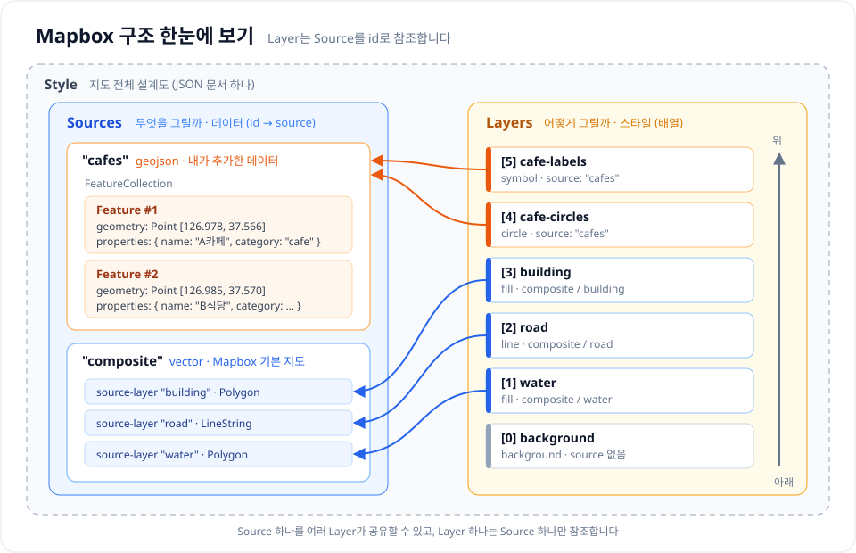

같은 구조를 트리로 펼쳐보면 다음과 같습니다.

```text
MapView
 └── Style (지도 전체 설계도, JSON 문서 하나)
      │
      ├── Sources (데이터 저장소, id → source 딕셔너리)
      │    │
      │    ├── "composite" : vector          ← Mapbox가 제공하는 기본 지도 데이터
      │    │     ├── source-layer "water"     → 물 Feature들 (Polygon)
      │    │     ├── source-layer "road"      → 도로 Feature들 (LineString)
      │    │     └── source-layer "building"  → 건물 Feature들 (Polygon)
      │    │
      │    └── "cafes" : geojson              ← 내가 추가한 데이터
      │          └── FeatureCollection
      │                ├── Feature
      │                │     ├── id: 1
      │                │     ├── geometry: Point [126.978, 37.566]
      │                │     └── properties: { name: "A카페", category: "cafe" }
      │                └── Feature
      │                      ├── id: 2
      │                      ├── geometry: Point [126.985, 37.570]
      │                      └── properties: { name: "B식당", category: "restaurant" }
      │
      └── Layers (그리는 방법, 배열 순서 = 그려지는 순서)
           ├── [0] background   type: background                          ← 가장 아래
           ├── [1] water        type: fill    source: composite / water
           ├── [2] road         type: line    source: composite / road
           ├── [3] building     type: fill    source: composite / building
           ├── [4] cafe-circles type: circle  source: cafes
           └── [5] cafe-labels  type: symbol  source: cafes                ← 가장 위
```

이 그림에서 알 수 있는 사실들을 정리해보면 다음과 같습니다.

- 우리가 보는 **기본 지도(바다, 도로, 건물)도 Source + Layer로 그려진 것**입니다. 내가 추가하는 카페 데이터와 구조가 똑같습니다.
- Source는 **딕셔너리**(id로 찾음), Layer는 **배열**(순서가 중요함)입니다.
- Layer는 Source를 직접 들고 있지 않고 **id 문자열로 참조**합니다. (`source: "cafes"`)
- Vector Source는 안에 여러 묶음(source-layer)이 있어서, Layer가 `source`와 `source-layer`를 함께 지정합니다.
- `background` Layer처럼 Source 없이 그려지는 예외도 있습니다.

### Layer는 쌓아서 그린다

Layer 배열의 순서는 곧 그려지는 순서입니다. 투명한 필름에 하나씩 그림을 그리고 아래부터 차곡차곡 쌓는다고 생각하면 쉽습니다.

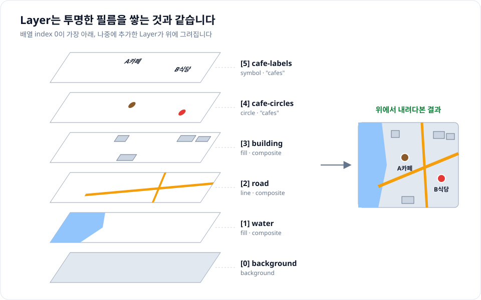

그래서 내가 추가한 카페 Layer는 기본 지도 위에 올라가고, 순서를 잘못 잡으면 경로선이 도로 이름을 덮어버리는 일이 생깁니다. 이 부분은 7장에서 다시 다룹니다.

### 데이터가 화면에 나오기까지

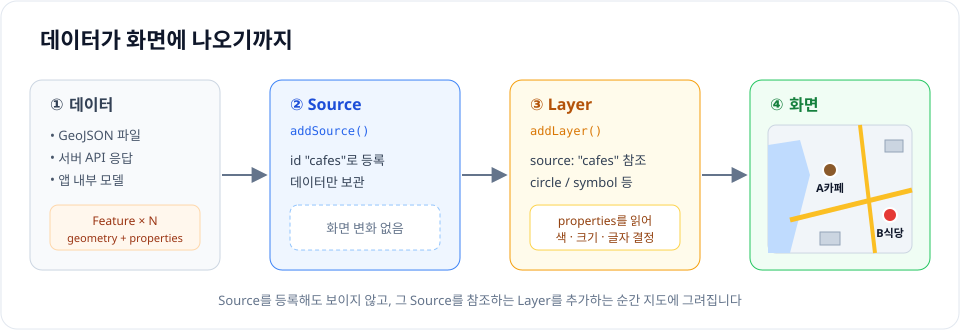

1. 앱이 가진 데이터를 **GeoJSON(Feature 묶음)** 형태로 만듭니다.
2. 이 데이터를 **Source**로 Style에 등록합니다. 이 시점까지 화면에는 아무 변화가 없습니다.
3. 그 Source를 참조하는 **Layer**를 추가하는 순간 지도에 그려집니다.
4. Layer는 각 Feature의 **properties**를 읽어서(Expression) 색, 크기, 글자를 다르게 그릴 수 있습니다.

코드로 보면 딱 이 세 단계입니다. 자세한 문법은 뒤에서 하나씩 다룹니다.

<details class="notion-toggle-list" markdown="1">
<summary>3단계 전체 코드 보기</summary>

```swift
// 1. 데이터 만들기 (Feature)
var cafe = Feature(geometry: Point(CLLocationCoordinate2D(latitude: 37.566, longitude: 126.978)))
cafe.properties = ["name": "A카페", "category": "cafe"]

// 2. Source 등록 (아직 안 보임)
var source = GeoJSONSource(id: "cafes")
source.data = .featureCollection(FeatureCollection(features: [cafe]))
try mapView.mapboxMap.addSource(source)

// 3. Layer 추가 (이제 보임)
var layer = CircleLayer(id: "cafe-circles", source: "cafes")
layer.circleColor = .constant(StyleColor(.brown))
try mapView.mapboxMap.addLayer(layer)
```

</details>

### 각 개념의 역할

| 개념 | 질문 | 역할 | 예시 |
| --- | --- | --- | --- |
| Style | 지도 전체를 어떻게 구성할까? | Source와 Layer를 모두 담는 설계도 | `streets-v12`, 내가 만든 커스텀 스타일 |
| Source | 무엇을 그릴까? | 데이터와 데이터를 가져오는 방법 | `"cafes"` GeoJSON, `"composite"` Vector |
| Feature | 그중 하나는 무엇인가? | 위치(geometry) + 정보(properties) 한 건 | A카페 한 곳, 도로 한 구간 |
| GeoJSON | 데이터를 어떤 형식으로 적을까? | Feature를 표현하는 JSON 포맷 | `{ "type": "Feature", ... }` |
| Layer | 어떻게 그릴까? | Source를 어떤 모양, 색으로 그릴지 | circle, line, fill, symbol |
| Expression | 데이터마다 다르게 그리려면? | properties, 줌에 따라 값을 계산하는 식 | category별 색상, 줌별 크기 |

### Source와 Layer의 관계

Source와 Layer는 **1 : N** 관계입니다.

```text
                      ┌──→ cafe-circles  (circle)  : 위치를 원으로
 Source "cafes"  ─────┼──→ cafe-labels   (symbol)  : 이름을 글자로
                      └──→ cafe-heatmap  (heatmap) : 밀집도를 히트맵으로
```

- 하나의 Source를 여러 Layer가 공유할 수 있습니다. 데이터는 한 번만 넣고 표현만 여러 개 만드는 구조입니다.
- 반대로 하나의 Layer는 **오직 하나의 Source**만 참조할 수 있습니다.
- 데이터가 바뀌면 Source만 갱신하면 되고, 이를 참조하는 모든 Layer가 자동으로 다시 그려집니다.
- 반대로 모양만 바꾸고 싶으면 Layer 속성만 바꾸면 되고, 데이터는 건드리지 않아도 됩니다.

이렇게 **데이터(Source)와 표현(Layer)을 분리**한 것이 Mapbox 구조의 핵심이고, 이 글 전체가 이 한 문장을 풀어서 설명하는 내용입니다.

&nbsp;

---

&nbsp;

## 1. 지도는 어떻게 그려질까 - 좌표와 타일

### 좌표: 경도(longitude), 위도(latitude)

지구 위의 한 점은 **위도**와 **경도**로 나타냅니다.

- 위도(latitude): 적도 기준 남북 위치, -90 ~ 90
- 경도(longitude): 그리니치 기준 동서 위치, -180 ~ 180

서울시청은 대략 위도 `37.5665`, 경도 `126.9780` 입니다.

여기서 가장 많이 실수하는 부분이 있습니다. iOS의 `CLLocationCoordinate2D`는 `(latitude, longitude)` 순서이지만 **GeoJSON과 Mapbox Style 스펙은 `[longitude, latitude]` 순서**입니다.

```swift
// iOS: 위도, 경도
CLLocationCoordinate2D(latitude: 37.5665, longitude: 126.9780)
```

```json
// GeoJSON: 경도, 위도
[126.9780, 37.5665]
```

순서를 바꿔 넣으면 서울 마커가 남극 근처 바다에 찍히는 걸 볼 수 있습니다.

### 줌 레벨과 타일

지도는 한 장의 거대한 이미지가 아니라 **타일(Tile)** 이라는 작은 정사각형 조각들을 이어 붙여서 보여줍니다.

- 줌 레벨 0에서는 전 세계가 타일 1장입니다.
- 줌이 1 올라갈 때마다 타일 하나가 4장으로 쪼개집니다. (줌 z에서 타일 수 = 4^z)
- 화면에 보이는 영역의 타일만 내려받기 때문에 전 세계 지도를 빠르게 보여줄 수 있습니다.

타일은 두 종류가 있습니다.

| 종류 | 내용 | 특징 |
| --- | --- | --- |
| Raster Tile | 이미 그려진 PNG/JPG 이미지 | 스타일 변경 불가, 위성사진 등에 사용 |
| Vector Tile | 도형 데이터(점, 선, 면 + 속성) | 기기에서 직접 그림, 스타일을 자유롭게 변경 가능 |

Mapbox 지도는 기본적으로 **Vector Tile**입니다. 데이터만 내려받고 "어떻게 그릴지"는 기기가 Style을 보고 결정합니다. 그래서 같은 데이터로 다크 모드, 내비게이션용 지도 등 전혀 다른 모양을 만들 수 있습니다. 이 "데이터와 그리는 방법의 분리"가 뒤에 나올 Source와 Layer 개념의 출발점입니다.

&nbsp;

---

&nbsp;

## 2. Geometry - 점, 선, 면

지도 위의 모든 데이터는 결국 세 가지 도형 중 하나입니다.

| Geometry | 의미 | 예시 |
| --- | --- | --- |
| Point | 점 하나 | 카페 위치, 버스 정류장 |
| LineString | 점들을 이은 선 | 도로, 이동 경로, 버스 노선 |
| Polygon | 닫힌 면 | 건물, 공원, 행정구역 |

여기에 여러 개를 묶은 `MultiPoint`, `MultiLineString`, `MultiPolygon`과, 서로 다른 Geometry를 묶는 `GeometryCollection`이 있습니다. 예를 들어 섬이 여러 개인 행정구역은 `MultiPolygon`으로 표현합니다.

어떤 Geometry인지에 따라 사용할 수 있는 Layer 종류가 달라지므로 기억해두면 좋습니다.

&nbsp;

---

&nbsp;

## 3. GeoJSON - 지리 데이터를 담는 포맷

**GeoJSON**은 지리 데이터를 JSON으로 표현하기 위한 표준 포맷(RFC 7946)입니다. Mapbox뿐 아니라 Google Maps, Leaflet, PostGIS 등 거의 모든 지도 도구가 지원합니다.

### Geometry 표현

```json
{ "type": "Point", "coordinates": [126.9780, 37.5665] }
```

```json
{
  "type": "LineString",
  "coordinates": [
    [126.9780, 37.5665],
    [126.9820, 37.5700],
    [126.9900, 37.5710]
  ]
}
```

```json
{
  "type": "Polygon",
  "coordinates": [
    [
      [126.97, 37.56],
      [126.99, 37.56],
      [126.99, 37.58],
      [126.97, 37.58],
      [126.97, 37.56]
    ]
  ]
}
```

Polygon은 두 가지를 주의해야 합니다.

- 좌표 배열이 한 겹 더 감싸져 있습니다. 첫 번째 배열은 바깥 테두리, 그다음 배열들은 구멍(hole)입니다.
- 첫 좌표와 마지막 좌표가 **같아야** 닫힌 도형이 됩니다.

### Feature와 FeatureCollection

Geometry만으로는 "이 점이 무엇인지" 알 수 없습니다. 그래서 GeoJSON은 Geometry에 속성을 붙인 **Feature**, 그리고 Feature들을 묶은 **FeatureCollection**을 제공합니다.

```json
{
  "type": "FeatureCollection",
  "features": [
    {
      "type": "Feature",
      "id": 1,
      "geometry": { "type": "Point", "coordinates": [126.9780, 37.5665] },
      "properties": { "name": "A카페", "category": "cafe", "rating": 4.5 }
    },
    {
      "type": "Feature",
      "id": 2,
      "geometry": { "type": "Point", "coordinates": [126.9850, 37.5700] },
      "properties": { "name": "B식당", "category": "restaurant", "rating": 3.8 }
    }
  ]
}
```

정리하면 GeoJSON은 아래 계층 구조를 가집니다.

```text
FeatureCollection
 └── Feature (여러 개)
      ├── id          (선택)
      ├── geometry    → 어디에, 어떤 모양으로
      └── properties  → 무엇인지 (자유로운 key-value)
```

&nbsp;

---

&nbsp;

## 4. Feature - 데이터 한 건

**Feature**는 지도 위의 "물체 하나"입니다. 카페 하나, 도로 한 구간, 건물 하나가 각각 Feature입니다.

Feature는 GeoJSON에서만 쓰는 말이 아니라 Mapbox 전체에서 쓰이는 개념입니다. Vector Tile 안의 도로, 건물 데이터도 모두 Feature이고, 사용자가 지도를 탭했을 때 돌려받는 것도 Feature입니다.

Feature에서 중요한 것은 **properties**입니다. 뒤에서 볼 Expression은 이 properties 값을 읽어서 색상, 크기, 텍스트를 결정합니다. 즉 **"데이터에 무엇을 넣어두느냐"가 "지도를 얼마나 다양하게 그릴 수 있느냐"를 결정**합니다.

iOS에서는 Mapbox SDK에 포함된 Turf 라이브러리로 Feature를 만듭니다.

<details class="notion-toggle-list" markdown="1">
<summary>Turf로 Feature 만드는 코드 보기</summary>

```swift
import MapboxMaps

var cafe = Feature(geometry: Point(CLLocationCoordinate2D(latitude: 37.5665, longitude: 126.9780)))
cafe.identifier = .number(1)
cafe.properties = [
    "name": "A카페",
    "category": "cafe",
    "rating": 4.5
]

let collection = FeatureCollection(features: [cafe])
```

</details>

Swift 코드에서는 `CLLocationCoordinate2D`를 쓰기 때문에 위도, 경도 순서로 넣어도 SDK가 GeoJSON 순서로 변환해줍니다. 직접 JSON 문자열이나 파일을 다룰 때만 `[경도, 위도]` 순서를 신경 쓰면 됩니다.

&nbsp;

---

&nbsp;

## 5. Style - 지도 전체의 설계도

**Style**은 지도를 어떻게 보여줄지를 정의한 JSON 문서입니다. Mapbox Studio에서 만든 스타일이나 `mapbox://styles/mapbox/streets-v12` 같은 기본 스타일이 모두 이 JSON입니다.

Style JSON의 뼈대는 아래와 같습니다.

```json
{
  "version": 8,
  "name": "My Style",
  "sprite": "mapbox://sprites/...",
  "glyphs": "mapbox://fonts/{fontstack}/{range}.pbf",
  "sources": {
    "cafes": { "type": "geojson", "data": "https://example.com/cafes.geojson" }
  },
  "layers": [
    { "id": "background", "type": "background", "paint": { "background-color": "#f5f5f5" } },
    { "id": "cafe-circles", "type": "circle", "source": "cafes", "paint": { "circle-radius": 6 } }
  ]
}
```

| 키 | 역할 |
| --- | --- |
| `sources` | 사용할 데이터 목록 (딕셔너리, id → source) |
| `layers` | 그리는 방법 목록 (배열, 순서 중요) |
| `sprite` | 아이콘 이미지 모음 |
| `glyphs` | 라벨에 쓸 폰트 |

결국 Mapbox로 지도를 커스터마이징한다는 것은 **이 Style에 Source와 Layer를 추가, 수정, 삭제하는 것**입니다. 코드로 `addSource`, `addLayer`를 호출하는 것도 런타임에 이 JSON을 고치는 일과 같습니다.

> v11의 기본 스타일인 **Mapbox Standard**는 내부 Layer를 직접 노출하지 않고, `slot`과 설정값(config)으로 커스터마이징하는 방식입니다. 개념 학습 단계에서는 `streets-v12`처럼 Layer 구조가 그대로 보이는 클래식 스타일로 실습하면 이해하기 더 쉽습니다.

&nbsp;

---

&nbsp;

## 6. Source - 데이터를 어디서 가져올까

**Source**는 지도에 그릴 데이터와 그 데이터를 가져오는 방법을 정의합니다. Source 자체는 화면에 그려지지 않습니다.

| Source type | 데이터 | 사용 예 |
| --- | --- | --- |
| `vector` | Vector Tile | Mapbox 기본 지도 데이터, 대용량 데이터 |
| `raster` | Raster Tile 이미지 | 위성사진, 외부 타일 서버 |
| `raster-dem` | 고도 데이터 | 3D 지형, 음영 기복 |
| `geojson` | GeoJSON | 앱에서 직접 만든 마커, 경로 등 |
| `image` | 이미지 한 장 | 특정 영역에 평면도 덮어씌우기 |

처음에는 `geojson`과 `vector` 두 가지만 알아도 충분합니다.

### GeoJSON Source

앱에서 가진 데이터를 지도에 올릴 때 가장 많이 사용합니다.

<details class="notion-toggle-list" markdown="1">
<summary>GeoJSON Source 추가 코드 보기</summary>

```swift
var source = GeoJSONSource(id: "cafes")
source.data = .featureCollection(collection)
// 또는 원격 파일: source.data = .url(URL(string: "https://example.com/cafes.geojson")!)

try mapView.mapboxMap.addSource(source)
```

</details>

데이터가 바뀌면 Source를 새로 만들지 않고 데이터만 갱신합니다.

```swift
mapView.mapboxMap.updateGeoJSONSource(withId: "cafes", geoJSON: .featureCollection(newCollection))
```

GeoJSON Source는 `cluster` 옵션으로 가까운 점들을 자동으로 묶는 **클러스터링** 기능도 제공합니다.

```swift
source.cluster = true
source.clusterRadius = 50
source.clusterMaxZoom = 14
```

### Vector Source와 source-layer

Vector Tile 하나에는 도로, 건물, 물 등 여러 종류의 데이터가 함께 들어 있습니다. 이 안의 데이터 묶음을 **source-layer**라고 부릅니다.

```text
Vector Source "composite" (Mapbox Streets)
 ├── source-layer "road"
 ├── source-layer "building"
 ├── source-layer "water"
 └── source-layer "poi_label"
```

그래서 Vector Source를 쓰는 Layer는 `source`와 함께 `sourceLayer`를 지정해야 합니다.

```swift
var buildings = FillLayer(id: "my-buildings", source: "composite")
buildings.sourceLayer = "building"
```

이름이 비슷해서 헷갈리는데, **source-layer는 데이터 안의 분류**이고 **Layer는 그리는 방법**입니다. 둘은 완전히 다른 개념입니다.

&nbsp;

---

&nbsp;

## 7. Layer - 데이터를 어떻게 그릴까

**Layer**는 Source의 Feature들을 화면에 어떤 모양으로 그릴지 정합니다.

### Layer 종류

| Layer type | 그리는 것 | 어울리는 Geometry |
| --- | --- | --- |
| `background` | 지도 배경색 | (Source 없음) |
| `fill` | 면 채우기 | Polygon |
| `line` | 선 | LineString, Polygon 테두리 |
| `circle` | 원 | Point |
| `symbol` | 아이콘, 텍스트 | Point, LineString(도로명처럼 선을 따라) |
| `fill-extrusion` | 3D로 솟은 면 | Polygon (3D 건물) |
| `heatmap` | 밀도 히트맵 | Point |
| `raster` | 래스터 이미지 | raster source |
| `hillshade` | 지형 음영 | raster-dem source |

같은 데이터라도 Layer를 바꾸면 전혀 다르게 보입니다. 카페 위치(Point)를 `circle`로 그리면 점, `symbol`로 그리면 아이콘과 이름, `heatmap`으로 그리면 카페 밀집 지역이 됩니다.

### layout과 paint

Layer의 속성은 두 그룹으로 나뉩니다.

| 그룹 | 의미 | 예시 |
| --- | --- | --- |
| layout | 배치, 구조에 관한 속성 | `visibility`, `text-field`, `icon-image`, `line-cap` |
| paint | 색, 크기 등 칠하는 속성 | `circle-color`, `fill-opacity`, `line-width` |

Swift SDK에서는 그룹 구분 없이 프로퍼티로 바로 접근할 수 있지만, Style JSON을 읽을 때는 이 구분이 보입니다.

### Layer 추가하기

카페, 식당, 바 10곳을 담은 `places` Source 하나로 원과 라벨 두 개의 Layer를 만들어 보겠습니다.

<details class="notion-toggle-list" markdown="1">
<summary>데이터(Source) 준비 코드 보기</summary>

```swift
struct Place { let id: Int; let name: String; let category: String; let rating: Double; let lat: Double; let lng: Double }

let places: [Place] = [
    Place(id: 1, name: "광화문카페", category: "cafe", rating: 4.5, lat: 37.5718, lng: 126.9768),
    Place(id: 2, name: "시청식당", category: "restaurant", rating: 3.8, lat: 37.5663, lng: 126.9779),
    Place(id: 3, name: "종로바", category: "bar", rating: 4.2, lat: 37.5704, lng: 126.9921),
    // ... 총 10곳
]

let collection = FeatureCollection(features: places.map { place in
    var feature = Feature(geometry: Point(CLLocationCoordinate2D(latitude: place.lat, longitude: place.lng)))
    feature.identifier = .number(Double(place.id))        // feature-state를 쓰려면 id가 필요
    feature.properties = [
        "name": .string(place.name),
        "category": .string(place.category),
        "rating": .number(place.rating)
    ]
    return feature
})

var source = GeoJSONSource(id: "places")
source.data = .featureCollection(collection)
try mapView.mapboxMap.addSource(source)
```

</details>

<details class="notion-toggle-list" markdown="1">
<summary>원(circle)과 라벨(symbol) Layer 코드 보기</summary>

```swift
var circles = CircleLayer(id: "place-circles", source: "places")
circles.circleRadius = .constant(8)
circles.circleColor = .constant(StyleColor(UIColor(red: 0.55, green: 0.35, blue: 0.17, alpha: 1)))
circles.circleStrokeWidth = .constant(2)
circles.circleStrokeColor = .constant(StyleColor(.white))

var labels = SymbolLayer(id: "place-labels", source: "places")
labels.textField = .expression(Exp(.get) { "name" })
labels.textSize = .constant(13)
labels.textAnchor = .constant(.top)
labels.textOffset = .constant([0, 1.0])
labels.textHaloColor = .constant(StyleColor(.white))
labels.textHaloWidth = .constant(1.5)

try mapView.mapboxMap.addLayer(circles)
try mapView.mapboxMap.addLayer(labels)
```

</details>

<p style="text-align: center;">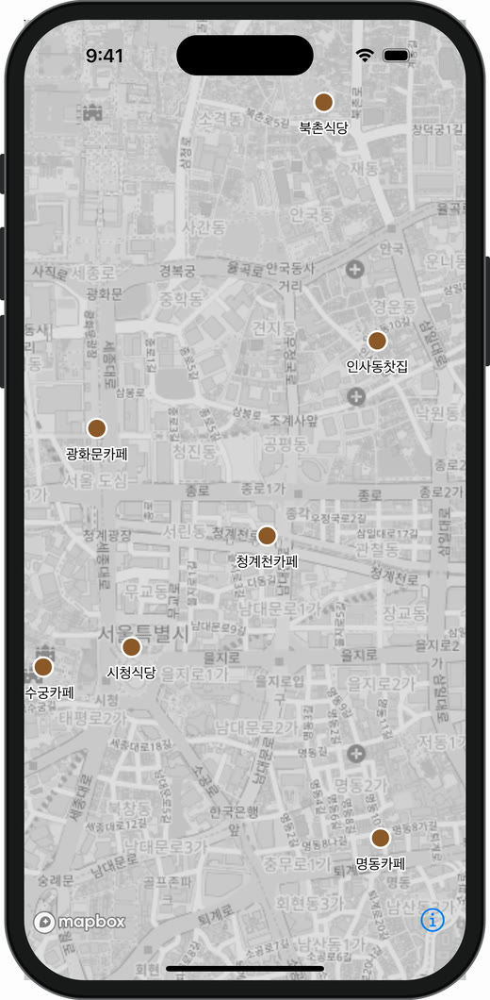</p>

Source는 하나인데 Layer가 둘이라 같은 데이터가 **원으로 한 번, 글자로 한 번** 그려졌습니다. 앞에서 본 "Source 1 : Layer N" 관계가 화면으로 확인됩니다.

> **캡처 환경**: 이 글의 캡처는 모두 iPhone 16 Pro 시뮬레이터, Mapbox Maps SDK 11.34.1에서 본문 코드를 그대로 실행한 결과입니다. 토큰 없이 실행하려고 배경 지도는 OpenStreetMap 래스터 타일을 **Raster Source**로 넣은 로컬 Style JSON을 썼습니다(6장의 `raster` Source 그대로입니다). 배경 지도 © OpenStreetMap contributors.

Source와 Layer는 Style이 로드된 뒤에 추가해야 합니다.

```swift
mapView.mapboxMap.onStyleLoaded.observeNext { [weak self] _ in
    self?.addPlaceLayers()
}.store(in: &cancelables)
```

### Layer 순서

Layer는 **배열 순서대로 아래에서 위로** 그려집니다. 나중에 추가한 Layer가 위에 올라갑니다. 그래서 경로선을 추가했는데 도로 라벨까지 덮어버리는 일이 생깁니다. 이럴 때는 위치를 지정합니다. (11장 경로 예제에서 실제로 사용합니다)

```swift
try mapView.mapboxMap.addLayer(routeLayer, layerPosition: .below("road-label"))
```

&nbsp;

---

&nbsp;

## 8. Expression - 데이터에 따라 다르게 그리기

지금까지는 모든 장소를 같은 색으로 그렸습니다. **Expression**을 쓰면 Feature의 properties나 줌 레벨에 따라 스타일을 다르게 줄 수 있습니다. (Data-driven styling)

Expression은 JSON 배열 형태의 작은 언어입니다. 첫 번째 원소가 연산자입니다.

```json
["get", "name"]
```

자주 쓰는 Expression은 아래와 같습니다.

| Expression | 역할 |
| --- | --- |
| `get` | properties 값 읽기 |
| `match` | 값에 따라 분기 (switch) |
| `case` | 조건에 따라 분기 (if-else) |
| `step` | 구간별로 값 정하기 (계단식) |
| `interpolate` | 값 사이를 부드럽게 보간 |
| `zoom` | 현재 줌 레벨 |
| `feature-state` | Feature에 붙인 상태 읽기 (9장) |
| `==`, `>=`, `all`, `any`, `has` | 비교, 논리 연산 (filter에 자주 사용) |

### match - 카테고리별 색상

```json
["match", ["get", "category"],
  "cafe", "#8C5A2B",
  "restaurant", "#E63836",
  "bar", "#5E40CC",
  "#9E9E9E"
]
```

<details class="notion-toggle-list" markdown="1">
<summary>match Swift 코드 보기</summary>

```swift
circles.circleColor = .expression(
    Exp(.match) {
        Exp(.get) { "category" }
        "cafe"
        UIColor(red: 0.55, green: 0.35, blue: 0.17, alpha: 1)   // 갈색
        "restaurant"
        UIColor(red: 0.90, green: 0.22, blue: 0.21, alpha: 1)   // 빨강
        "bar"
        UIColor(red: 0.37, green: 0.25, blue: 0.80, alpha: 1)   // 보라
        UIColor.gray                                           // 그 외 (default)
    }
)
```

</details>

<p style="text-align: center;">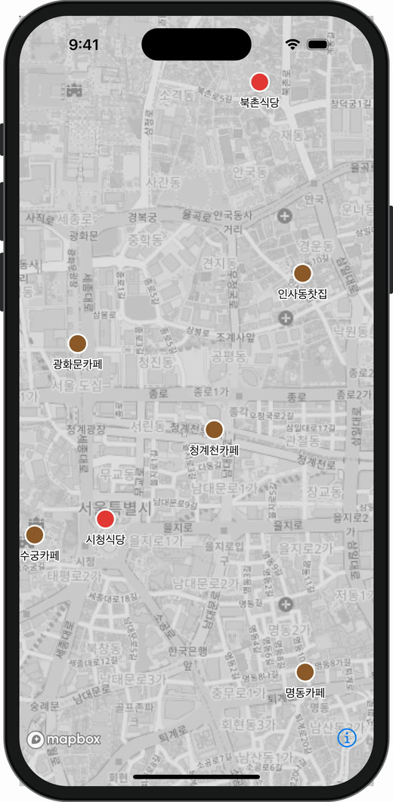</p>

데이터는 그대로인데 `category` 값에 따라 카페는 갈색, 식당은 빨강, 바는 보라로 칠해졌습니다. 색 규칙은 Layer에만 있고, Feature에는 `"category": "cafe"` 같은 값만 있습니다.

### interpolate - 줌에 따라 크기 바꾸기

줌 12에서는 반지름 4, 줌 16에서는 반지름 14가 되고 그 사이는 자연스럽게 커집니다.

<details class="notion-toggle-list" markdown="1">
<summary>interpolate Swift 코드 보기</summary>

```swift
circles.circleRadius = .expression(
    Exp(.interpolate) {
        Exp(.linear)
        Exp(.zoom)
        12   // 줌 12일 때
        4    //   반지름 4
        16   // 줌 16일 때
        14   //   반지름 14
    }
)
```

</details>

<div style="display: flex; gap: 16px; flex-wrap: wrap; justify-content: center;">
  <figure style="width: 240px; margin: 0;">
    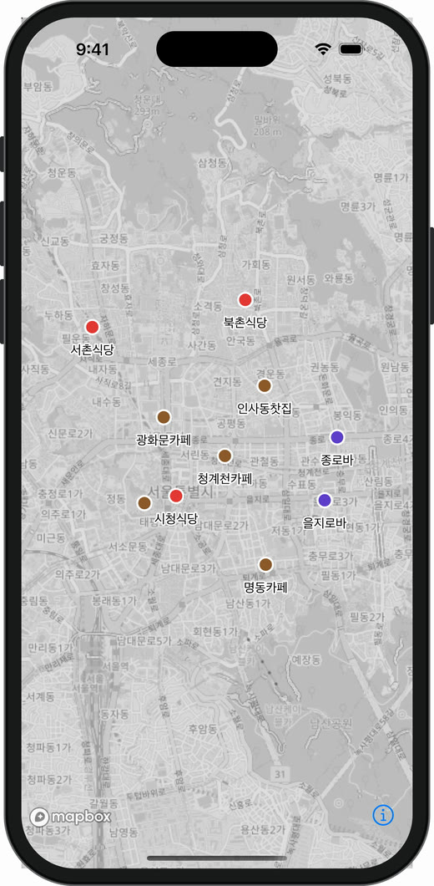
    <figcaption style="font-size: 0.8em; text-align: center;">줌 13 → 반지름 6.5</figcaption>
  </figure>
  <figure style="width: 240px; margin: 0;">
    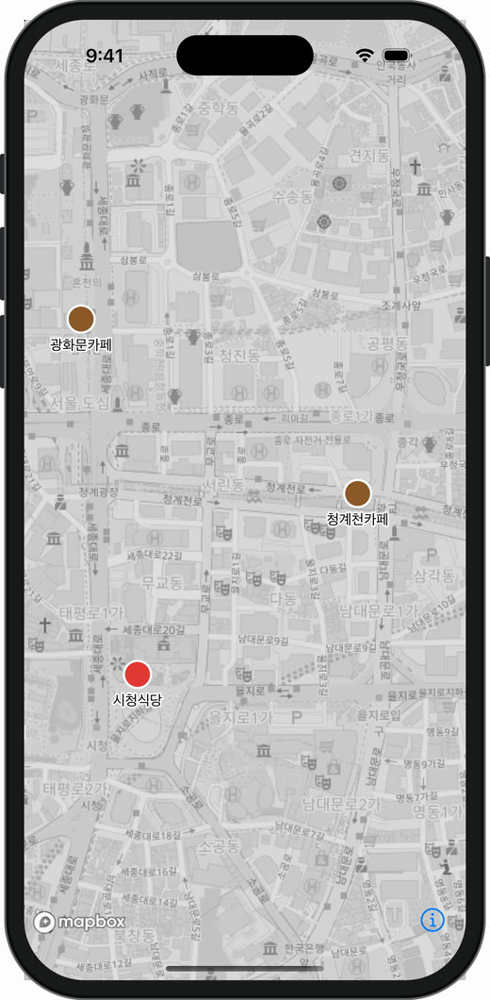
    <figcaption style="font-size: 0.8em; text-align: center;">줌 15 → 반지름 11.5</figcaption>
  </figure>
</div>

&nbsp;

같은 Layer, 같은 데이터인데 줌에 따라 원 크기가 달라집니다. 멀리서 볼 때는 작게 그려서 겹침을 줄이고, 가까이 볼 때는 크게 그려서 누르기 쉽게 만드는 패턴으로 자주 씁니다.

### filter - 일부 Feature만 그리기

Layer의 `filter`에 Expression을 넣으면 조건에 맞는 Feature만 그립니다.

<details class="notion-toggle-list" markdown="1">
<summary>filter Swift 코드 보기</summary>

```swift
// 평점 4.0 이상인 카페만
let onlyGoodCafes = Exp(.all) {
    Exp(.eq) { Exp(.get) { "category" }; "cafe" }
    Exp(.gte) { Exp(.get) { "rating" }; 4.0 }
}
circles.filter = onlyGoodCafes
labels.filter = onlyGoodCafes   // 라벨 Layer에도 같은 filter를 줘야 글자도 사라짐
```

</details>

<p style="text-align: center;">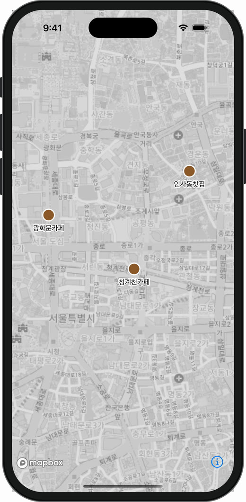</p>

10곳 중 평점 4.0 이상인 카페 3곳(광화문카페, 인사동찻집, 청계천카페)만 남았습니다. filter는 **Layer마다 따로** 걸리기 때문에, 원 Layer에만 filter를 주면 원은 사라지고 라벨만 남는 일이 생깁니다.

필터 UI를 만들 때 데이터를 다시 만들지 않고 Layer의 filter만 바꾸면 되기 때문에 효율적입니다.

&nbsp;

---

&nbsp;

## 9. 상호작용 - 지도에서 Feature 찾기

사용자가 지도를 탭했을 때 "무엇을 탭했는지" 알려면 Feature를 조회해야 합니다.

| API | 대상 |
| --- | --- |
| `queryRenderedFeatures` | 현재 화면에 **그려진** Feature (Layer 기준) |
| `querySourceFeatures` | Source에 있는 Feature (화면 표시 여부와 무관) |

선택된 장소만 강조하고 싶을 때는 **Feature State**를 사용합니다. 데이터를 다시 넣지 않고 특정 Feature에 `selected: true` 같은 상태만 붙인 뒤, Expression의 `feature-state`로 읽어 스타일을 바꿉니다. 이를 위해 Feature에 `id`가 있어야 합니다. (7장 데이터 준비 코드에서 `feature.identifier`를 넣은 이유입니다)

<details class="notion-toggle-list" markdown="1">
<summary>탭해서 선택하기 코드 보기</summary>

```swift
// 1) 스타일: selected 상태면 노란 두꺼운 테두리
circles.circleStrokeColor = .expression(
    Exp(.switchCase) {
        Exp(.boolean) { Exp(.featureState) { "selected" }; false }
        UIColor.systemYellow
        UIColor.white
    }
)
circles.circleStrokeWidth = .expression(
    Exp(.switchCase) {
        Exp(.boolean) { Exp(.featureState) { "selected" }; false }
        6
        2
    }
)

// 2) 탭 처리: 탭한 Feature를 찾아 상태를 바꾼다
private var selectedId: String?

@objc private func handleTap(_ gesture: UITapGestureRecognizer) {
    let map = mapView.mapboxMap!
    let point = gesture.location(in: mapView)
    let options = RenderedQueryOptions(layerIds: ["place-circles"], filter: nil)

    _ = map.queryRenderedFeatures(with: point, options: options) { [weak self] result in
        guard let self,
              case .success(let features) = result,
              let feature = features.first?.queriedFeature.feature,
              case .number(let id) = feature.identifier else { return }

        // 이전 선택 해제
        if let previous = self.selectedId {
            _ = map.setFeatureState(sourceId: "places", featureId: previous, state: ["selected": false]) { _ in }
        }
        // 새로 선택
        let newId = String(Int(id))
        _ = map.setFeatureState(sourceId: "places", featureId: newId, state: ["selected": true]) { _ in }
        self.selectedId = newId
    }
}
```

</details>

<p style="text-align: center;">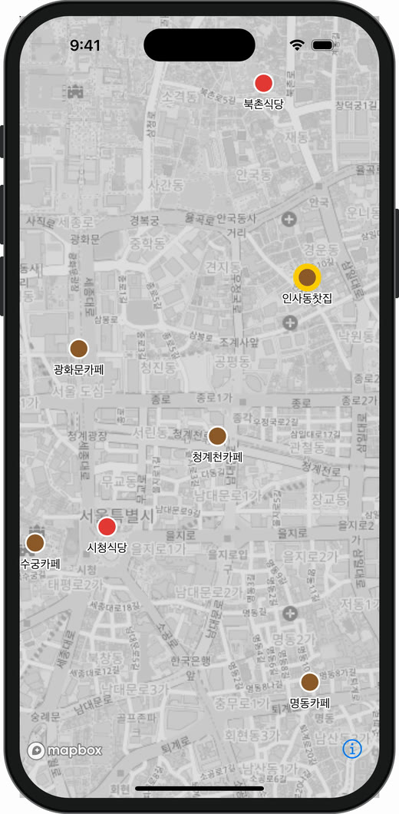</p>

인사동찻집 위치를 탭한 결과입니다. `queryRenderedFeatures`가 id 5인 "인사동찻집" Feature를 찾았고, `setFeatureState`로 상태만 바꿨더니 노란 테두리가 생겼습니다. **GeoJSON 데이터는 한 글자도 바뀌지 않았습니다.** 선택, 호버처럼 자주 바뀌는 상태는 데이터를 다시 넣는 것보다 feature-state가 훨씬 가볍습니다.

&nbsp;

---

&nbsp;

## 10. 다시 보는 Annotation - 결국 Source + Layer

글 처음에 소개한 **Annotation** API를 이제 다시 보겠습니다. Source/Layer를 직접 다루지 않아도 마커를 찍을 수 있습니다.

<details class="notion-toggle-list" markdown="1">
<summary>PointAnnotation 코드 보기</summary>

```swift
let manager = mapView.annotations.makePointAnnotationManager()
let pin = UIImage(systemName: "mappin.circle.fill")!
    .withTintColor(.systemRed, renderingMode: .alwaysOriginal)
    .applyingSymbolConfiguration(.init(pointSize: 34))!

manager.annotations = places.prefix(5).map { place in
    var annotation = PointAnnotation(coordinate: CLLocationCoordinate2D(latitude: place.lat, longitude: place.lng))
    annotation.image = .init(image: pin, name: "pin")
    annotation.textField = place.name
    annotation.textOffset = [0, 1.6]
    annotation.textSize = 13
    annotation.textHaloColor = StyleColor(.white)
    annotation.textHaloWidth = 1.5
    return annotation
}
// manager는 프로퍼티로 보관해야 함 (해제되면 마커도 사라짐)
```

</details>

<p style="text-align: center;">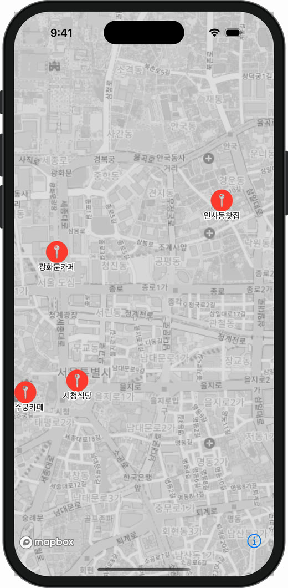</p>

실행한 뒤 Style에 들어 있는 Source와 Layer 목록을 출력해 보면 이렇게 나옵니다.

```text
Sources: ["osm", "E9611..."]
Layers:  ["osm", "road-label", "E9611..."]
```

내가 addSource, addLayer를 호출한 적이 없는데 `E9611…`이라는 id의 **Source 1개와 Layer 1개가 생겼습니다.** Annotation Manager가 내부적으로 GeoJSON Source와 Symbol Layer를 만들고, `annotations` 배열이 바뀔 때마다 Source의 데이터를 갱신하는 것입니다. 지금까지 배운 구조를 감싸 놓은 편의 API인 셈입니다.

그래서 처음에는 Annotation으로 빠르게 시작하더라도, 데이터가 많아지거나 클러스터링, Expression 기반 스타일이 필요해지면 Source + Layer 방식으로 옮겨가게 됩니다. 이때 이 글의 개념들이 그대로 쓰입니다.

&nbsp;

---

&nbsp;

## 11. 자주 쓰는 예제

지금까지 배운 Source, Layer, Expression을 조합하면 실무에서 자주 만드는 화면 대부분을 만들 수 있습니다. 예제마다 **어떤 Source + 어떤 Layer + 어떤 Expression** 조합인지 먼저 정리하고 코드를 붙였습니다.

| 예제 | Source | Layer | 핵심 포인트 |
| --- | --- | --- | --- |
| 삼각형 그리기 | GeoJSON (Polygon) | fill, line, circle, symbol | 바탕색은 fill, 굵은 테두리는 line |
| 선박 모양 | GeoJSON (Polygon) | fill, line, symbol | 미터, heading으로 육각형 계산, 선종별 `match` |
| 경로 그리기 | GeoJSON (LineString) | line, circle, symbol | `line-progress` 그라데이션, Layer 순서 |
| 반경 표시 | GeoJSON (Polygon) | fill, line | 원도 결국 Polygon, 채우기와 테두리는 Layer 2개 |
| 클러스터링 | GeoJSON + `cluster` | circle, symbol | `point_count`와 `step`, `has` filter |
| 히트맵 | GeoJSON (Point) | heatmap | `heatmap-density` 색 보간 |
| 3D 돌출 | GeoJSON (Polygon) | fill-extrusion | properties 값을 높이로 |

### 도형 그리기 - FillLayer + LineLayer로 삼각형

가장 기본이 되는 "면 그리기"입니다. 서울, 부산, 광주를 꼭짓점으로 하는 삼각형 Polygon을 만들고, **안쪽 바탕색은 FillLayer**, **테두리는 LineLayer**로 칠합니다.

<details class="notion-toggle-list" markdown="1">
<summary>삼각형 그리기 코드 보기</summary>

```swift
let seoul = CLLocationCoordinate2D(latitude: 37.5665, longitude: 126.9780)
let busan = CLLocationCoordinate2D(latitude: 35.1796, longitude: 129.0756)
let gwangju = CLLocationCoordinate2D(latitude: 35.1595, longitude: 126.8526)

// Polygon은 첫 점과 마지막 점이 같아야 닫힌다 (3장 GeoJSON 규칙)
let triangle = Polygon([[seoul, busan, gwangju, seoul]])

var source = GeoJSONSource(id: "triangle")
source.data = .feature(Feature(geometry: triangle))
try mapView.mapboxMap.addSource(source)

// 1) 안쪽 바탕색
var fill = FillLayer(id: "triangle-fill", source: "triangle")
fill.fillColor = .constant(StyleColor(.systemOrange))
fill.fillOpacity = .constant(0.35)
try mapView.mapboxMap.addLayer(fill)

// 2) 테두리 (같은 Source를 line으로 한 번 더)
var outline = LineLayer(id: "triangle-outline", source: "triangle")
outline.lineColor = .constant(StyleColor(.systemOrange))
outline.lineWidth = .constant(3)
outline.lineJoin = .constant(.round)
try mapView.mapboxMap.addLayer(outline)

// 3) 꼭짓점과 도시 이름 (Point 데이터라 Source를 따로)
var cities = GeoJSONSource(id: "triangle-cities")
cities.data = .featureCollection(FeatureCollection(features: [("서울", seoul), ("부산", busan), ("광주", gwangju)].map { name, coordinate in
    var feature = Feature(geometry: Point(coordinate))
    feature.properties = ["name": .string(name)]
    return feature
}))
try mapView.mapboxMap.addSource(cities)

var dots = CircleLayer(id: "triangle-dots", source: "triangle-cities")
dots.circleRadius = .constant(6)
dots.circleColor = .constant(StyleColor(.white))
dots.circleStrokeWidth = .constant(3)
dots.circleStrokeColor = .constant(StyleColor(.systemOrange))
try mapView.mapboxMap.addLayer(dots)

var labels = SymbolLayer(id: "triangle-labels", source: "triangle-cities")
labels.textField = .expression(Exp(.get) { "name" })
labels.textSize = .constant(15)
labels.textOffset = .constant([0, 1.3])
labels.textHaloColor = .constant(StyleColor(.white))
labels.textHaloWidth = .constant(2)
try mapView.mapboxMap.addLayer(labels)
```

</details>

<p style="text-align: center;">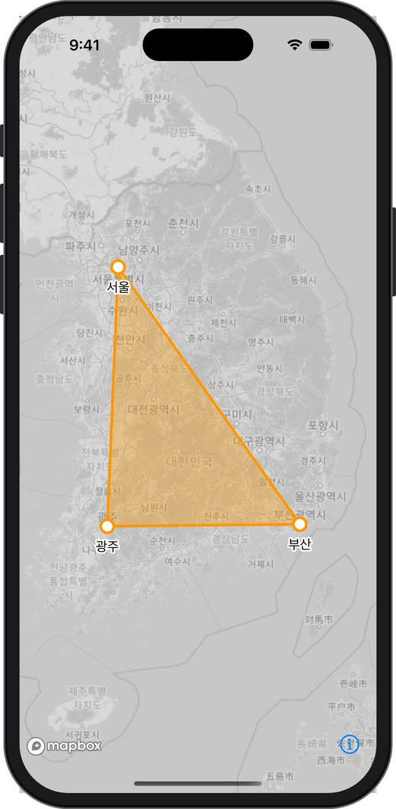</p>

- **FillLayer는 테두리를 굵게 그릴 수 없습니다.** `fillOutlineColor`가 있지만 두께가 항상 1픽셀이라, 눈에 띄는 테두리가 필요하면 같은 Source를 LineLayer로 한 번 더 그리는 것이 정석입니다.
- Layer를 추가한 순서대로 `fill`(바탕) → `line`(테두리) → `circle`(꼭짓점) → `symbol`(이름) 순으로 쌓였습니다. 순서를 바꾸면 테두리가 꼭짓점 원을 덮게 됩니다.
- [Custom Layer 딥다이브]()에서 같은 세 도시로 삼각형을 Metal로 직접 그려봅니다. 단색 삼각형이라면 이렇게 Layer 2개로 충분하고, 꼭짓점별 색 보간이나 셰이더 효과가 필요할 때 Custom Layer를 꺼내면 됩니다.

### 선박 모양 그리기 - 육각형 Polygon

해양, 물류 앱에서 자주 그리는 **선박 모양**입니다. 실제 선박의 길이, 폭(미터)과 진행 방향(heading)으로 육각형 선체를 계산해서 Polygon으로 넣습니다. 꼭짓점은 뱃머리, 좌우 어깨, 좌우 선미, 선미 중앙의 6개입니다.

```text
            ▲ 뱃머리 (0, +L/2)
           / \
 좌현 어깨 /   \ 우현 어깨 (+W/2, +L/4)
          |     |
          |     |      x: 우현 방향 (+)
          |     |      y: 뱃머리 방향 (+)
 좌현 선미 \   / 우현 선미 (+W/2, -0.4L)
            \ /
             ▼ 선미 중앙 (0, -L/2)
```

<details class="notion-toggle-list" markdown="1">
<summary>선박 Polygon 만드는 함수 코드 보기</summary>

```swift
/// 선박 중심, 진행 방향(북쪽 기준 시계방향 각도), 길이, 폭(미터)으로 육각형 선체 Polygon을 만든다
func shipPolygon(center: CLLocationCoordinate2D, heading: Double, length: Double, width: Double) -> Polygon {
    let l = length, w = width
    // 선박 기준 좌표 (x: 우현 방향, y: 뱃머리 방향), 단위 미터
    let hull: [(x: Double, y: Double)] = [
        (0, 0.5 * l),            // 뱃머리
        (0.5 * w, 0.25 * l),     // 우현 어깨
        (0.5 * w, -0.4 * l),     // 우현 선미
        (0, -0.5 * l),           // 선미 중앙
        (-0.5 * w, -0.4 * l),    // 좌현 선미
        (-0.5 * w, 0.25 * l)     // 좌현 어깨
    ]
    let rad = heading * .pi / 180
    let metersPerDegreeLat = 111_320.0
    let metersPerDegreeLng = 111_320.0 * cos(center.latitude * .pi / 180)   // 위도가 높을수록 경도 1도가 짧아짐

    var ring = hull.map { p -> CLLocationCoordinate2D in
        // heading만큼 시계방향 회전 → 동쪽(east), 북쪽(north) 거리(미터)
        let east = p.x * cos(rad) + p.y * sin(rad)
        let north = -p.x * sin(rad) + p.y * cos(rad)
        // 미터 → 위경도
        return CLLocationCoordinate2D(latitude: center.latitude + north / metersPerDegreeLat,
                                      longitude: center.longitude + east / metersPerDegreeLng)
    }
    ring.append(ring[0])   // 닫힌 도형
    return Polygon([ring])
}
```

</details>

<details class="notion-toggle-list" markdown="1">
<summary>선박 Source와 Layer 코드 보기</summary>

```swift
struct Ship { let name: String; let type: String; let lat: Double; let lng: Double; let heading: Double; let length: Double; let width: Double }

let ships = [
    Ship(name: "HANBADA", type: "cargo", lat: 35.0410, lng: 129.0690, heading: 40, length: 300, width: 48),
    Ship(name: "OCEAN STAR", type: "tanker", lat: 35.0365, lng: 129.0815, heading: 300, length: 250, width: 44),
    Ship(name: "BADA 7", type: "fishing", lat: 35.0325, lng: 129.0680, heading: 120, length: 90, width: 18),
    Ship(name: "BUSAN EXP", type: "cargo", lat: 35.0285, lng: 129.0770, heading: 15, length: 220, width: 36),
    Ship(name: "SEAGULL", type: "fishing", lat: 35.0398, lng: 129.0765, heading: 210, length: 80, width: 16)
]

var source = GeoJSONSource(id: "ships")
source.data = .featureCollection(FeatureCollection(features: ships.map { ship in
    var feature = Feature(geometry: shipPolygon(
        center: CLLocationCoordinate2D(latitude: ship.lat, longitude: ship.lng),
        heading: ship.heading, length: ship.length, width: ship.width))
    feature.properties = ["name": .string(ship.name), "type": .string(ship.type)]
    return feature
}))
try mapView.mapboxMap.addSource(source)

// 선종별 색 (8장 match)
let typeColor = Exp(.match) {
    Exp(.get) { "type" }
    "cargo"
    UIColor.systemGreen     // 화물선
    "tanker"
    UIColor.systemRed       // 유조선
    "fishing"
    UIColor.systemOrange    // 어선
    UIColor.gray
}

var hull = FillLayer(id: "ship-hull", source: "ships")
hull.fillColor = .expression(typeColor)
hull.fillOpacity = .constant(0.85)
try mapView.mapboxMap.addLayer(hull)

var outline = LineLayer(id: "ship-outline", source: "ships")
outline.lineColor = .constant(StyleColor(.black))
outline.lineWidth = .constant(1.2)
try mapView.mapboxMap.addLayer(outline)

var labels = SymbolLayer(id: "ship-labels", source: "ships")
labels.textField = .expression(Exp(.get) { "name" })
labels.textFont = .constant(["Open Sans Semibold"])
labels.textSize = .constant(12)
labels.textOffset = .constant([0, 1.8])
labels.textHaloColor = .constant(StyleColor(.white))
labels.textHaloWidth = .constant(1.5)
try mapView.mapboxMap.addLayer(labels)
```

</details>

<div style="display: flex; gap: 16px; flex-wrap: wrap; justify-content: center;">
  <figure style="width: 240px; margin: 0;">
    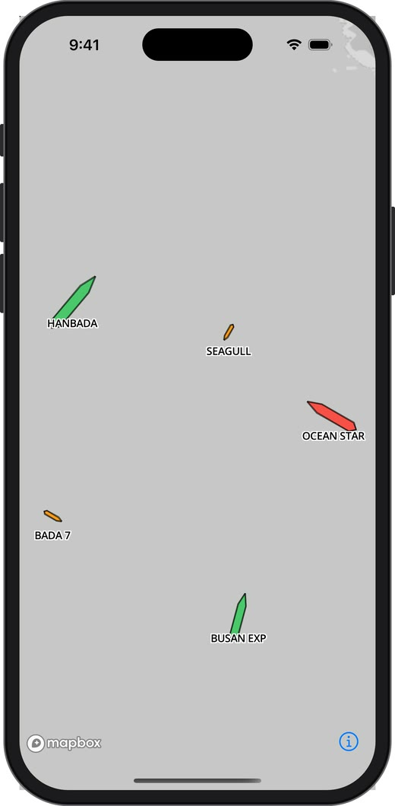
    <figcaption style="font-size: 0.8em; text-align: center;">부산 영도 남쪽 바다, 줌 14</figcaption>
  </figure>
  <figure style="width: 240px; margin: 0;">
    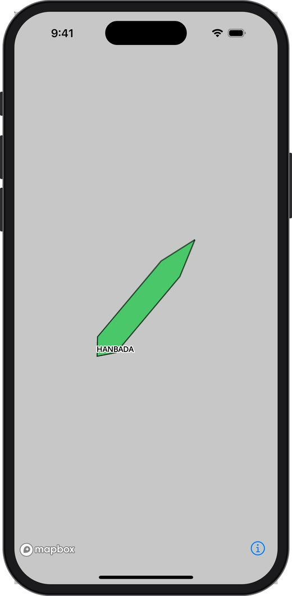
    <figcaption style="font-size: 0.8em; text-align: center;">HANBADA 확대, 줌 15.6</figcaption>
  </figure>
</div>

&nbsp;

- 선종(`type`)에 따라 화물선은 초록, 유조선은 빨강, 어선은 주황으로 칠해졌고, 각 배는 자기 heading 방향으로 뱃머리가 향해 있습니다.
- **Polygon으로 그린 배는 실제 크기를 가집니다.** 300m 화물선은 줌 14에서는 작게, 줌 15.6에서는 크게 보이고, 80~90m 어선은 300m 화물선보다 확실히 작습니다. 항만, 접안처럼 실제 크기가 중요한 화면에 적합합니다.
- 반대로 **줌과 상관없이 항상 같은 크기**로 보여야 한다면(멀리서도 배가 보여야 하는 넓은 해역), 선박 아이콘 이미지를 SymbolLayer로 그리고, properties에 `heading`을 넣어 `iconRotate = .expression(Exp(.get) { "heading" })`로 방향만 돌리는 방식이 맞습니다. 실무에서는 **줌이 낮을 때는 아이콘(Symbol), 높을 때는 실제 크기 Polygon(Fill)** 으로 `minZoom`, `maxZoom`을 나눠 함께 쓰는 경우가 많습니다.
- 미터를 위경도로 바꿀 때 경도 쪽에 `cos(위도)`를 곱하는 이유는 경도 1도의 실제 거리가 적도에서 약 111km이고, 위도가 올라갈수록 짧아지기 때문입니다. 부산(약 35°)에서는 경도 1도가 약 91km입니다.

### 경로 그리기 - LineLayer + 그라데이션

출발지에서 도착지로 갈수록 색이 바뀌는 경로입니다. 산책 코스, 배송 경로, 운항 경로 등에 그대로 쓸 수 있습니다.

<details class="notion-toggle-list" markdown="1">
<summary>경로 그리기 코드 보기</summary>

```swift
let route = [
    CLLocationCoordinate2D(latitude: 37.5663, longitude: 126.9779), // 시청
    CLLocationCoordinate2D(latitude: 37.5718, longitude: 126.9768), // 광화문
    CLLocationCoordinate2D(latitude: 37.5759, longitude: 126.9768), // 경복궁
    CLLocationCoordinate2D(latitude: 37.5790, longitude: 126.9830),
    CLLocationCoordinate2D(latitude: 37.5800, longitude: 126.9840), // 북촌
    CLLocationCoordinate2D(latitude: 37.5740, longitude: 126.9857), // 인사동
    CLLocationCoordinate2D(latitude: 37.5704, longitude: 126.9921)  // 종로
]

var source = GeoJSONSource(id: "route")
source.data = .feature(Feature(geometry: LineString(route)))
source.lineMetrics = true          // line-progress(선의 진행률 0~1)를 쓰려면 필수
try mapView.mapboxMap.addSource(source)

var line = LineLayer(id: "route-line", source: "route")
line.lineWidth = .constant(7)
line.lineCap = .constant(.round)
line.lineJoin = .constant(.round)
line.lineGradient = .expression(
    Exp(.interpolate) {
        Exp(.linear)
        Exp(.lineProgress)   // 선의 시작 0 → 끝 1
        0
        UIColor.systemBlue
        1
        UIColor.systemPink
    }
)
// 도로 라벨을 덮지 않도록 라벨 아래에 넣기
try mapView.mapboxMap.addLayer(line, layerPosition: .below("road-label"))

// 출발, 도착 지점은 별도 Source + circle, symbol Layer
var endpoints = GeoJSONSource(id: "route-endpoints")
var start = Feature(geometry: Point(route.first!)); start.properties = ["label": "출발"]
var end = Feature(geometry: Point(route.last!)); end.properties = ["label": "도착"]
endpoints.data = .featureCollection(FeatureCollection(features: [start, end]))
try mapView.mapboxMap.addSource(endpoints)

var dots = CircleLayer(id: "route-dots", source: "route-endpoints")
dots.circleRadius = .constant(8)
dots.circleColor = .constant(StyleColor(.white))
dots.circleStrokeWidth = .constant(4)
dots.circleStrokeColor = .constant(StyleColor(.darkGray))
try mapView.mapboxMap.addLayer(dots)

var labels = SymbolLayer(id: "route-labels", source: "route-endpoints")
labels.textField = .expression(Exp(.get) { "label" })
labels.textSize = .constant(14)
labels.textOffset = .constant([0, -1.6])
labels.textHaloColor = .constant(StyleColor(.white))
labels.textHaloWidth = .constant(2)
try mapView.mapboxMap.addLayer(labels)
```

</details>

<p style="text-align: center;">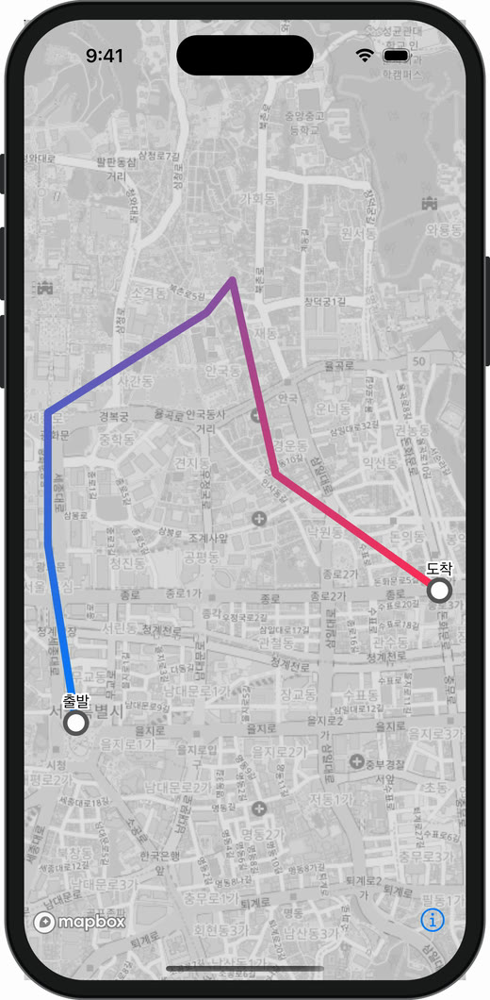</p>

- `lineGradient`는 Source에 `lineMetrics = true`가 있어야 동작합니다. 선의 길이 정보를 미리 계산해 두어야 "지금 몇 % 지점인지(`line-progress`)"를 알 수 있기 때문입니다.
- 경로선은 데이터가 하나인데, 출발, 도착 표시는 데이터 성격이 달라서 Source를 따로 만들었습니다. **"같은 데이터면 Source 하나 + Layer 여러 개, 다른 데이터면 Source를 나눈다"** 가 기본 원칙입니다.

### 반경 표시 - FillLayer + LineLayer

"현재 위치 반경 500m", "배달 가능 지역"처럼 영역을 표시하는 화면입니다.

<details class="notion-toggle-list" markdown="1">
<summary>반경 표시 코드 보기</summary>

```swift
let center = CLLocationCoordinate2D(latitude: 37.5663, longitude: 126.9779)
let circle = Polygon(center: center, radius: 500, vertices: 64)   // 반경 500m를 64각형으로

var source = GeoJSONSource(id: "area")
source.data = .feature(Feature(geometry: circle))
try mapView.mapboxMap.addSource(source)

// 채우기
var fill = FillLayer(id: "area-fill", source: "area")
fill.fillColor = .constant(StyleColor(.systemBlue))
fill.fillOpacity = .constant(0.18)
try mapView.mapboxMap.addLayer(fill)

// 테두리 (같은 Source를 line으로 한 번 더)
var outline = LineLayer(id: "area-outline", source: "area")
outline.lineColor = .constant(StyleColor(.systemBlue))
outline.lineWidth = .constant(2.5)
outline.lineDasharray = .constant([2, 1.5])   // 점선
try mapView.mapboxMap.addLayer(outline)
```

</details>

<p style="text-align: center;">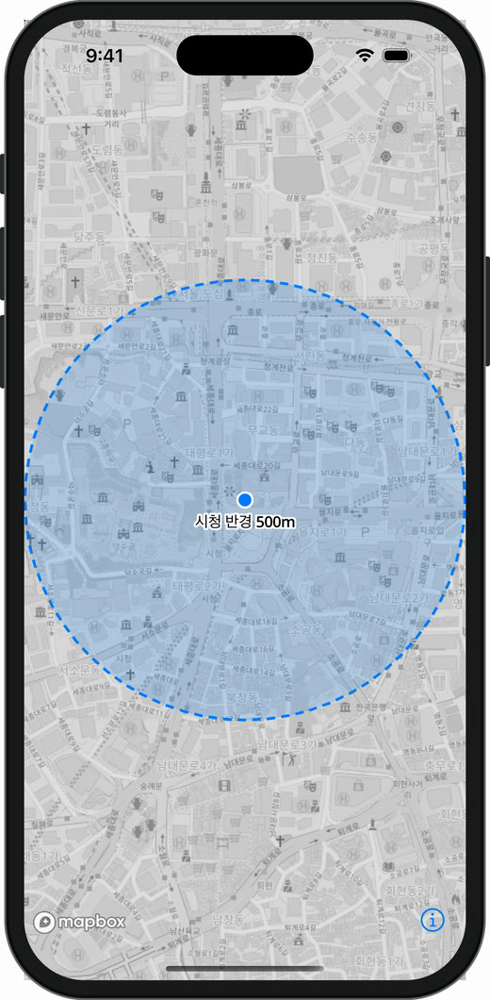</p>

- Mapbox에는 "원" Geometry가 없습니다. `Polygon(center:radius:vertices:)`(Turf)로 **원처럼 보이는 64각형**을 만들어 넣습니다. 2장에서 본 대로 화면에 그려지는 것은 결국 점, 선, 면뿐입니다.
- `circle` Layer로 원을 그리면 안 될까요? `circle` Layer의 반지름은 **화면 픽셀 단위**라서 줌을 바꿔도 크기가 그대로입니다. 실제 거리 500m를 표현하려면 Polygon이어야 합니다.
- 채우기와 테두리는 같은 Source를 `fill`과 `line` 두 Layer로 그린 것입니다.

### 클러스터링 - 많은 점을 묶어서 보여주기

점 400개를 그대로 찍으면 겹쳐서 아무것도 안 보입니다. GeoJSON Source에 `cluster`를 켜면 가까운 점을 Mapbox가 자동으로 묶어줍니다.

<details class="notion-toggle-list" markdown="1">
<summary>클러스터링 코드 보기</summary>

```swift
var source = GeoJSONSource(id: "points")
source.data = .featureCollection(points)   // 점 400개
source.cluster = true
source.clusterRadius = 50                  // 화면상 50pt 안의 점들을 하나로 묶음
source.clusterMaxZoom = 14                 // 줌 14보다 크면 묶지 않음
try mapView.mapboxMap.addSource(source)

// 1) 묶인 점: point_count에 따라 색과 크기를 계단식으로
var clusters = CircleLayer(id: "clusters", source: "points")
clusters.filter = Exp(.has) { "point_count" }
clusters.circleColor = .expression(
    Exp(.step) {
        Exp(.get) { "point_count" }
        UIColor.systemTeal     // ~19개
        20
        UIColor.systemOrange   // 20~49개
        50
        UIColor.systemRed      // 50개 이상
    }
)
clusters.circleRadius = .expression(
    Exp(.step) {
        Exp(.get) { "point_count" }
        16
        20
        22
        50
        30
    }
)
clusters.circleOpacity = .constant(0.85)
clusters.circleStrokeWidth = .constant(2)
clusters.circleStrokeColor = .constant(StyleColor(.white))
try mapView.mapboxMap.addLayer(clusters)

// 2) 묶인 개수 글자
var counts = SymbolLayer(id: "cluster-count", source: "points")
counts.filter = Exp(.has) { "point_count" }
counts.textField = .expression(Exp(.get) { "point_count_abbreviated" })
counts.textSize = .constant(13)
counts.textColor = .constant(StyleColor(.white))
try mapView.mapboxMap.addLayer(counts)

// 3) 묶이지 않은 개별 점
var single = CircleLayer(id: "unclustered", source: "points")
single.filter = Exp(.not) { Exp(.has) { "point_count" } }
single.circleColor = .constant(StyleColor(.systemTeal))
single.circleRadius = .constant(5)
single.circleStrokeWidth = .constant(1.5)
single.circleStrokeColor = .constant(StyleColor(.white))
try mapView.mapboxMap.addLayer(single)
```

</details>

<p style="text-align: center;">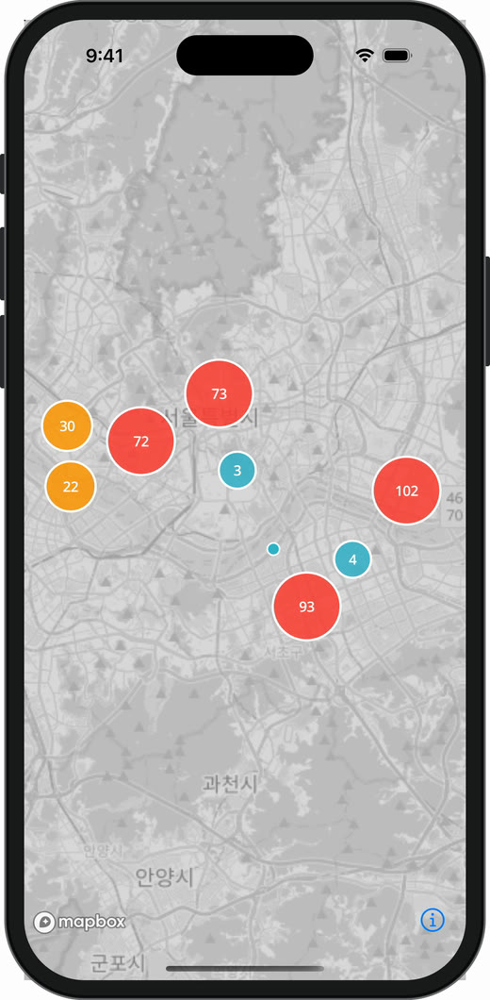</p>

- 클러스터를 켜면 Mapbox가 묶은 점을 **새로운 Feature**로 만들고 `point_count`, `point_count_abbreviated` 같은 properties를 붙여줍니다. 내가 넣은 데이터에는 없던 값입니다.
- 그래서 같은 Source를 `has point_count` filter로 **"묶인 점"과 "개별 점"으로 나눠** 서로 다른 Layer로 그립니다. filter로 Layer를 나누는 대표적인 예입니다.
- `step`은 `interpolate`와 달리 값을 섞지 않고 구간마다 딱 끊어서 정합니다. 개수 구간별 색처럼 "등급"을 표현할 때 씁니다.

### 히트맵 - 밀집도 표현

점 하나하나보다 "어디에 몰려 있는지"가 중요할 때 씁니다. 클러스터링과 같은 데이터를 Layer만 바꿔서 그린 결과입니다.

<details class="notion-toggle-list" markdown="1">
<summary>히트맵 코드 보기</summary>

```swift
var source = GeoJSONSource(id: "points")
source.data = .featureCollection(points)
try mapView.mapboxMap.addSource(source)

var heatmap = HeatmapLayer(id: "points-heat", source: "points")
heatmap.heatmapRadius = .expression(
    Exp(.interpolate) {
        Exp(.linear)
        Exp(.zoom)
        9
        6
        15
        30
    }
)
heatmap.heatmapIntensity = .constant(0.8)
heatmap.heatmapOpacity = .constant(0.8)
heatmap.heatmapColor = .expression(
    Exp(.interpolate) {
        Exp(.linear)
        Exp(.heatmapDensity)   // 그 픽셀의 밀집도 0~1
        0
        UIColor.clear
        0.2
        UIColor.systemBlue
        0.5
        UIColor.systemGreen
        0.8
        UIColor.systemYellow
        1
        UIColor.systemRed
    }
)
try mapView.mapboxMap.addLayer(heatmap)
```

</details>

<div style="display: flex; gap: 16px; flex-wrap: wrap; justify-content: center;">
  <figure style="width: 240px; margin: 0;">
    
    <figcaption style="font-size: 0.8em; text-align: center;">같은 점 400개 → circle + symbol</figcaption>
  </figure>
  <figure style="width: 240px; margin: 0;">
    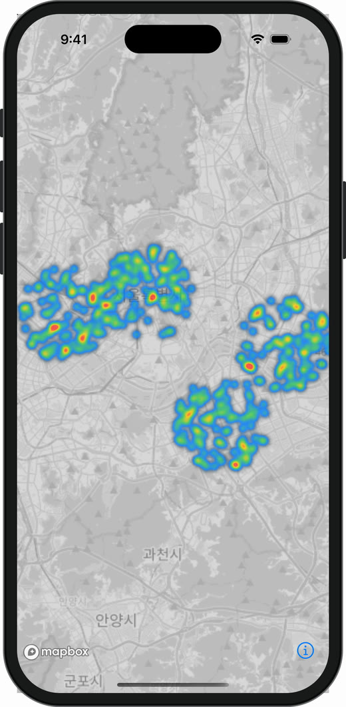
    <figcaption style="font-size: 0.8em; text-align: center;">같은 점 400개 → heatmap</figcaption>
  </figure>
</div>

&nbsp;

- `heatmap-density`는 Feature의 properties가 아니라 **픽셀마다 계산되는 밀집도**입니다. 그래서 이 Expression은 `heatmapColor`에서만 쓸 수 있습니다.
- 데이터는 클러스터링 예제와 똑같습니다. **데이터(Source)와 표현(Layer)의 분리**가 가장 잘 드러나는 예입니다.

### 3D 돌출 - FillExtrusionLayer

Polygon을 위로 솟게 그려 건물, 구역별 수치를 3D 막대처럼 보여줍니다. 높이를 properties에서 읽습니다.

<details class="notion-toggle-list" markdown="1">
<summary>3D 돌출 코드 보기</summary>

```swift
// 각 Polygon Feature에 "height"(미터) 속성이 들어 있다고 가정
var source = GeoJSONSource(id: "buildings")
source.data = .featureCollection(buildings)
try mapView.mapboxMap.addSource(source)

var extrusion = FillExtrusionLayer(id: "buildings-3d", source: "buildings")
extrusion.fillExtrusionHeight = .expression(Exp(.get) { "height" })   // 높이 = 데이터 값
extrusion.fillExtrusionBase = .constant(0)
extrusion.fillExtrusionOpacity = .constant(0.9)
extrusion.fillExtrusionColor = .expression(
    Exp(.interpolate) {
        Exp(.linear)
        Exp(.get) { "height" }
        20
        UIColor.systemTeal     // 낮을수록 청록
        200
        UIColor.systemIndigo   // 높을수록 남색
    }
)
try mapView.mapboxMap.addLayer(extrusion)

// 3D는 기울여야 보인다
mapView.mapboxMap.setCamera(to: CameraOptions(zoom: 15.3, bearing: -20, pitch: 58))
```

</details>

<p style="text-align: center;">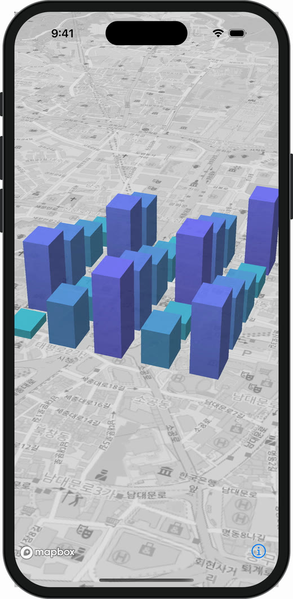</p>

- `interpolate`의 입력이 `zoom`이 아니라 `get height`입니다. **보간의 입력은 줌이든 데이터 값이든 숫자면 무엇이든** 될 수 있습니다.
- 캡처의 건물은 시청 주변에 높이 20 ~ 196m인 가상의 사각형 25개를 만들어 넣은 것입니다. 실제 서비스에서는 건물 데이터(Vector Source의 `building` source-layer 등)의 높이 값을 그대로 연결합니다.

&nbsp;

---

&nbsp;

## 정리

| 개념 | 한 줄 정의 | 비유 |
| --- | --- | --- |
| Geometry | 점, 선, 면 도형 | 모양 |
| GeoJSON | 지리 데이터를 담는 JSON 포맷 | 데이터 파일 형식 |
| Feature | Geometry + properties, 데이터 한 건 | 엑셀의 한 행 |
| Source | 데이터 묶음과 가져오는 방법 | 재료 |
| Layer | Source를 그리는 방법 | 레시피 |
| Expression | 데이터, 줌에 따라 스타일을 바꾸는 식 | 레시피의 조건문 |
| Style | Source + Layer 전체를 담은 설계도 | 요리책 |

Mapbox의 핵심은 **데이터(Source)와 표현(Layer)의 분리**입니다. 데이터는 한 번 넣어두고, 어떻게 보여줄지는 Layer와 Expression으로 자유롭게 바꿀 수 있습니다. 새로운 기능을 만들 때 "이건 데이터를 바꿔야 하는 일인가, 그리는 방법을 바꿔야 하는 일인가"를 먼저 생각해보면 어떤 API를 써야 할지 쉽게 정리됩니다.

&nbsp;

### 참고

- [Mapbox Style Specification](https://docs.mapbox.com/style-spec/guides/)
- [Mapbox Maps SDK for iOS](https://docs.mapbox.com/ios/maps/guides/)
- [RFC 7946 - The GeoJSON Format](https://datatracker.ietf.org/doc/html/rfc7946)
- [geojson.io](https://geojson.io) - GeoJSON을 직접 그려보고 확인할 수 있는 도구
