[이전 글]()에서 Mapbox로 지도에 무언가를 그리는 5가지 방법을 소개했습니다. 이번 글은 그중 가장 저수준인 **Custom Layer**를 처음부터 끝까지 파고들어 보겠습니다.

Custom Layer 공식 예제를 열어보면 `MTLDevice`, `shader`, `pipeline`, `projectionMatrix`, `clip space` 같은 단어가 쏟아집니다. 지도 SDK 글인데 갑자기 3D 그래픽스 용어가 나오는 이유는, Custom Layer가 **Mapbox가 지도를 그리는 GPU 작업 한가운데에 내 그래픽 코드를 끼워 넣는 기능**이기 때문입니다.

그래서 이 글은 Mapbox 이야기를 하기 전에 그래픽스 기초부터 순서대로 쌓아 올립니다.

**Part 1. 그래픽스 기초**

1. CPU와 GPU - 왜 GPU에게 그림을 맡길까
2. 모든 것은 삼각형이다
3. 렌더링 파이프라인
4. 셰이더란 무엇인가
5. 좌표의 여정과 행렬
6. Metal의 핵심 객체들
7. 깊이 버퍼와 블렌딩

**Part 2. Mapbox Custom Layer 해부**

8. Mapbox는 한 프레임을 어떻게 그릴까
9. CustomLayer와 CustomLayerHost
10. 생명주기 - renderingWillStart, render, renderingWillEnd
11. CustomLayerRenderParameters - 매 프레임 받는 카메라 정보
{: start="8"}

**Part 3. 예제와 실전**

12. 예제 1 - 서울, 부산, 광주를 잇는 삼각형
13. 예제 2 - 시간에 따라 깜빡이는 삼각형 (uniform, triggerRepaint)
14. 예제 3 - 공식 예제 읽기 (미터 단위 3D 큐브, Globe)
15. Source + Layer와 비교 - Custom Layer는 CPU를 덜 쓸까? (실측)
16. 실전에서 부딪히는 문제들
17. 아무것도 안 보일 때 체크리스트
{: start="12"}

> 이 글은 **Mapbox Maps SDK for iOS v11** 기준입니다. (소스 기준 11.34 ~ 11.35) `CustomLayer`는 `@_spi(Experimental)`로 표시된 실험적 API라 이후 버전에서 바뀔 수 있습니다.

&nbsp;

---

&nbsp;

# Part 1. 그래픽스 기초

## 1. CPU와 GPU - 왜 GPU에게 그림을 맡길까

아이폰 화면은 수백만 개의 픽셀로 이루어져 있고, 120Hz 화면이라면 1초에 120번 이 픽셀 전부의 색을 다시 정해야 합니다. 1초에 수억 번의 "이 픽셀은 무슨 색?" 계산이 필요한 셈입니다.

| | CPU | GPU |
| --- | --- | --- |
| 코어 | 소수의 똑똑한 코어 | 수천 개의 단순한 코어 |
| 잘하는 일 | 복잡한 분기, 순서가 중요한 로직 | 똑같은 계산을 엄청나게 많이, 동시에 |
| 비유 | 박사 몇 명 | 계산만 하는 초등학생 수천 명 |

픽셀 색 계산은 "같은 공식을 픽셀마다 반복"하는 일이라 GPU에 딱 맞습니다. 그래서 그림 그리기는 GPU에게 맡기고, CPU는 **GPU에게 일을 시키는 명령서**를 작성하는 역할을 합니다.

GPU에게 명령을 내리는 방법을 표준화한 것이 **그래픽스 API**입니다. OpenGL, Vulkan, DirectX 등이 있고, Apple 플랫폼에서는 **Metal**을 사용합니다. Mapbox iOS SDK도 내부적으로 Metal로 지도를 그리고, Custom Layer 역시 Metal 코드를 직접 작성하는 방식입니다.

&nbsp;

## 2. 모든 것은 삼각형이다

GPU가 직접 그릴 수 있는 도형(primitive)은 딱 세 가지입니다.

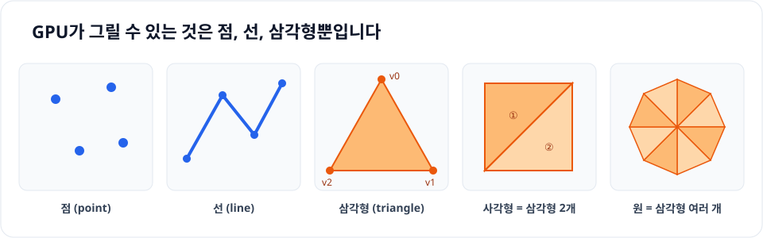

- **점(point)**, **선(line)**, **삼각형(triangle)**
- 사각형은 삼각형 2개, 원은 삼각형 여러 개를 이어 붙여서 만듭니다.
- 3D 큐브는 면 6개 × 삼각형 2개 = **삼각형 12개**, 꼭짓점으로 세면 12 × 3 = **36개**입니다.

Metal에서는 같은 세 가지 도형을 정점을 잇는 방식에 따라 5가지로 나눕니다. `drawPrimitives(type:)`에 넣는 값입니다.

| `MTLPrimitiveType` | 정점을 해석하는 방식 | 정점 6개(v0~v5)일 때 |
| --- | --- | --- |
| `.point` | 정점마다 점 하나 | 점 6개 |
| `.line` | 2개씩 끊어서 선 | 선 3개 (v0-v1, v2-v3, v4-v5) |
| `.lineStrip` | 이어서 연결된 선 | 선 5개 (v0-v1-v2-…-v5) |
| `.triangle` | 3개씩 끊어서 삼각형 | 삼각형 2개 |
| `.triangleStrip` | 앞의 두 정점을 재사용하며 이어 붙인 삼각형 | 삼각형 4개 |

예제 1은 `.triangle`, 15장 측정 예제와 공식 예제의 움직이는 점들은 `.point`를 씁니다.

이때 각 꼭짓점을 **정점(vertex)** 이라고 부릅니다. 정점은 위치뿐 아니라 색, 텍스처 좌표 같은 정보를 함께 가질 수 있습니다.

> 이전 글의 GeoJSON Geometry(Point, LineString, Polygon)와 비슷하다고 느꼈다면 정확합니다. Mapbox의 fill Layer도 내부적으로 Polygon을 삼각형으로 쪼개서(triangulation) GPU에 넘깁니다.

&nbsp;

## 3. 렌더링 파이프라인

정점 데이터가 화면의 픽셀이 되기까지 GPU는 정해진 단계를 차례로 거칩니다. 이 흐름을 **렌더링 파이프라인**이라고 합니다.

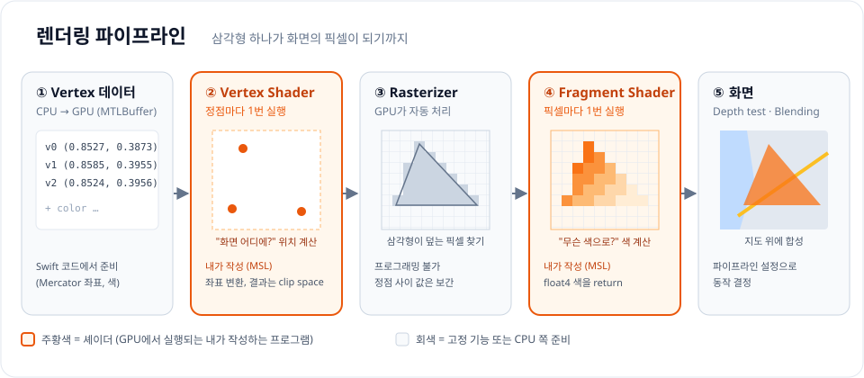

| 단계 | 하는 일 | 누가 |
| --- | --- | --- |
| ① Vertex 데이터 | 정점 좌표와 색을 GPU 메모리(`MTLBuffer`)에 올림 | 내가 (Swift) |
| ② Vertex Shader | 정점마다 실행되어 **화면 어디에 놓일지** 계산 | 내가 (셰이더) |
| ③ Rasterizer | 삼각형이 덮는 픽셀들을 찾고, 정점 사이 값을 보간 | GPU 자동 |
| ④ Fragment Shader | 픽셀마다 실행되어 **무슨 색일지** 계산 | 내가 (셰이더) |
| ⑤ 출력 병합 | 깊이 테스트, 블렌딩 후 최종 픽셀에 기록 | GPU (설정으로 제어) |

핵심은 **②와 ④만 내가 프로그래밍하고, 나머지는 GPU가 알아서** 한다는 점입니다.

### 보간 - 정점 3개의 값으로 수천 개 픽셀을 채우는 법

③ Rasterizer의 **보간(interpolation)** 은 Custom Layer 결과물을 이해하는 데 꼭 필요한 개념입니다.

정점 3개에 빨강, 파랑, 초록을 주면 삼각형 내부 픽셀은 거리에 따라 색이 섞인 그라데이션이 됩니다. 정점에만 값을 줬는데 그 사이 픽셀의 값이 자동으로 채워지는 것입니다.

```text
           v0 (빨강)
           /\
          /  \
         / P  \        P는 v0에 가까우니까 빨강이 많이 섞임
        /      \       P = 0.6 × 빨강 + 0.3 × 파랑 + 0.1 × 초록
       /________\
 v2 (초록)      v1 (파랑)
```

GPU는 픽셀 P가 세 꼭짓점에 각각 얼마나 가까운지를 비율(합이 1인 세 개의 가중치)로 계산합니다. 이 비율을 **무게중심 좌표(barycentric coordinates)** 라고 하며, Vertex Shader가 출력한 값(색, 텍스처 좌표 등) 전부를 이 비율로 섞어서 Fragment Shader에 넘겨줍니다. Fragment Shader 파라미터에 `[[stage_in]]`이 붙는 이유가 이것입니다. "앞 단계에서 보간되어 들어온 값"이라는 뜻입니다.

### 얼마나 많이 실행될까

| 단계 | 실행 횟수 (삼각형 1개 기준) |
| --- | --- |
| Vertex Shader | 정점 수만큼, **3번** |
| Fragment Shader | 삼각형이 덮는 픽셀 수만큼, 화면의 1/4을 덮으면 **약 100만 번** |

iPhone 15 Pro Max 화면은 1290 × 2796 ≈ 360만 픽셀입니다. 삼각형이 화면의 1/4만 덮어도 Fragment Shader는 한 프레임에 약 90만 번, 120Hz라면 1초에 1억 번 넘게 실행됩니다. 그래서 **Fragment Shader에 무거운 계산을 넣으면 바로 프레임이 떨어지고**, 정점마다 한 번이면 되는 계산은 Vertex Shader로 옮기는 것이 기본 최적화입니다.

&nbsp;

## 4. 셰이더란 무엇인가

**셰이더(Shader)** 는 GPU에서 실행되는 작은 함수입니다. 이름은 "음영(shade)을 계산한다"에서 왔지만, 지금은 GPU에서 돌아가는 프로그램 전반을 부르는 말입니다.

Metal에서는 **MSL(Metal Shading Language)** 이라는 C++ 기반 언어로 작성하고, `.metal` 파일에 넣으면 Xcode가 빌드할 때 함께 컴파일해줍니다.

<details class="notion-toggle-list" markdown="1">
<summary>MSL 셰이더 기본 구조 코드 보기</summary>

```cpp
#include <metal_stdlib>
using namespace metal;

// Vertex Shader와 Fragment Shader 사이에서 전달되는 데이터
struct RasterizerData {
    float4 position [[position]]; // 이 정점의 clip space 위치 (필수)
    float4 color;                 // Rasterizer가 픽셀마다 보간해서 넘겨줌
};

// ② 정점마다 1번 실행
vertex RasterizerData myVertex(uint vertexID [[vertex_id]],
                               constant float2 *positions [[buffer(0)]]) {
    RasterizerData out;
    out.position = float4(positions[vertexID], 0.0, 1.0);
    out.color = float4(1.0, 0.5, 0.0, 1.0);
    return out;
}

// ④ 픽셀마다 1번 실행
fragment float4 myFragment(RasterizerData in [[stage_in]]) {
    return in.color; // 이 픽셀의 색 (r, g, b, a)
}
```

</details>

처음 보면 낯선 문법이 몇 가지 있습니다.

| 문법 | 의미 |
| --- | --- |
| `vertex`, `fragment` | 이 함수가 어떤 셰이더인지 표시 |
| `float2`, `float4`, `float4x4` | 벡터, 행렬 타입. Swift의 `SIMD2<Float>`, `SIMD4<Float>`, `simd_float4x4`에 대응 |
| `[[vertex_id]]` | 지금 처리 중인 정점의 번호 (0, 1, 2, ...) |
| `[[buffer(0)]]` | Swift에서 `setVertexBuffer(_, index: 0)`으로 넘긴 데이터 |
| `[[position]]` | 이 값이 정점의 최종 위치라고 GPU에게 알려줌 |
| `[[stage_in]]` | Rasterizer가 보간해서 넘겨준 데이터 |
| `constant` | 읽기 전용 GPU 메모리 공간 (uniform, 정점 데이터를 읽기만 할 때) |
| `device` | 읽고 쓸 수 있는 GPU 메모리 공간 (셰이더가 버퍼에 결과를 쓸 때) |
| `thread`, `threadgroup` | 실행 하나만 쓰는 지역 변수 / compute 셰이더에서 그룹이 공유하는 메모리 |
| `[[point_size]]` | `.point`로 그릴 때 점의 크기(픽셀). Vertex Shader 출력에 지정 |
| `[[point_coord]]` | `.point`로 그릴 때 점 안에서의 위치(0~1). 사각형 점을 원으로 깎을 때 사용 |
| `discard_fragment()` | 이 픽셀은 그리지 않고 버림 |

셰이더 함수는 세 종류입니다. 이 글에서는 앞의 두 가지만 씁니다.

| 함수 종류 | 실행 단위 | 용도 |
| --- | --- | --- |
| `vertex` | 정점마다 | 위치 계산 (렌더링 파이프라인 ②) |
| `fragment` | 픽셀마다 | 색 계산 (렌더링 파이프라인 ④) |
| `kernel` | 내가 정한 개수만큼 | 그리기와 무관한 범용 계산(compute). 수십만 개 입자의 물리 계산 등 |

Swift 코드와 셰이더는 **`[[buffer(n)]]`의 번호로 연결**된다는 점이 가장 중요합니다. Swift에서 `index: 1`로 넘긴 데이터는 셰이더의 `[[buffer(1)]]` 파라미터로 들어옵니다.

### uniform - 모든 정점이 공유하는 값

정점마다 다른 값(위치, 색)과 달리 **모든 정점과 픽셀이 똑같이 사용하는 값**도 있습니다. 카메라 행렬, 현재 시간 같은 것들입니다. 그래픽스에서는 이런 값을 **uniform**이라고 부릅니다. Metal에서는 별도 문법 없이 버퍼로 넘기지만, 개념상 구분해 두면 공식 예제의 `GlobeUniforms`, `u_matrix` 같은 이름을 읽을 때 도움이 됩니다.

| 데이터 종류 | 예시 | 변하는 단위 | 넘기는 방법 |
| --- | --- | --- | --- |
| 정점 속성 (attribute) | 위치, 색 | 정점마다 다름 | `MTLBuffer` + `[[vertex_id]]`로 인덱싱 |
| uniform | MVP 행렬, 시간 | 한 번의 draw 안에서 모두 같음 | `setVertexBytes`, `setFragmentBytes` |
| 보간된 값 (varying) | Fragment로 넘어간 색 | 픽셀마다 다름 | Vertex Shader의 출력 → `[[stage_in]]` |

### 셰이더는 "병렬로 실행되는 순수 함수"다

Swift 코드에 익숙하다면 셰이더를 처음 짤 때 이 제약이 가장 낯섭니다.

- **실행끼리 서로를 모릅니다.** Fragment Shader 100만 번은 동시에, 순서 없이 실행됩니다. 옆 픽셀의 결과를 읽거나, "이전 프레임에 계산한 값"을 변수에 저장해 둘 수 없습니다.
- **입력이 같으면 출력도 같습니다.** 그래서 애니메이션을 하려면 시간처럼 "변하는 값"을 매 프레임 uniform으로 넣어줘야 합니다. 셰이더가 스스로 시간을 셀 수는 없습니다.
- **분기(if)는 비쌀 수 있습니다.** GPU는 여러 실행(thread)을 한 묶음으로 같은 명령을 동시에 처리합니다. 같은 묶음 안에서 어떤 픽셀은 if, 어떤 픽셀은 else로 가면 양쪽을 모두 실행하고 결과를 버리는 식으로 처리합니다. 그래서 셰이더에서는 `if` 대신 `mix`, `step`, `clamp` 같은 수학 함수를 자주 씁니다.

이 관점으로 보면 셰이더는 "**입력(정점 1개 또는 픽셀 1개 + uniform) → 출력(위치 또는 색)** 을 계산하는 작은 순수 함수"이고, GPU는 이 함수를 수십만 개 동시에 돌리는 기계입니다.

&nbsp;

## 5. 좌표의 여정과 행렬

Vertex Shader가 해야 할 일은 결국 "이 정점이 화면 어디에 있는가"를 계산하는 것입니다. 지도에서는 이 계산이 꽤 긴 여정을 거칩니다.

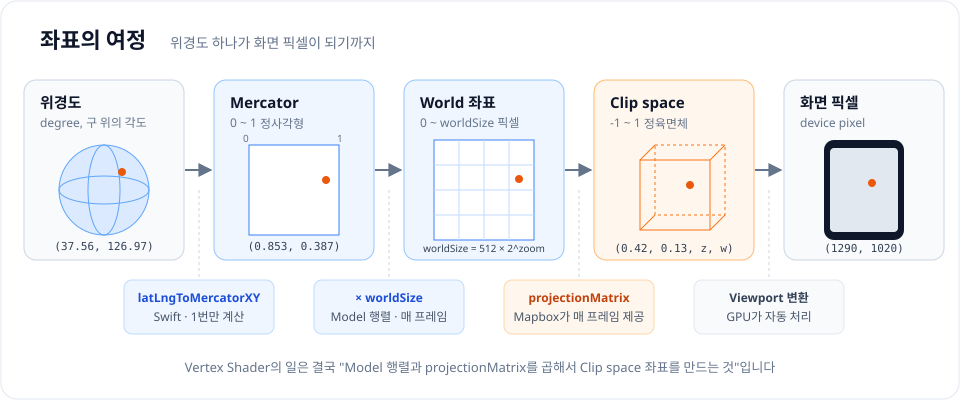

### ① 위경도 → Mercator (0 ~ 1)

지구는 둥글지만 화면은 평평합니다. 둥근 지구를 평면에 펼치는 방법을 **투영(projection)** 이라고 하고, 웹 지도는 대부분 **Web Mercator** 투영을 사용합니다.

Mapbox는 전 세계를 가로, 세로 0 ~ 1인 정사각형으로 펼친 Mercator 좌표를 사용합니다. 왼쪽 위가 (0, 0), 오른쪽 아래가 (1, 1)입니다.

```swift
let mercator = Projection.latLngToMercatorXY(coordinate: CLLocationCoordinate2D(latitude: 37.5665, longitude: 126.9780))
// mercator.x ≈ 0.8527, mercator.y ≈ 0.3873
```

이 값은 카메라와 상관없이 고정이므로 **한 번만 계산**해두면 됩니다.

Mercator 좌표에서 알아둘 성질이 두 가지 있습니다.

- **y는 아래로 갈수록 커집니다.** 북쪽(위)이 0, 남쪽(아래)이 1입니다. 수학 그래프와 반대이고 UIKit 좌표계와 같은 방향입니다. 서울(0.3873)이 부산(0.3955)보다 y가 작은 이유입니다.
- **위도가 높을수록 늘어납니다.** Mercator는 둥근 지구를 원통에 펼치기 때문에 위도 φ에서 길이가 `1 / cos(φ)`배로 늘어납니다. 적도에서 1km인 크기가 서울(약 37.5°)에서는 약 1.26배, 위도 60°에서는 2배로 그려집니다. 지도에서 그린란드가 아프리카만큼 커 보이는 이유입니다. "1000미터짜리 큐브"처럼 **미터 단위로 크기를 정하려면 위도별로 이 배율을 반영**해야 하고, 공식 예제가 `Projection.metersPerPoint(for:zoom:)`를 쓰는 이유가 바로 이것입니다.

### ② Mercator → World 좌표 (픽셀)

줌 레벨에 따라 전 세계 지도의 크기가 달라집니다. 줌 0에서 전 세계는 512 × 512 크기이고, 줌이 1 올라갈 때마다 2배씩 커집니다.

```swift
let worldSize = Projection.worldSize(scale: pow(2, zoom)) // 512 × 2^zoom
let worldX = mercator.x * worldSize
```

이 "World 좌표"가 Mapbox가 넘겨주는 `projectionMatrix`가 기대하는 입력입니다.

### ③ World → Clip space (-1 ~ 1)

GPU는 화면 크기를 모릅니다. 대신 **Clip space**라는 표준 공간을 사용합니다. x, y가 -1 ~ 1 범위 안에 들어온 점만 화면에 보이고, 밖으로 벗어난 점은 잘려나갑니다(clip). Vertex Shader의 출력인 `[[position]]`이 바로 이 Clip space 좌표입니다.

World 좌표를 Clip space로 바꾸려면 카메라 위치, 회전(bearing), 기울기(pitch), 시야각(field of view)을 모두 반영해야 합니다. 이 복잡한 계산은 **Mapbox가 매 프레임 `projectionMatrix`로 만들어서 넘겨줍니다.** 우리는 곱하기만 하면 됩니다.

### ④ Clip space → 화면 픽셀

마지막 변환은 GPU가 Viewport 설정을 보고 자동으로 처리합니다.

### 왜 행렬일까 - MVP

위 변환들을 매번 따로 계산하는 대신, 그래픽스에서는 각 변환을 **4×4 행렬**로 표현하고 곱해서 하나로 합칩니다.

| 행렬 | 역할 | 이 글에서 |
| --- | --- | --- |
| **M**odel | 물체 자신의 좌표 → World 좌표 (이동, 회전, 크기) | `× worldSize` 스케일 행렬 |
| **V**iew | World → 카메라 기준 좌표 | Mapbox `projectionMatrix`에 포함 |
| **P**rojection | 카메라 기준 → Clip space (원근감) | Mapbox `projectionMatrix`에 포함 |

```text
clipPosition = Projection × View × Model × vertexPosition
             = projectionMatrix × modelMatrix × vertexPosition
```

여기서 두 가지를 짚고 넘어가겠습니다.

- **왜 4×4일까?** 3D 좌표 (x, y, z)에 1을 붙여 (x, y, z, 1)로 만들면 이동(translation)까지 행렬 곱 하나로 표현할 수 있습니다. 이 네 번째 값을 `w`라고 하며, 이런 좌표를 **동차 좌표(homogeneous coordinates)** 라고 합니다. 셰이더에서 `float4(position, 0.0, 1.0)`처럼 마지막에 1을 붙이는 이유입니다.
- **곱하는 순서가 중요합니다.** 행렬 곱은 교환법칙이 성립하지 않습니다. 오른쪽부터 적용된다고 읽으면 됩니다. Model을 먼저 적용하고, 그다음 projectionMatrix를 적용합니다.

### 행렬 곱을 직접 계산해보기

막연하게 느껴지는 행렬을 숫자로 한 번 따라가 보겠습니다. 줌 6에서 `worldSize`는 512 × 2⁶ = 32768입니다. 예제 1에서 쓸 Model 행렬은 x, y만 `worldSize`배 키우는 **스케일 행렬**입니다.

```text
 Model 행렬               서울 정점 (Mercator)       결과 (World 좌표)
┌                    ┐   ┌        ┐               ┌          ┐
│ 32768   0    0   0 │   │ 0.8527 │               │ 27941.3  │
│   0   32768  0   0 │ × │ 0.3873 │       =       │ 12691.0  │
│   0     0    1   0 │   │ 0      │               │ 0        │
│   0     0    0   1 │   │ 1      │               │ 1        │
└                    ┘   └        ┘               └          ┘
```

0 ~ 1 범위의 Mercator 좌표가 줌 6 기준 픽셀 좌표 (27941, 12691)이 되었습니다. 이 값에 `projectionMatrix`를 한 번 더 곱하면 Clip space 좌표가 됩니다.

이동(translation)은 4번째 열에 들어갑니다. 공식 예제의 이동 행렬을 보면 위치값이 마지막 열(`columns.3`)에 들어 있습니다.

<details class="notion-toggle-list" markdown="1">
<summary>공식 예제의 이동 행렬 코드 보기</summary>

```swift
// 공식 예제 createTranslationMatrix 중
simd_float4x4([
    simd_float4(1, 0, 0, 0),                 // columns.0
    simd_float4(0, 1, 0, 0),                 // columns.1
    simd_float4(0, 0, 1, 0),                 // columns.2
    simd_float4(worldPos.x, worldPos.y, z, 1) // columns.3 ← 이동량
])
```

</details>

`w = 1`인 점에 이 행렬을 곱하면 `x + worldPos.x`, `y + worldPos.y`가 됩니다. 반대로 `w = 0`이면 이동이 적용되지 않습니다. 그래서 위치는 `w = 1`, 방향(벡터)은 `w = 0`으로 표현합니다.

### 열 우선(column-major) 저장

`simd_float4x4([a, b, c, d])` 이니셜라이저는 **열(column) 4개**를 받습니다. 위 코드는 눈으로 보기에는 행처럼 적혀 있지만 실제로는 열입니다. Metal, simd, Mapbox의 `projectionMatrix` 배열 모두 열 우선이라서, 16개 숫자를 4개씩 끊어 그대로 열로 넣으면 됩니다. 행 우선으로 착각해서 넣으면 행렬이 전치(transpose)되어 이동량이 엉뚱한 곳에 들어가고, 화면에 아무것도 안 보이게 됩니다.

### w와 원근 나눗셈

Vertex Shader의 출력이 `float3`가 아니라 `float4`인 이유도 여기서 나옵니다. GPU는 Vertex Shader가 끝난 직후 **x, y, z를 w로 나눕니다.** 이를 **원근 나눗셈(perspective divide)** 이라고 합니다.

```text
clip (x, y, z, w)  →  NDC (x/w, y/w, z/w)
```

지도를 기울이면(pitch) 멀리 있는 점일수록 `projectionMatrix`가 w를 크게 만들고, w로 나누면서 x, y가 작아집니다. **멀리 있는 것이 작게 보이는 원근감**이 이 나눗셈 한 번으로 만들어집니다. 우리가 직접 나눌 필요는 없고, `projectionMatrix`를 곱한 결과를 그대로 넘기기만 하면 됩니다.

&nbsp;

## 6. Metal의 핵심 객체들

Metal 코드를 처음 보면 `MTL`로 시작하는 타입이 너무 많아서 길을 잃기 쉽습니다. 역할별로 정리하면 다음과 같습니다.

| 객체 | 역할 | 언제 만드나 |
| --- | --- | --- |
| `MTLDevice` | GPU 그 자체. 다른 모든 객체를 만드는 공장 | Mapbox가 넘겨줌 |
| `MTLLibrary` / `MTLFunction` | 컴파일된 `.metal` 파일 / 그 안의 셰이더 함수 하나 | 시작할 때 1번 |
| `MTLRenderPipelineState` | "어떤 셰이더로, 어떤 픽셀 포맷에, 어떻게 블렌딩할지"를 묶은 설정. 만들기 비쌈 | 시작할 때 1번 |
| `MTLDepthStencilState` | 깊이 테스트 규칙 | 시작할 때 1번 |
| `MTLBuffer` | GPU가 읽을 수 있는 메모리 (정점 데이터 등) | 시작할 때 또는 데이터 바뀔 때 |
| `MTLCommandBuffer` | 이번 프레임에 GPU가 할 일 목록 | Mapbox가 매 프레임 넘겨줌 |
| `MTLRenderPassDescriptor` | 어디에 그릴지 (그릴 대상 텍스처) | Mapbox가 매 프레임 넘겨줌 |
| `MTLRenderCommandEncoder` | Command Buffer에 그리기 명령을 기록하는 펜 | 매 프레임 내가 생성 |

음식점에 비유하면 다음과 같습니다.

- `MTLDevice`는 **주방**, `MTLRenderPipelineState`는 미리 정해둔 **레시피**, `MTLBuffer`는 손질해 둔 **재료**입니다.
- `MTLCommandBuffer`는 이번 타임의 **주문서**이고, `MTLRenderCommandEncoder`로 주문서에 "이 레시피로, 이 재료를 써서, 삼각형 3개 그려주세요"라고 적습니다.
- 주문서를 주방에 넘기는 일(`commit`)은 Mapbox가 다른 Layer 주문까지 모두 적은 뒤에 합니다.

> 비싼 객체(Pipeline, Buffer)는 **한 번만 만들고**, 매 프레임에는 **기록(encode)만** 하는 것이 Metal 성능의 기본 원칙입니다. 이 원칙이 그대로 Custom Layer의 생명주기 구조가 됩니다.

### Encoder의 draw는 "기록"일 뿐이다

처음 Metal을 배울 때 가장 많이 헷갈리는 부분입니다. `encoder.drawPrimitives(...)`를 호출하는 순간 삼각형이 그려지는 것이 아닙니다. Command Buffer에 **"나중에 이걸 그려라"라는 명령이 한 줄 추가**될 뿐입니다. 실제로 GPU가 그리는 것은 Command Buffer가 `commit`된 이후입니다.

이 차이 때문에 두 가지 결과가 생깁니다.

- `render()` 안에서 `print`를 찍어도 그 시점에는 아직 아무것도 그려지지 않은 상태입니다.
- draw 호출 하나하나를 **draw call**이라고 부르며, draw call마다 상태 확인과 명령 기록 비용이 듭니다. 점 1000개를 draw call 1000번으로 그리는 것보다, 버퍼 하나에 담아 draw call 1번으로 그리는 것이 훨씬 빠릅니다.

### Render Pass - 어디에, 어떻게 이어 그릴까

`MTLRenderPassDescriptor`는 "이번에 그릴 도화지"를 설명합니다.

| 항목 | 의미 |
| --- | --- |
| `colorAttachments[0].texture` | 색을 그릴 텍스처 (최종적으로 화면에 보일 이미지) |
| `depthAttachment`, `stencilAttachment` | 깊이, 스텐실 값을 저장할 텍스처 |
| `loadAction` | 그리기 시작할 때 기존 내용을 어떻게 할지: `.clear`(지움), `.load`(유지), `.dontCare` |
| `storeAction` | 다 그린 뒤 결과를 저장할지: `.store`(저장), `.dontCare`(버림), `.multisampleResolve`, `.storeAndMultisampleResolve`(멀티샘플 안티앨리어싱용), `.unknown`, `.customSampleDepthStore` |

Custom Layer에서 **반드시 Mapbox가 넘겨준 descriptor로 Encoder를 만들어야 하는 이유**가 여기 있습니다. Mapbox의 descriptor는 이미 그려진 지도(바다, 도로)를 유지하도록 설정되어 있습니다. 실제로 찍어보면 color와 depth 모두 `loadAction`이 `.load`입니다. (12장에서 확인합니다) 만약 직접 descriptor를 만들어 `loadAction = .clear`로 그리면, 내 삼각형만 남고 그 아래 지도는 지워집니다.

### CPU와 GPU는 동시에 일한다

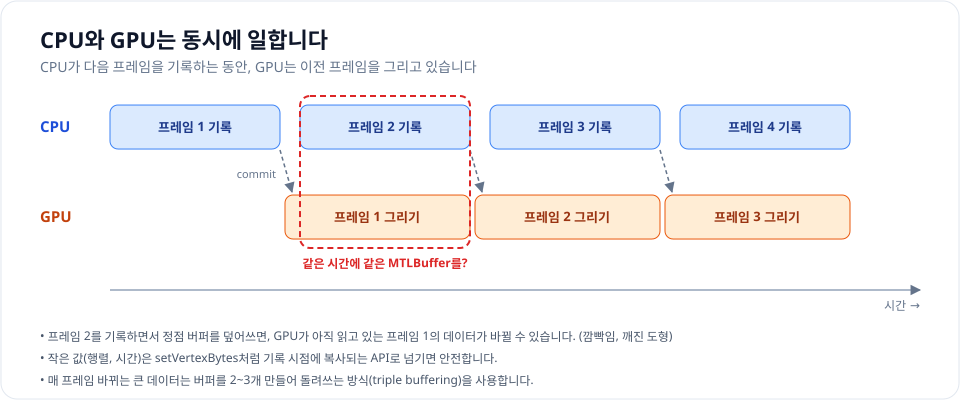

CPU가 `commit`하면 GPU가 그 프레임을 그리기 시작하고, CPU는 기다리지 않고 바로 **다음 프레임을 기록**합니다. 두 프로세서가 한 프레임씩 엇갈려서 동시에 일하는 구조입니다.

이 구조에서 생기는 함정이 있습니다. 매 프레임 같은 `MTLBuffer`의 내용을 CPU에서 덮어쓰면, GPU가 아직 읽고 있는 이전 프레임의 데이터가 중간에 바뀔 수 있습니다. 이 경우 도형이 깜빡이거나 깨집니다.

- **작은 데이터**(행렬, 시간 등 4KB 미만)는 `setVertexBytes`, `setFragmentBytes`로 넘깁니다. 기록하는 시점에 값이 복사되기 때문에 안전합니다. 예제에서 MVP 행렬을 이렇게 넘기는 이유입니다.
- **큰 데이터가 매 프레임 바뀐다면** 버퍼를 2~3개 만들어 돌려쓰는 **triple buffering**을 사용합니다. 프레임 1은 버퍼 A, 프레임 2는 버퍼 B, 프레임 3은 버퍼 C를 쓰고, GPU가 A를 다 읽은 뒤에 다시 A를 씁니다.
- **가끔 바뀐다면** 새 `MTLBuffer`를 만들어 교체하는 것이 가장 단순합니다.

&nbsp;

## 7. 깊이 버퍼와 블렌딩

파이프라인 마지막 ⑤ 단계에서 "이 픽셀을 정말 칠할지, 칠한다면 기존 색과 어떻게 섞을지"를 결정합니다. Custom Layer 코드에서 `depthStencilState`와 블렌딩 설정이 바로 이 단계를 제어합니다.

### 깊이 버퍼 (Depth buffer)

화면의 픽셀마다 **"지금까지 그려진 것 중 가장 가까운 것의 거리"** 를 0 ~ 1 값으로 저장해 둔 텍스처입니다.

```text
픽셀 P에 이미 그려진 건물:   depth = 0.40
새로 그리려는 큐브의 면:      depth = 0.55   (더 멂)

depthCompareFunction = .less  →  0.55 < 0.40 ? 아니오  →  안 그림 (건물에 가려짐)
```

| 설정 | 의미 | 언제 |
| --- | --- | --- |
| `depthCompareFunction = .less` | 기존보다 가까울 때만 그림 | 3D 물체 (큐브, 모델) |
| `isDepthWriteEnabled = true` | 그린 뒤 내 깊이를 기록 | 뒤에 그려질 것을 가리고 싶을 때 |
| `depthCompareFunction = .always` | 비교 없이 항상 그림 | 평평한 2D 도형 (예제 1) |

비교 함수(`MTLCompareFunction`)는 8가지입니다. `.never`(항상 버림), `.less`, `.equal`, `.lessEqual`, `.greater`, `.notEqual`, `.greaterEqual`, `.always`(항상 통과). "새 깊이 ○ 기존 깊이"가 참일 때 그립니다.

Custom Layer는 Mapbox와 **같은 깊이 버퍼를 공유**합니다. 그래서 깊이 테스트를 켜면 Mapbox의 3D 건물(fill-extrusion) 뒤에 있는 내 큐브가 자연스럽게 가려집니다. 반대로 평평한 도형에서 깊이 테스트를 켜면 지면과 깊이 값이 거의 같아 픽셀이 지글지글 깨져 보이는 **z-fighting**이 생길 수 있어서, 예제 1에서는 `.always`로 끕니다.

### 블렌딩 (Blending)

반투명한 색을 이미 그려진 색 위에 칠할 때 두 색을 섞는 공식입니다.

```text
결과 = 새 색(source) × sourceFactor + 기존 색(destination) × destinationFactor
```

예제 1의 설정(`source = .one`, `destination = .oneMinusSourceAlpha`)으로 흰 바탕 위에 투명도 0.7인 주황색(1.0, 0.35, 0.2)을 칠해 보겠습니다.

```text
① Fragment Shader가 rgb에 alpha를 미리 곱해서 반환 (premultiplied)
   source = (1.0 × 0.7, 0.35 × 0.7, 0.2 × 0.7) = (0.70, 0.245, 0.14), alpha 0.7

② 블렌딩
   결과 = source × 1 + 흰색(1, 1, 1) × (1 - 0.7)
        = (0.70 + 0.30, 0.245 + 0.30, 0.14 + 0.30)
        = (1.00, 0.545, 0.44)   ← 흰 바탕에 70% 주황이 비친 색
```

블렌딩 공식에 들어가는 값은 두 가지 종류에서 고릅니다.

| 항목 | 종류 |
| --- | --- |
| 섞는 비율 `MTLBlendFactor` | `.zero`, `.one`, `.sourceColor`, `.oneMinusSourceColor`, `.sourceAlpha`, `.oneMinusSourceAlpha`, `.destinationColor`, `.oneMinusDestinationColor`, `.destinationAlpha`, `.oneMinusDestinationAlpha`, `.sourceAlphaSaturated`, `.blendColor` 등 |
| 섞는 연산 `MTLBlendOperation` | `.add`(기본), `.subtract`, `.reverseSubtract`, `.min`, `.max` |

rgb에 alpha를 **미리 곱해두는 방식을 premultiplied alpha**라고 합니다. 일반 방식(`source = .sourceAlpha`)과 결과는 같지만, 여러 반투명 레이어를 겹치거나 텍스처를 확대, 축소할 때 가장자리에 검은 테두리가 생기지 않아 그래픽스에서 널리 쓰입니다. 공식 예제도 `destinationRGBBlendFactor = .oneMinusSourceAlpha`에 source는 기본값(`.one`)을 사용하는 premultiplied 방식입니다. 중요한 것은 **셰이더 출력과 블렌딩 설정이 짝을 이뤄야 한다**는 점입니다. 셰이더는 premultiplied로 내보내는데 블렌딩은 `.sourceAlpha`로 설정하면 alpha가 두 번 곱해져 색이 어둡게 나옵니다.

실제로 예제 1의 셰이더(premultiplied 출력)는 그대로 두고 `sourceRGBBlendFactor`만 바꿔서 실행해 보면 차이가 바로 보입니다.

<div style="display: flex; gap: 16px; flex-wrap: wrap; justify-content: center;">
  <figure style="width: 240px; margin: 0;">
    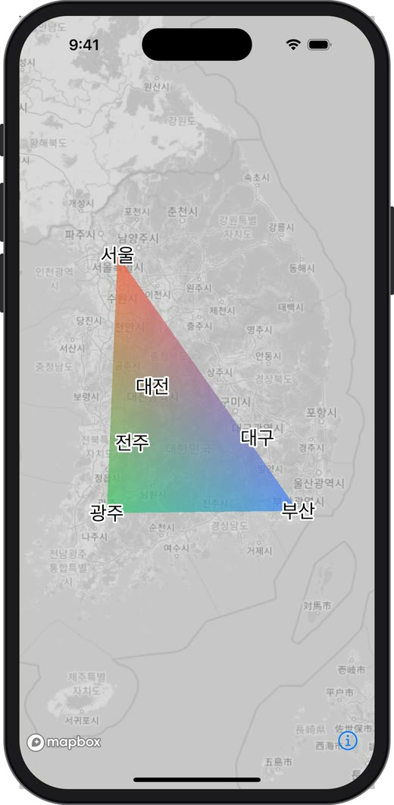
    <figcaption style="font-size: 0.8em; text-align: center;">셰이더와 짝이 맞음: source = .one</figcaption>
  </figure>
  <figure style="width: 240px; margin: 0;">
    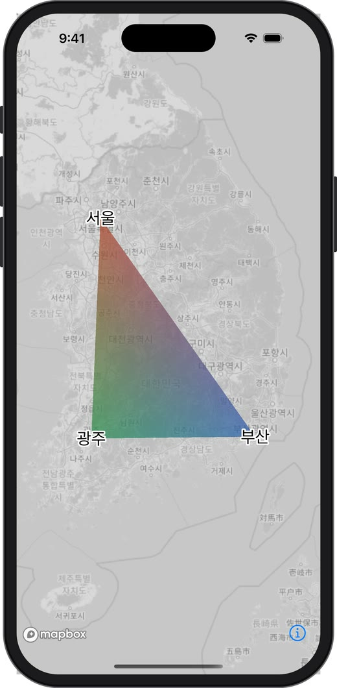
    <figcaption style="font-size: 0.8em; text-align: center;">짝이 안 맞음: source = .sourceAlpha</figcaption>
  </figure>
</div>

&nbsp;

오른쪽은 rgb에 alpha(0.7)가 한 번 더 곱해져서 0.7 × 0.7 = 0.49만큼만 색이 들어가고, 그만큼 어둡고 탁해졌습니다. 에러는 나지 않기 때문에 "색이 왜 칙칙하지?" 싶을 때 가장 먼저 의심할 부분입니다.

&nbsp;

---

&nbsp;

# Part 2. Mapbox Custom Layer 해부

## 8. Mapbox는 한 프레임을 어떻게 그릴까

Custom Layer API를 보기 전에, Mapbox 자신이 지도를 어떻게 그리는지부터 보겠습니다. 이 그림이 머릿속에 있으면 Custom Layer의 모든 규칙(왜 commit하면 안 되는지, 왜 descriptor를 그대로 써야 하는지, 왜 triggerRepaint가 필요한지)이 자연스럽게 이해됩니다.

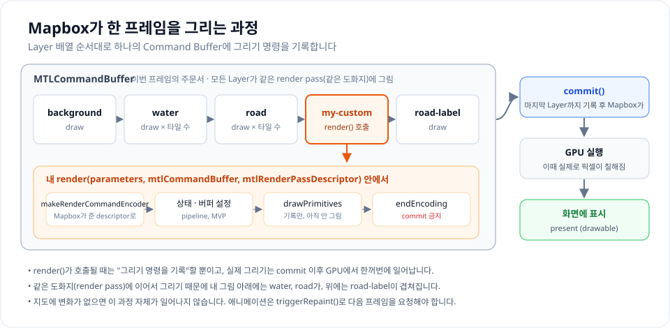

1. **다시 그릴 이유가 생깁니다.** 카메라가 움직였거나, 타일이 새로 도착했거나, Source 데이터가 바뀌었거나, `triggerRepaint()`가 호출된 경우입니다. 이유가 없으면 Mapbox는 아무것도 그리지 않습니다.
2. **Mapbox가 Command Buffer 하나를 준비합니다.** 이번 프레임의 모든 그리기 명령이 여기에 기록됩니다.
3. **Layer 배열을 아래에서부터 순서대로 돌면서** 각 Layer의 그리기 명령을 기록합니다. Vector Tile 기반 Layer는 화면에 보이는 타일마다 draw call이 생깁니다.
4. **내 Custom Layer 차례가 오면** Mapbox는 `render(parameters, mtlCommandBuffer, mtlRenderPassDescriptor)`를 호출합니다. 나는 같은 Command Buffer에, 같은 도화지(render pass)를 이어서 쓰는 Encoder를 만들어 내 명령을 끼워 넣습니다.
5. 내 차례가 끝나면 Mapbox가 나머지 Layer(라벨 등)를 이어서 기록합니다.
6. **마지막 Layer까지 기록이 끝나면 Mapbox가 commit**하고, GPU가 실제로 그린 뒤 화면에 표시합니다.

이 흐름에서 Custom Layer의 규칙이 그대로 나옵니다.

| 규칙 | 이유 |
| --- | --- |
| Command Buffer를 commit하지 않는다 | 내 뒤의 Layer들이 아직 기록되지 않았음 |
| Mapbox가 준 descriptor로 Encoder를 만든다 | 앞 Layer들이 그린 내용을 유지한 채 이어 그려야 함 |
| `endEncoding()`을 반드시 호출한다 | 다음 Layer가 Encoder를 만들 수 있어야 함 |
| `render()`는 가볍게 유지한다 | 프레임 전체 기록 시간에 그대로 더해짐 |
| 애니메이션은 `triggerRepaint()` | 변화가 없으면 프레임 자체가 시작되지 않음 |
| Layer 위치(`.below`, `slot`)가 곧 그려지는 순서 | Layer 배열을 순서대로 돌기 때문 |

&nbsp;

## 9. CustomLayer와 CustomLayerHost

Custom Layer는 두 부분으로 나뉩니다.

- **`CustomLayer`**: Style의 Layer 배열에 들어가는 Layer 정의 (구조체)
- **`CustomLayerHost`**: 실제로 Metal 코드를 실행하는 렌더러 (내가 구현하는 프로토콜)

SDK 소스에서 `CustomLayer`의 정의를 보면 다음과 같습니다.

<details class="notion-toggle-list" markdown="1">
<summary>CustomLayer 구조체 정의 코드 보기</summary>

```swift
@_spi(Experimental)
public struct CustomLayer: Layer, Equatable {
    public var id: String
    public let type: LayerType = .custom
    public var slot: Slot?
    public var minZoom: Double?
    public var maxZoom: Double?
    public var visibility: Value<Visibility> = .constant(.visible)
    public var renderer: CustomLayerHost
}
```

</details>

이전 글에서 배운 `CircleLayer`, `FillLayer`와 비교해 보면 차이가 분명합니다.

| | 일반 Layer (Circle, Fill 등) | CustomLayer |
| --- | --- | --- |
| Source | 필요함 | **없음** |
| 그리는 방법 | paint, layout 속성 (Expression) | **renderer가 Metal로 직접** |
| Layer 순서, slot, minZoom, maxZoom, visibility | 있음 | 있음 |

즉 Custom Layer는 **Layer 배열에서 한 자리를 차지한다는 점은 같지만, 그 자리에서 무엇을 그릴지는 전부 내가 정하는** Layer입니다. Layer 순서가 있기 때문에 도로 위, 라벨 아래처럼 지도 요소 사이에 내 그래픽을 끼워 넣을 수 있습니다. 이것이 지도 위에 `UIView`나 별도의 `MTKView`를 겹쳐 올리는 방식과 가장 큰 차이입니다.

### 지도 위에 MTKView를 겹치면 안 될까?

"Metal로 그릴 거면 그냥 지도 위에 투명한 `MTKView`를 올려도 되지 않나?"라는 생각이 들 수 있습니다. 가능은 하지만 차이가 큽니다.

| | 지도 위에 MTKView 오버레이 | Custom Layer |
| --- | --- | --- |
| 그려지는 위치 | 항상 지도 전체(라벨 포함) **위** | Layer 순서 안 원하는 위치 (도로 위, 라벨 아래 등) |
| 카메라 동기화 | 카메라 이벤트를 받아 직접 맞춰야 해서 한 프레임씩 밀리기 쉬움 | 같은 프레임 안에서 같은 행렬로 그려서 항상 일치 |
| 3D 건물과 가려짐 | 깊이 정보가 없어 처리 불가 | 같은 깊이 버퍼를 공유해 자연스럽게 가려짐 |
| 렌더링 비용 | 화면 합성(compositing)이 한 번 더 필요 | 지도와 같은 도화지에 한 번에 그림 |

### 언제 Custom Layer를 써야 할까

Custom Layer는 강력하지만 가장 많은 일을 직접 해야 합니다. 원하는 결과를 다른 Layer로 만들 수 있다면 그쪽이 거의 항상 낫습니다.

| 하고 싶은 것 | 먼저 고려할 방법 |
| --- | --- |
| 마커, 아이콘, 라벨 | Annotation, `SymbolLayer` |
| 데이터 수천 개를 값에 따라 다른 색, 크기로 | `CircleLayer`, `SymbolLayer` + Expression |
| 영역 채우기, 경로 | `FillLayer`, `LineLayer` |
| 3D 건물, 돌출된 면 | `FillExtrusionLayer` |
| 3D 모델(glTF) 배치 | `ModelLayer` |
| 밀집도 표현 | `HeatmapLayer` |
| 버튼, 말풍선 같은 UI | View Annotation |
| **위 방법으로 표현할 수 없는 그래픽** | **Custom Layer** |

Custom Layer가 진짜 필요한 경우는 이런 것들입니다.

- 바람, 해류처럼 **수만 개의 입자가 매 프레임 움직이는 시각화** (파티클)
- 물결, 빛 번짐, 왜곡 같은 **셰이더 효과**
- 레이더 스캔, 소나 영역처럼 **시간에 따라 변하는 특수한 도형**
- 직접 만든 3D 메시, 포인트 클라우드
- 이미 Metal로 작성된 렌더링 엔진을 지도에 통합

### Custom Layer가 해주지 않는 것들

일반 Layer에서 당연하게 쓰던 기능들이 Custom Layer에서는 동작하지 않습니다. 직접 구현해야 하는 목록이라고 보면 됩니다.

- **`queryRenderedFeatures`로 조회되지 않습니다.** Mapbox는 내가 무엇을 그렸는지 모릅니다. 탭 감지는 직접 해야 합니다. (16장에서 다룹니다)
- **Expression, data-driven styling이 없습니다.** 데이터에 따라 색을 바꾸려면 정점 데이터나 uniform으로 직접 넘겨야 합니다.
- **라벨 충돌 회피(collision)가 없습니다.** 내 그래픽은 라벨 배치에 영향을 주지 않습니다.
- **투영, 지형 대응을 직접 해야 합니다.** Globe, terrain에서 올바른 위치에 그리려면 `parameters.projection`, `elevationData`를 직접 활용해야 합니다.
- **실험적 API입니다.** `@_spi(Experimental)`이므로 SDK 업데이트 때 바뀔 수 있습니다.

&nbsp;

## 10. 생명주기 - renderingWillStart, render, renderingWillEnd

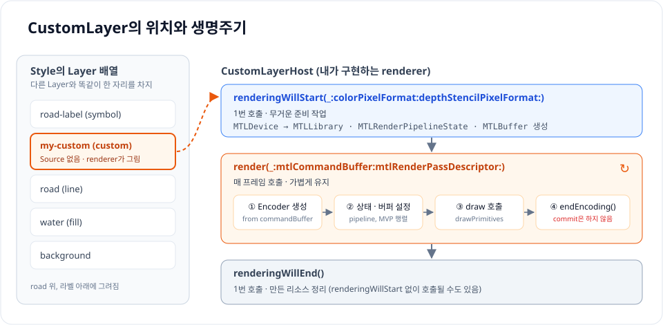

`CustomLayerHost` 프로토콜의 필수 메서드는 3개입니다.

<details class="notion-toggle-list" markdown="1">
<summary>CustomLayerHost 프로토콜 코드 보기</summary>

```swift
protocol CustomLayerHost: NSObjectProtocol {
    func renderingWillStart(_ metalDevice: MTLDevice,
                            colorPixelFormat: UInt,
                            depthStencilPixelFormat: UInt)

    func render(_ parameters: CustomLayerRenderParameters,
                mtlCommandBuffer: MTLCommandBuffer,
                mtlRenderPassDescriptor: MTLRenderPassDescriptor)

    func renderingWillEnd()
}
```

</details>

### renderingWillStart - 한 번, 무거운 준비

렌더링을 처음 시작하기 전(또는 앱이 백그라운드에서 돌아왔을 때) 호출됩니다. Mapbox가 사용하는 `MTLDevice`와 픽셀 포맷을 넘겨주므로, 여기서 앞에서 말한 "비싼 객체"들을 만듭니다.

- `makeDefaultLibrary()`로 셰이더 함수 불러오기
- `MTLRenderPipelineState` 만들기
- 정점 데이터를 담은 `MTLBuffer` 만들기

`colorPixelFormat`, `depthStencilPixelFormat`이 `MTLPixelFormat`이 아니라 `UInt`인 이유는 헤더에서 Metal을 import하지 않기 위해서입니다. `MTLPixelFormat(rawValue:)`로 변환해서 씁니다. Pipeline의 픽셀 포맷은 **반드시 Mapbox가 넘겨준 값과 같아야** 합니다. Mapbox가 그리는 도화지에 함께 그리기 때문입니다.

### render - 매 프레임, 가볍게

지도가 다시 그려질 때마다 호출됩니다. 여기서 하는 일은 정해져 있습니다.

1. `mtlCommandBuffer.makeRenderCommandEncoder(descriptor: mtlRenderPassDescriptor)`로 Encoder 만들기
2. Pipeline, Buffer, 행렬 같은 상태 설정
3. `drawPrimitives` 호출
4. `endEncoding()`으로 기록 끝내기

여기서 주의할 점이 있습니다. SDK 헤더 주석에도 적혀 있는 내용입니다.

> Command Buffer는 **commit 하면 안 됩니다.** 내 Layer 뒤에 그려질 다른 Layer들의 명령이 아직 기록되지 않았기 때문입니다.

`render`는 매 프레임 호출되므로 여기서 Pipeline이나 Buffer를 새로 만들면 프레임이 떨어집니다.

### renderingWillEnd - 한 번, 정리

렌더링이 끝날 때 호출되며 만든 리소스를 정리합니다. 헤더 주석에 따르면 **`renderingWillStart`가 호출되지 않았는데도 호출될 수 있으므로**, 정리 코드는 리소스가 없는 상황도 안전하게 처리해야 합니다.

### 선택 메서드

SDK 헤더(`MBMCustomLayerHost.h`)에 정의된 메서드를 모두 정리하면 다음과 같습니다.

| 메서드 | 필수 | 그래픽스 API | 역할 |
| --- | --- | --- | --- |
| `renderingWillStart(_:colorPixelFormat:depthStencilPixelFormat:)` | 필수 | Metal | 리소스 준비 |
| `render(_:mtlCommandBuffer:mtlRenderPassDescriptor:)` | 필수 | Metal | 매 프레임 그리기 |
| `renderingWillEnd()` | 필수 | 공통 | 정리 |
| `prerender(_:mtlCommandBuffer:)` | 선택 (실험적) | Metal | 본 렌더링 전에 실행. 반환하는 설정으로 렌더링 방식 지정 |
| `renderToTile(_:mtlRenderCommandEncoder:)` | 선택 (실험적) | Metal | 지형(terrain)이나 Globe 위에 덮어씌울 타일 텍스처에 그리기 |
| `renderingWillStartOpenGL()` | 선택 | OpenGL | OpenGL 백엔드일 때 준비 |
| `renderOpenGL(_:)` | 선택 | OpenGL | OpenGL 백엔드일 때 그리기 |
| `openGLContextLost()` | 선택 | OpenGL | OpenGL 컨텍스트가 사라졌을 때 |

iOS의 Mapbox는 Metal로 그리므로 OpenGL 메서드는 구현하지 않아도 됩니다. Apple이 OpenGL을 deprecated 했기 때문에 선택 메서드로 남아 있습니다. `prerender`, `renderToTile`은 지형, Globe 위에 텍스처처럼 덮어 그릴 때 쓰는 실험적 기능이라 이후 딥다이브 주제로 남겨두겠습니다.

&nbsp;

## 11. CustomLayerRenderParameters - 매 프레임 받는 카메라 정보

`render`의 첫 번째 파라미터에는 지금 이 프레임의 카메라 정보가 담겨 있습니다.

| 프로퍼티 | 의미 |
| --- | --- |
| `width`, `height` | 지도 뷰 크기 (**point 단위**) |
| `latitude`, `longitude` | 카메라 중심 좌표 |
| `zoom` | 줌 레벨 |
| `bearing` | 회전 각도 (북쪽 기준 시계 방향) |
| `pitch` | 기울기 |
| `fieldOfView` | 시야각 (degree) |
| `projectionMatrix` | World 좌표 → Clip space 변환 행렬. `[NSNumber]` 16개 |
| `depthRange` | 3D 콘텐츠에 쓸 깊이 범위 |
| `elevationData` | 지형(terrain)이 켜져 있을 때 고도 정보 |
| `renderToTilesIDs` | (실험적) 지형, Globe에 덮어씌울 타일 목록. `renderToTile`과 함께 사용 |
| `projection` | 현재 지도 투영(Mercator, Globe)에 맞는 변환 도우미 |

`projection`(`CustomLayerMapProjection`)이 제공하는 도우미는 4가지입니다. 14장의 공식 예제가 Globe에 대응할 때 이것들을 씁니다.

| 메서드 | 역할 |
| --- | --- |
| `convertMercatorModelMatrix(forMatrix:ignoreDistortion:)` | Mercator 기준으로 만든 Model 행렬을 현재 투영에 맞게 변환 |
| `getModelMatrix()` | 현재 투영의 로컬 좌표(Globe면 지구 중심 기준 ECEF)를 World 좌표로 바꾸는 행렬 |
| `getTransitionPhase()` | 현재 투영과 Mercator 사이 전환 진행도 0 ~ 1 (Globe 상태면 1, 확대할수록 0으로) |
| `getTransitionMatrix()` | 전환 중에 Mercator 쪽 위치를 보간 목적지로 쓰기 위한 행렬 |

가장 많이 쓰는 것은 `projectionMatrix`와 `zoom`입니다. `projectionMatrix`는 `[NSNumber]` 16개로 오기 때문에 `simd_float4x4`로 바꿔서 사용합니다. 값은 **열 우선(column-major)** 순서로 들어 있어서 4개씩 끊어 열(column)로 만들면 됩니다.

<details class="notion-toggle-list" markdown="1">
<summary>projectionMatrix 변환 extension 코드 보기</summary>

```swift
extension Array where Element == NSNumber {
    var simdFloat4x4: simd_float4x4 {
        simd_float4x4([
            SIMD4(self[0].floatValue,  self[1].floatValue,  self[2].floatValue,  self[3].floatValue),
            SIMD4(self[4].floatValue,  self[5].floatValue,  self[6].floatValue,  self[7].floatValue),
            SIMD4(self[8].floatValue,  self[9].floatValue,  self[10].floatValue, self[11].floatValue),
            SIMD4(self[12].floatValue, self[13].floatValue, self[14].floatValue, self[15].floatValue)
        ])
    }
}
```

</details>

`width`, `height`가 point 단위라는 점도 기억해야 합니다. Metal의 Viewport는 실제 픽셀 단위이므로 화면 배율(scale)을 곱해야 합니다. 이걸 빠뜨리면 그림이 화면의 1/3 크기로 구석에 그려집니다.

&nbsp;

---

&nbsp;

# Part 3. 예제와 실전

## 12. 예제 1 - 서울, 부산, 광주를 잇는 삼각형

지금까지 배운 내용을 모두 모아서, 서울, 부산, 광주를 꼭짓점으로 하는 반투명 삼각형을 지도에 그려보겠습니다. 지도를 움직이고 확대하면 삼각형도 지도에 붙어서 함께 움직여야 합니다.

파일은 3개입니다.

```text
TriangleShaders.metal        ← 셰이더 (GPU)
TriangleLayerHost.swift      ← CustomLayerHost 구현 (CPU)
CustomLayerViewController.swift
```

### Step 1. 정점 데이터 구조 정하기

Swift와 셰이더가 **같은 메모리 구조**를 사용해야 합니다. 정점 하나는 Mercator 위치(x, y)와 색(r, g, b, a)을 가집니다.

<details class="notion-toggle-list" markdown="1">
<summary>Swift 정점 구조체 코드 보기</summary>

```swift
// Swift
struct TriangleVertex {
    var position: SIMD2<Float> // Mercator x, y (0 ~ 1)
    var color: SIMD4<Float>    // r, g, b, a (0 ~ 1)
}
```

</details>

<details class="notion-toggle-list" markdown="1">
<summary>MSL 정점 구조체 코드 보기</summary>

```cpp
// MSL
struct TriangleVertex {
    float2 position;
    float4 color;
};
```

</details>

`float4`는 16바이트 정렬이 필요해서, 두 언어 모두 `position`(8바이트) 뒤에 8바이트 패딩을 넣고 `color`를 16바이트 위치에 둡니다. 그래서 `MemoryLayout<TriangleVertex>.stride`는 32입니다. 구조가 어긋나면 GPU가 엉뚱한 바이트를 읽어 삼각형이 깨지므로, 타입을 바꿀 때는 양쪽을 함께 바꿔야 합니다.

> 공식 예제처럼 C 헤더(`.h`) 하나에 구조체를 정의하고 Swift(Bridging Header)와 셰이더 양쪽에서 include하면 이 불일치를 원천적으로 막을 수 있습니다.

### Step 2. 셰이더 작성 (TriangleShaders.metal)

<details class="notion-toggle-list" markdown="1">
<summary>TriangleShaders.metal 전체 코드 보기</summary>

```cpp
#include <metal_stdlib>
using namespace metal;

struct TriangleVertex {
    float2 position; // Mercator (0 ~ 1)
    float4 color;
};

struct RasterizerData {
    float4 position [[position]];
    float4 color;
};

vertex RasterizerData triangleVertex(uint vertexID [[vertex_id]],
                                     constant TriangleVertex *vertices [[buffer(0)]],
                                     constant float4x4 &mvp [[buffer(1)]]) {
    TriangleVertex v = vertices[vertexID];

    RasterizerData out;
    // Mercator(x, y, 0, 1) → MVP 행렬 → Clip space
    out.position = mvp * float4(v.position, 0.0, 1.0);
    out.color = v.color;
    return out;
}

fragment float4 triangleFragment(RasterizerData in [[stage_in]]) {
    // premultiplied alpha: rgb에 미리 alpha를 곱해서 반환
    return float4(in.color.rgb * in.color.a, in.color.a);
}
```

</details>

Vertex Shader는 앞에서 본 좌표의 여정을 코드 한 줄로 끝냅니다. `mvp`는 Swift에서 `projectionMatrix × modelMatrix`를 미리 곱해서 넘겨줄 것입니다.

Fragment Shader에서 rgb에 alpha를 곱하는 것을 **premultiplied alpha**라고 합니다. 아래 Pipeline의 블렌딩 설정(`source = one`, `destination = oneMinusSourceAlpha`)과 짝을 이루는 방식으로, 공식 예제도 같은 블렌딩 설정을 사용합니다.

### Step 3. CustomLayerHost 구현 (TriangleLayerHost.swift)

<details class="notion-toggle-list" markdown="1">
<summary>TriangleLayerHost.swift 전체 코드 보기</summary>

```swift
import UIKit
import Metal
import simd
@_spi(Experimental) import MapboxMaps

final class TriangleLayerHost: NSObject, CustomLayerHost {

    private var pipelineState: MTLRenderPipelineState?
    private var depthStencilState: MTLDepthStencilState?
    private var vertexBuffer: MTLBuffer?

    private let corners: [(coordinate: CLLocationCoordinate2D, color: SIMD4<Float>)] = [
        (CLLocationCoordinate2D(latitude: 37.5665, longitude: 126.9780), [1.0, 0.35, 0.2, 0.7]), // 서울
        (CLLocationCoordinate2D(latitude: 35.1796, longitude: 129.0756), [0.2, 0.5, 1.0, 0.7]),  // 부산
        (CLLocationCoordinate2D(latitude: 35.1595, longitude: 126.8526), [0.2, 0.8, 0.4, 0.7])   // 광주
    ]

    // MARK: - 1번: 무거운 준비

    func renderingWillStart(_ metalDevice: MTLDevice, colorPixelFormat: UInt, depthStencilPixelFormat: UInt) {
        // 1. 셰이더 함수 불러오기
        guard let library = metalDevice.makeDefaultLibrary(),
              let vertexFunction = library.makeFunction(name: "triangleVertex"),
              let fragmentFunction = library.makeFunction(name: "triangleFragment") else {
            assertionFailure("셰이더 함수를 찾을 수 없습니다.")
            return
        }

        // 2. Render Pipeline: 어떤 셰이더로, 어떤 포맷에, 어떻게 섞을지
        let pipelineDescriptor = MTLRenderPipelineDescriptor()
        pipelineDescriptor.label = "Triangle Pipeline"
        pipelineDescriptor.vertexFunction = vertexFunction
        pipelineDescriptor.fragmentFunction = fragmentFunction

        let colorAttachment = pipelineDescriptor.colorAttachments[0]!
        colorAttachment.pixelFormat = MTLPixelFormat(rawValue: colorPixelFormat)!   // Mapbox와 같은 포맷
        colorAttachment.isBlendingEnabled = true
        colorAttachment.sourceRGBBlendFactor = .one                     // premultiplied alpha
        colorAttachment.destinationRGBBlendFactor = .oneMinusSourceAlpha
        colorAttachment.sourceAlphaBlendFactor = .one
        colorAttachment.destinationAlphaBlendFactor = .oneMinusSourceAlpha

        pipelineDescriptor.depthAttachmentPixelFormat = MTLPixelFormat(rawValue: depthStencilPixelFormat)!
        pipelineDescriptor.stencilAttachmentPixelFormat = MTLPixelFormat(rawValue: depthStencilPixelFormat)!

        do {
            pipelineState = try metalDevice.makeRenderPipelineState(descriptor: pipelineDescriptor)
        } catch {
            assertionFailure("Pipeline 생성 실패: \(error)")
        }

        // 3. 깊이 테스트: 평평한 2D 도형이므로 비교 없이 항상 그림
        let depthDescriptor = MTLDepthStencilDescriptor()
        depthDescriptor.depthCompareFunction = .always
        depthDescriptor.isDepthWriteEnabled = false
        depthStencilState = metalDevice.makeDepthStencilState(descriptor: depthDescriptor)

        // 4. 정점 버퍼: Mercator 좌표는 카메라와 무관하므로 1번만 계산
        let vertices = corners.map { corner -> TriangleVertex in
            let mercator = Projection.latLngToMercatorXY(coordinate: corner.coordinate)
            return TriangleVertex(position: SIMD2(Float(mercator.x), Float(mercator.y)), color: corner.color)
        }
        vertexBuffer = metalDevice.makeBuffer(
            bytes: vertices,
            length: MemoryLayout<TriangleVertex>.stride * vertices.count,
            options: []
        )
    }

    // MARK: - 매 프레임: 가볍게 기록만

    func render(_ parameters: CustomLayerRenderParameters,
                mtlCommandBuffer: MTLCommandBuffer,
                mtlRenderPassDescriptor: MTLRenderPassDescriptor) {
        guard let pipelineState,
              let depthStencilState,
              let vertexBuffer,
              let encoder = mtlCommandBuffer.makeRenderCommandEncoder(descriptor: mtlRenderPassDescriptor) else {
            return
        }

        // 1. MVP 행렬 만들기
        let projectionMatrix = parameters.projectionMatrix.simdFloat4x4
        let worldSize = Float(Projection.worldSize(scale: pow(2, parameters.zoom)))
        let modelMatrix = simd_float4x4(diagonal: SIMD4<Float>(worldSize, worldSize, 1, 1)) // Mercator → World
        var mvp = projectionMatrix * modelMatrix

        // 2. Viewport: point → pixel
        let scale = UIScreen.main.scale
        encoder.setViewport(MTLViewport(
            originX: 0, originY: 0,
            width: parameters.width * scale,
            height: parameters.height * scale,
            znear: 0, zfar: 1
        ))

        // 3. 상태와 데이터 설정
        encoder.label = "Triangle Custom Layer"
        encoder.setRenderPipelineState(pipelineState)
        encoder.setDepthStencilState(depthStencilState)
        encoder.setVertexBuffer(vertexBuffer, offset: 0, index: 0)                         // → [[buffer(0)]]
        encoder.setVertexBytes(&mvp, length: MemoryLayout<simd_float4x4>.stride, index: 1)  // → [[buffer(1)]]

        // 4. 그리기: 정점 3개로 삼각형 1개
        encoder.drawPrimitives(type: .triangle, vertexStart: 0, vertexCount: 3)

        // 5. 기록 끝 (commit은 Mapbox가 함)
        encoder.endEncoding()
    }

    // MARK: - 1번: 정리

    func renderingWillEnd() {
        pipelineState = nil
        depthStencilState = nil
        vertexBuffer = nil
    }
}
```

</details>

코드를 파이프라인 관점에서 다시 읽어보면 다음과 같습니다.

| 코드 | 파이프라인 단계 |
| --- | --- |
| `vertexBuffer` 생성 | ① Vertex 데이터를 GPU 메모리에 올림 |
| `vertexFunction` + `mvp` | ② Vertex Shader가 Clip space 좌표 계산 |
| `drawPrimitives(type: .triangle)` | ③ Rasterizer가 삼각형으로 픽셀을 채움 |
| `fragmentFunction` | ④ Fragment Shader가 색 결정 (보간된 색 사용) |
| `isBlendingEnabled`, `depthStencilState` | ⑤ 블렌딩과 깊이 테스트 규칙 |

`setVertexBytes`는 작은 데이터(4KB 미만)를 버퍼 없이 바로 넘기는 API입니다. 행렬처럼 매 프레임 바뀌는 작은 uniform을 넘길 때 편리합니다.

### Step 4. 지도에 추가 (CustomLayerViewController.swift)

<details class="notion-toggle-list" markdown="1">
<summary>CustomLayerViewController.swift 전체 코드 보기</summary>

```swift
import UIKit
@_spi(Experimental) import MapboxMaps

final class CustomLayerViewController: UIViewController {

    private var mapView: MapView!
    // 렌더러는 Layer를 다시 만들 때마다 새로 생기지 않도록 프로퍼티로 보관
    private let renderer = TriangleLayerHost()
    private var cancelables = Set<AnyCancelable>()

    override func viewDidLoad() {
        super.viewDidLoad()

        let camera = CameraOptions(center: CLLocationCoordinate2D(latitude: 36.3, longitude: 127.8), zoom: 6)
        mapView = MapView(frame: view.bounds, mapInitOptions: MapInitOptions(cameraOptions: camera, styleURI: .streets))
        mapView.autoresizingMask = [.flexibleWidth, .flexibleHeight]
        view.addSubview(mapView)

        mapView.mapboxMap.onStyleLoaded.observeNext { [weak self] _ in
            guard let self else { return }

            // 이 예제의 MVP 계산은 평면 Mercator 기준이므로 투영을 고정
            try? self.mapView.mapboxMap.setProjection(StyleProjection(name: .mercator))

            let layer = CustomLayer(id: "triangle-layer", renderer: self.renderer)
            // 도로 라벨 아래에 끼워 넣기
            try? self.mapView.mapboxMap.addLayer(layer, layerPosition: .below("road-label"))
        }.store(in: &cancelables)
    }
}
```

</details>

`.below("road-label")` 덕분에 삼각형은 도로 위에, 도로 이름 라벨 아래에 그려집니다. 이전 글에서 배운 Layer 순서 개념이 Custom Layer에도 그대로 적용됩니다.

실제 지도 위에서 확인해 보겠습니다. OpenStreetMap 배경 위에 도시 이름을 일반 `SymbolLayer`(`city-labels`)로 올리고, Custom Layer를 넣는 위치만 바꿨습니다. 배경 지도 © OpenStreetMap contributors.

<div style="display: flex; gap: 16px; flex-wrap: wrap; justify-content: center;">
  <figure style="width: 240px; margin: 0;">
    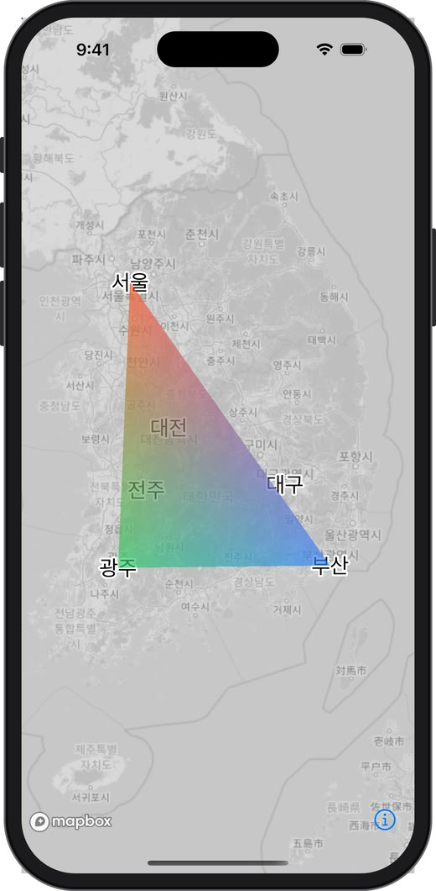
    <figcaption style="font-size: 0.8em; text-align: center;">addLayer(layer): 맨 위</figcaption>
  </figure>
  <figure style="width: 240px; margin: 0;">
    
    <figcaption style="font-size: 0.8em; text-align: center;">addLayer(layer, layerPosition: .below("city-labels"))</figcaption>
  </figure>
</div>

&nbsp;

왼쪽은 Custom Layer가 Layer 배열의 맨 끝, 즉 가장 위에 그려져서 삼각형 안의 "대전", "전주" 라벨이 반투명 삼각형에 덮여 흐려졌습니다. 오른쪽은 라벨 Layer 바로 아래에 끼워 넣어서 라벨이 선명하게 위로 올라왔습니다. 8장에서 본 것처럼 Custom Layer도 **Layer 배열 순서대로 같은 도화지에 이어 그리기 때문**입니다. 지도 위에 `MTKView`를 겹치는 방식으로는 이렇게 라벨 아래에 끼워 넣을 수 없습니다.

SwiftUI처럼 선언형 Style DSL을 쓴다면 공식 예제처럼 이렇게 추가할 수도 있습니다.

```swift
mapView.mapboxMap.setMapStyleContent {
    CustomLayer(id: "triangle-layer", renderer: renderer)
}
```

### 실제로 실행해서 검증하기

이 예제는 iOS 시뮬레이터(Mapbox Maps SDK 11.34.1)에서 직접 실행해 확인했습니다. 토큰 없이도 돌아가도록 배경 Layer만 있는 로컬 Style JSON을 사용했고, 위치가 정확한지 확인하기 위해 **같은 세 도시를 일반 Layer로도 함께 그렸습니다.** 검은 점은 `CircleLayer`, 검은 선은 `LineLayer`이고, 색이 칠해진 삼각형이 Custom Layer입니다.

<div style="display: flex; gap: 16px; flex-wrap: wrap; justify-content: center;">
  <figure style="width: 240px; margin: 0;">
    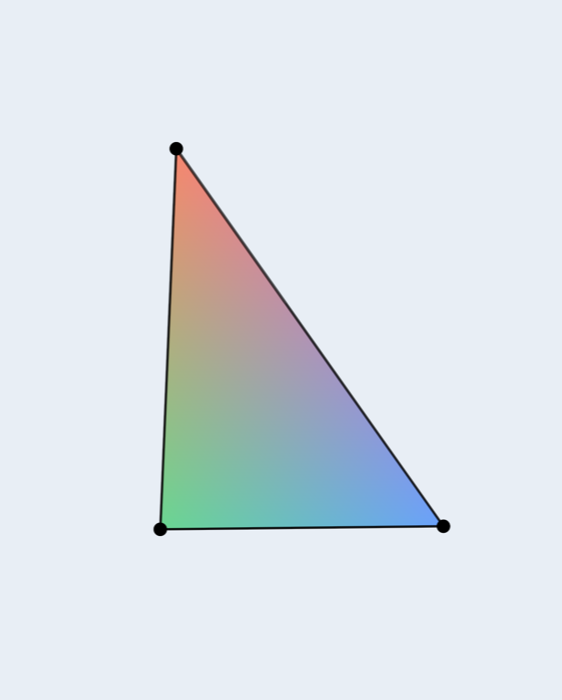
    <figcaption style="font-size: 0.8em; text-align: center;">줌 6, 기울기 0°</figcaption>
  </figure>
  <figure style="width: 240px; margin: 0;">
    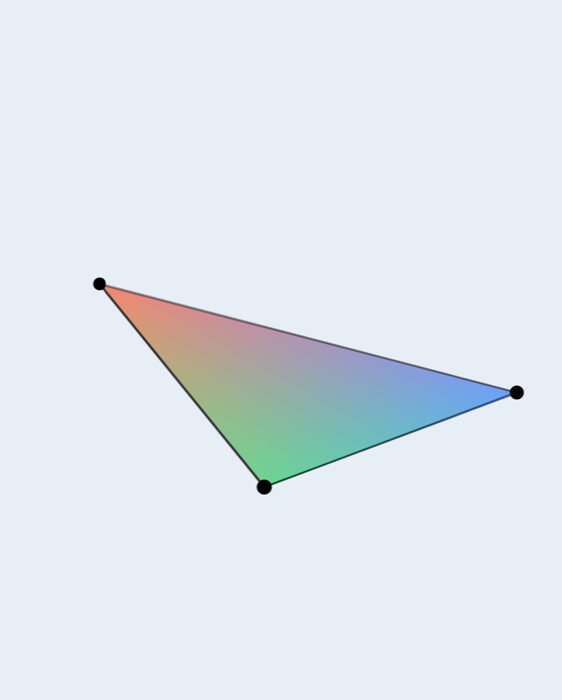
    <figcaption style="font-size: 0.8em; text-align: center;">기울기 55°, 회전 30°</figcaption>
  </figure>
</div>

&nbsp;

확인한 내용은 다음과 같습니다.

- **위치**: 삼각형 꼭짓점이 `CircleLayer`의 점과 정확히 겹칩니다. 지도를 기울이고 회전해도 어긋나지 않습니다. Mercator × `worldSize` × `projectionMatrix` 계산이 Mapbox 내부 계산과 같다는 뜻입니다.
- **보간**: 정점 3개에만 색(주황, 파랑, 초록)을 줬는데 내부가 그라데이션으로 채워집니다. ③ Rasterizer의 보간 결과입니다.
- **Layer 순서**: Custom Layer를 `.below("ref-line")`로 넣었기 때문에 검은 선이 삼각형 위에 그려집니다.

`render()` 안에서 값을 찍어보면 앞에서 설명한 개념들이 숫자로 확인됩니다.

| 찍어본 값 | 결과 | 의미 |
| --- | --- | --- |
| `parameters.width`, `height` | 402 × 874 | **point** 단위 (iPhone 16 Pro) |
| 그릴 텍스처 크기 | 1206 × 2622 | 실제 **pixel** 단위, 3배. Viewport에 scale을 곱해야 하는 이유 |
| `colorPixelFormat` | 80 | `.bgra8Unorm` |
| `depthStencilPixelFormat` | 260 | `.depth32Float_stencil8` (깊이 + 스텐실 공용) |
| color, depth의 `loadAction` | `.load` | 앞 Layer들이 그린 내용과 깊이를 유지한 채 이어 그림 |
| `render()` 호출 스레드 | 메인 스레드 | iOS 시뮬레이터에서 확인 |
| 지도를 가만히 둔 7초 동안 `render()` 호출 | 3번 | 변화가 없으면 다시 그리지 않음 |

`depthStencilPixelFormat` 하나를 깊이와 스텐실 양쪽에 그대로 넣는 이유도 여기서 알 수 있습니다. 하나의 텍스처가 깊이(32bit float)와 스텐실(8bit)을 함께 담는 포맷이기 때문입니다.

### 왜 Globe에서는 다르게 해야 할까

v11의 기본 스타일들은 줌이 낮을 때 지구를 공 모양으로 보여주는 **Globe** 투영을 사용합니다. 이 예제는 평면 Mercator를 가정하고 MVP를 만들었기 때문에 Globe에서는 맞지 않습니다. 그래서 `setProjection(StyleProjection(name: .mercator))`로 투영을 고정했습니다.

실제로 투영만 `.globe`로 바꿔서 실행하면 어떻게 될까요?

<p style="text-align: center;">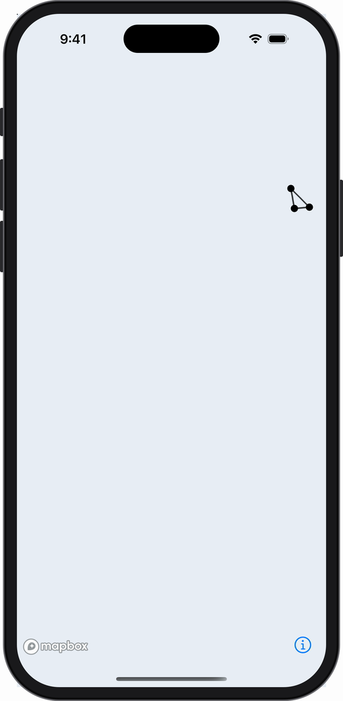</p>

일반 Layer로 그린 점과 선은 Mapbox가 Globe에 맞게 다시 계산하므로 제자리에 있습니다. 하지만 **Custom Layer 삼각형은 아예 사라집니다.** Globe에서 `projectionMatrix`가 기대하는 입력은 평면 World 좌표가 아니기 때문에, 우리가 넘긴 좌표가 엉뚱한 Clip space 좌표로 계산되어 화면 밖으로 잘려나간 것으로 보입니다. Custom Layer는 투영을 직접 책임져야 한다는 것을 보여주는 결과입니다.

Globe에 대응하려면 `parameters.projection`이 제공하는 도우미(`convertMercatorModelMatrix`, `getTransitionMatrix`, `getTransitionPhase` 등)를 써야 합니다. 예제 3에서 공식 코드로 살펴보겠습니다.

### 정밀도 문제 - 줌을 많이 당기면 흔들린다

`Float`은 유효숫자가 약 7자리입니다. Mercator 좌표 `0.8527...`을 `Float`으로 저장하면 아주 작은 오차가 생기는데, 줌 18에서 `worldSize`는 512 × 2¹⁸ ≈ 1억 3천만이므로 이 작은 오차가 수 픽셀 단위로 커집니다. 그래서 줌을 아주 많이 당기면 도형이 미세하게 떨리거나 어긋날 수 있습니다.

이 문제는 보통 **기준점(origin)을 정하고, 정점을 기준점으로부터의 상대 좌표로 저장**하는 방식(Relative To Center)으로 해결합니다. 큰 수는 `Double`로 CPU에서 계산하고, GPU에는 작은 수만 넘기는 아이디어입니다. 도시 단위 시각화라면 크게 문제 되지 않지만, 건물 단위로 정밀하게 그려야 한다면 꼭 고려해야 합니다.

&nbsp;

## 13. 예제 2 - 시간에 따라 깜빡이는 삼각형

이번에는 시간을 uniform으로 넘겨서 삼각형이 숨 쉬듯 깜빡이게 만들어 보겠습니다. 이 예제에서 배울 것은 두 가지입니다.

- Fragment Shader에 uniform 넘기기
- 지도가 멈춰 있어도 계속 다시 그리게 만들기

### Fragment Shader에 시간 받기

<details class="notion-toggle-list" markdown="1">
<summary>pulseFragment 셰이더 코드 보기</summary>

```cpp
fragment float4 pulseFragment(RasterizerData in [[stage_in]],
                              constant float &time [[buffer(0)]]) {
    float pulse = 0.5 + 0.5 * sin(time * 3.0);     // 0 ~ 1 사이를 반복
    float alpha = in.color.a * (0.3 + 0.7 * pulse);
    return float4(in.color.rgb * alpha, alpha);    // premultiplied alpha
}
```

</details>

`renderingWillStart`에서 fragment 함수 이름을 `"pulseFragment"`로 바꾸고, `render`에서 시간을 넘겨줍니다.

<details class="notion-toggle-list" markdown="1">
<summary>render()에 시간 넘기는 코드 보기</summary>

```swift
private let startTime = CACurrentMediaTime()

// render(...) 안, drawPrimitives 전에
var time = Float(CACurrentMediaTime() - startTime)
encoder.setFragmentBytes(&time, length: MemoryLayout<Float>.stride, index: 0) // → fragment의 [[buffer(0)]]
```

</details>

Vertex와 Fragment는 버퍼 번호 공간이 따로입니다. `setVertexBytes(index: 0)`과 `setFragmentBytes(index: 0)`은 서로 다른 슬롯입니다.

### 계속 다시 그리게 만들기 - triggerRepaint

여기까지만 하면 삼각형이 깜빡이지 않습니다. **Mapbox는 지도에 변화가 없으면 다시 그리지 않기** 때문입니다. 배터리를 아끼기 위한 당연한 동작이지만, 애니메이션을 하려면 매 프레임 "다시 그려줘"라고 요청해야 합니다.

<details class="notion-toggle-list" markdown="1">
<summary>CADisplayLink로 다시 그리는 코드 보기</summary>

```swift
private var displayLink: CADisplayLink?

override func viewDidAppear(_ animated: Bool) {
    super.viewDidAppear(animated)
    displayLink = CADisplayLink(target: self, selector: #selector(repaint))
    displayLink?.add(to: .main, forMode: .common)
}

override func viewWillDisappear(_ animated: Bool) {
    super.viewWillDisappear(animated)
    displayLink?.invalidate() // CADisplayLink는 target을 강하게 잡으므로 꼭 해제
    displayLink = nil
}

@objc private func repaint() {
    mapView.mapboxMap.triggerRepaint()
}
```

</details>

`CADisplayLink`는 화면 주사율에 맞춰 호출되는 타이머이고, `triggerRepaint()`는 Mapbox에게 다음 프레임을 그리라고 요청합니다. 그러면 `render`가 매 프레임 호출되면서 새 시간 값이 셰이더로 전달됩니다.

### 실행 결과

예제 1과 같은 시뮬레이터 환경에서 위 코드를 그대로 실행하고 화면을 녹화했습니다. 영상은 깜빡임 한 주기(약 2.1초)를 반복 재생합니다.

<p style="text-align: center;"><video src="/assets/img/2026-11-02-mapbox-custom-layer-deep-dive/result-pulse.mp4" poster="/assets/img/2026-11-02-mapbox-custom-layer-deep-dive/result-pulse-poster.png" autoplay loop muted playsinline style="width: 240px;"></video></p>

같은 셰이더로 `CADisplayLink`가 **있을 때와 없을 때**를 비교해 보면 `triggerRepaint()`의 역할이 숫자로 드러납니다.

| | DisplayLink + `triggerRepaint()` | 셰이더만 교체 (DisplayLink 없음) |
| --- | --- | --- |
| `render()` 호출 | 1초에 정확히 60번씩 계속 | 시작 직후 2번 호출 후 멈춤 |
| 화면 | 숨 쉬듯 깜빡임 | 한 장면에서 멈춤 |
| 화면 녹화 결과 | 4초 영상 | 화면 변화가 없어 프레임 1장만 녹화됨 |

녹화 영상에서 삼각형 중심 픽셀의 색을 0.17초 간격으로 뽑아보면, 가장 진할 때 RGB (155, 171, 172)에서 가장 옅을 때 (208, 217, 224)까지 부드럽게 오르내리고, 약 2.1초마다 같은 값으로 돌아옵니다. 셰이더의 `sin(time * 3.0)` 주기인 2π / 3 ≈ 2.09초와 일치합니다. 셰이더 코드는 그대로인데 **"누가 프레임을 요청하느냐"에 따라 애니메이션이 되기도 하고 멈추기도 한다**는 것이 이 예제의 핵심입니다.

> 애니메이션이 필요 없을 때는 DisplayLink를 멈추는 것이 좋습니다. 매 프레임 지도 전체를 다시 그리는 것은 공짜가 아닙니다.

&nbsp;

## 14. 예제 3 - 공식 예제 읽기 (미터 단위 3D 큐브, Globe)

Mapbox 공식 저장소의 `CustomLayerExample.swift`는 두 가지를 그립니다. 지금까지 배운 개념으로 핵심만 읽어보겠습니다.

이 예제도 공식 코드의 렌더링 부분은 그대로 두고 같은 시뮬레이터에서 실행했습니다. 바꾼 것은 Examples 앱 전용 의존성 스텁, 토큰 없는 로컬 스타일, 카메라 위치뿐입니다.

<div style="display: flex; gap: 16px; flex-wrap: wrap; justify-content: center;">
  <figure style="width: 240px; margin: 0;">
    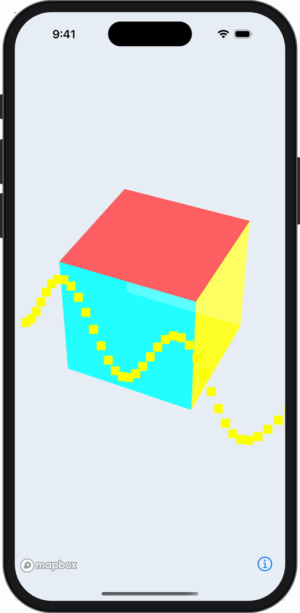
    <figcaption style="font-size: 0.8em; text-align: center;">헬싱키 상공의 큐브 (기울기 50°)</figcaption>
  </figure>
  <figure style="width: 240px; margin: 0;">
    <video src="/assets/img/2026-11-02-mapbox-custom-layer-deep-dive/official-globe.mp4" poster="/assets/img/2026-11-02-mapbox-custom-layer-deep-dive/official-globe-poster.png" autoplay loop muted playsinline style="width: 100%;"></video>
    <figcaption style="font-size: 0.8em; text-align: center;">Globe 위의 큐브와 움직이는 점들</figcaption>
  </figure>
</div>

&nbsp;

왼쪽 화면에서 노란 점들이 큐브 앞을 지날 때는 보이고 뒤로 지나갈 때는 가려지는 것을 볼 수 있습니다. 7장에서 본 **깊이 테스트**가 실제로 동작하는 모습입니다. 오른쪽은 예제 1에서는 삼각형이 사라졌던 **Globe 투영에서도 제자리에 그려지는** 모습입니다.

### 헬싱키 위의 큐브

<details class="notion-toggle-list" markdown="1">
<summary>공식 예제 renderCubesInMeters 코드 보기</summary>

```swift
private func renderCubesInMeters(parameters: CustomLayerRenderParameters,
                                 renderCommandEncoder: MTLRenderCommandEncoder) {
    // 1. Mapbox가 준 View + Projection
    let projectionMatrix = parameters.projectionMatrix.simdFloat4x4

    // 2. Model 행렬: 위치 이동 × 미터→픽셀 스케일
    let modelMatrix = parameters.createModelMatrixMeters(
        location: cubeConfiguration.location,
        altitude: cubeConfiguration.altitude,
        size: cubeConfiguration.cubeSize)

    // 3. 현재 투영(Mercator/Globe)에 맞게 Model 행렬 보정
    let transformedMatrix = parameters.projection.convertMercatorModelMatrix(
        forMatrix: modelMatrix.nsNumberArray,
        ignoreDistortion: false
    )!.simdFloat4x4

    // 4. MVP
    var finalMatrix = projectionMatrix * transformedMatrix

    // 5. 깊이 테스트를 켠 파이프라인으로 36개 정점 그리기
    renderCommandEncoder.setDepthStencilState(simpleShaderProgram.depthStencilState)
    ...
}
```

</details>

예제 1과 비교하면 차이가 보입니다.

- **Model 행렬이 더 복잡합니다.** 예제 1은 `× worldSize` 스케일 하나였지만, 여기서는 "헬싱키 위치로 이동(translation)"과 "1000미터를 픽셀로 변환하는 스케일"을 곱합니다. Mercator 투영에서는 위도에 따라 1미터가 차지하는 픽셀 수가 달라지기 때문에 `Projection.metersPerPoint(for:zoom:)`로 위도별 값을 계산합니다.
- **`convertMercatorModelMatrix`** 가 들어갑니다. Mercator 기준으로 만든 Model 행렬을 현재 투영(Globe 포함)에 맞게 바꿔주는 도우미입니다. 예제 1에서 Globe를 피하려고 투영을 고정했던 문제를 이렇게 해결합니다.
- **깊이 테스트를 켭니다.** 큐브는 3D라서 앞면이 뒷면을 가려야 하므로 `depthCompareFunction = .less`, `isDepthWriteEnabled = true`를 사용합니다.

> **실행해 보고 알게 된 점: 이 큐브는 1km가 아니라 약 1000km입니다.** 설정값은 `cubeSize: 1_000`(미터)이지만, 정점 데이터를 만드는 `cubeVertexDataFrom`이 이미 ±500 범위(한 변 1000 단위)로 큐브를 만듭니다. 여기에 Model 행렬이 다시 "1000미터를 픽셀로" 바꾸는 스케일을 곱하므로, 결과적으로 1000 × 1000m = **1000km** 크기가 됩니다. 처음에 헬싱키를 줌 13으로 확대했더니 아무것도 보이지 않았던 이유가 이것입니다. 카메라가 거대한 큐브 안쪽에 들어가 있었던 것입니다. 정점은 "단위 크기(±0.5)"로 만들고 크기는 Model 행렬에서만 정한다는 원칙을 지켜야, `cubeSize`가 이름 그대로 동작합니다.

### 베를린에서 도쿄까지 움직이는 점들

두 번째는 점 128개가 파도치듯 움직이는 애니메이션입니다. 여기서는 정점마다 위치를 **두 벌** 준비합니다.

- `pos_merc`: 평면 Mercator 기준 위치
- `pos_ecef`: 지구 중심 기준 3D 위치 (ECEF, Globe용)

<details class="notion-toggle-list" markdown="1">
<summary>Globe 전환 셰이더 코드 보기</summary>

```cpp
float4 pos_merc = uniforms.u_matrix_merc * float4(vertices[vertexID].pos_merc, 1.0);
float4 pos_ecef = uniforms.u_matrix_ecef * float4(vertices[vertexID].pos_ecef, 1.0);

float t = clamp(uniforms.u_transition, 0.0, 1.0);
out.position = mix(pos_merc, pos_ecef, t);
```

</details>

줌을 바꾸면 지도가 Globe와 평면 사이를 부드럽게 오가는데, 그 진행도를 `parameters.projection.getTransitionPhase()`로 받아 셰이더에서 `mix`로 두 위치를 섞습니다. 셰이더가 "정점 위치를 계산하는 프로그램"이라는 것을 잘 보여주는 예입니다.

또 `type: .point`로 그리면서 Vertex Shader 출력에 `[[point_size]]`를 지정해 점 크기를 정하는 것도 볼 수 있습니다.

&nbsp;

## 15. Source + Layer와 비교 - Custom Layer는 CPU를 덜 쓸까?

"Custom Layer를 쓰면 기존 Source + Layer보다 CPU를 덜 쓰고 GPU를 쓴다"는 말을 자주 듣습니다. 직접 측정해 보면 **맞지만 조건이 붙습니다.** 먼저 오해 하나를 정리하고 시작하겠습니다.

> 두 방식 모두 **실제로 그리는 일은 GPU가 합니다.** Mapbox의 circle, line, fill Layer도 Metal로 그립니다. 차이는 그리기 전 단계, 즉 **"데이터를 GPU가 그릴 수 있는 형태로 준비하는 일"과 "움직이는 위치를 계산하는 일"을 누가, 얼마나 자주 하느냐**입니다.

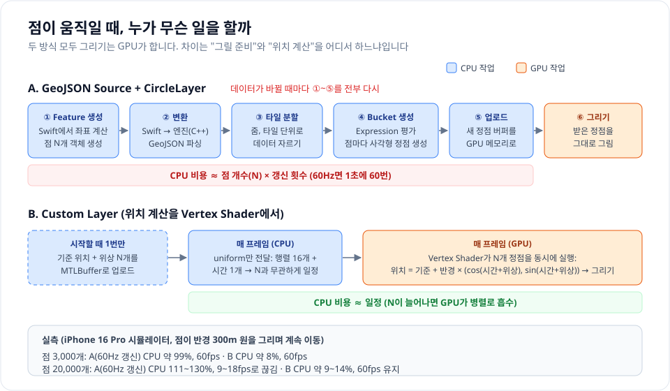

### Source + Layer는 데이터가 바뀔 때 CPU가 무슨 일을 할까

GeoJSON Source에 데이터를 넣으면 Mapbox 엔진은 GPU에 넘기기 전에 이런 일을 합니다. 모두 CPU 작업입니다.

| 단계 | 하는 일 |
| --- | --- |
| ① Feature 생성 | 앱이 Swift에서 좌표를 계산하고 `Feature` 객체 N개를 만듦 |
| ② 변환 | Swift 객체를 엔진(C++)이 쓰는 형태로 변환 |
| ③ 타일 분할 | 데이터를 줌, 타일 단위로 잘라 둠 (Vector Tile처럼 다루기 위해) |
| ④ Bucket 생성 | 타일마다 Layer의 Expression을 Feature별로 평가하고, GPU용 정점을 만듦. circle은 점마다 사각형, line은 이음새(join)와 끝(cap), fill은 삼각형 분할, symbol은 글자 배치와 충돌 계산 |
| ⑤ 업로드 | 만들어진 정점 버퍼를 GPU 메모리로 |
| ⑥ 그리기 | GPU가 정점을 그대로 그림 |

이 구조는 **데이터가 가끔 바뀔 때 매우 효율적**입니다. ①~⑤는 데이터가 바뀔 때 한 번만 하고, 그 뒤에는 카메라를 움직여도 GPU가 같은 버퍼를 새 행렬로 다시 그리기만 하면 됩니다. Expression, 클러스터링, 라벨 충돌 처리, `queryRenderedFeatures`가 모두 이 준비 단계 덕분에 공짜로 생깁니다.

문제는 **데이터가 매 프레임 바뀔 때**입니다. 점 위치가 1초에 60번 바뀌면 ①~⑤도 1초에 60번 반복됩니다. CPU 비용이 **점 개수 × 갱신 횟수**에 비례합니다.

### Custom Layer에서는 무엇이 달라질까

Custom Layer에는 ③, ④ 단계가 없습니다. 내가 GPU가 바로 읽을 정점 데이터를 직접 만들어 넘기기 때문입니다. 여기에 **움직임 계산을 Vertex Shader로 옮기면** 매 프레임 CPU가 하는 일이 거의 사라집니다.

- **시작할 때 1번**: 점마다 기준 위치와 위상(phase)을 `MTLBuffer`로 올려 둡니다.
- **매 프레임 CPU**: 행렬 16개 숫자와 시간 1개를 uniform으로 넘기고 draw call 1번. **점이 3000개든 2만 개든 같은 양**입니다.
- **매 프레임 GPU**: Vertex Shader가 점 N개에 대해 `기준 위치 + 반경 × (cos(시간 + 위상), sin(시간 + 위상))`을 **동시에** 계산합니다. 4장에서 본 "병렬로 실행되는 순수 함수"가 그대로 쓰입니다.

즉 CPU가 줄어드는 이유는 Custom Layer라서가 아니라, **N에 비례하는 계산을 CPU에서 GPU로 옮겼고, 엔진의 준비 단계(③, ④)를 건너뛰었기 때문**입니다.

### 실제로 측정하기

같은 시뮬레이터(iPhone 16 Pro, SDK 11.34.1, Release 빌드)에서 서울 상공에 점을 뿌리고, 모든 점이 반경 300m 원을 그리며 계속 움직이게 했습니다. 앱 프로세스의 누적 CPU 시간을 10초 간격으로 읽어 평균 CPU 사용률을 계산했고, 3000개는 3번, 2만 개는 2번 반복했습니다.

| 점 개수 | 방식 | CPU (평균) | 렌더링 FPS |
| --- | --- | --- | --- |
| 3,000 | 기준선: GeoJSON, 움직이지 않음 | 약 1% | 0 (다시 그릴 일이 없음) |
| 3,000 | A. GeoJSON, **매 프레임(60Hz)** `updateGeoJSONSource` | **약 99%** (95 ~ 107%) | 60 |
| 3,000 | A'. GeoJSON, **1초에 1번** 갱신 | 약 6% | 20 |
| 3,000 | B. Custom Layer, 셰이더에서 위치 계산 | **약 8%** (7.6 ~ 9.5%) | 60 |
| 20,000 | A. GeoJSON, 60Hz 갱신 | **111 ~ 130%** | **9 ~ 18 (끊김)** |
| 20,000 | A'. GeoJSON, 1초에 1번 갱신 | 약 20% | 18 |
| 20,000 | B. Custom Layer | **약 9 ~ 14%** | **60** |

- 같은 60fps 애니메이션에서 **A는 CPU 코어 하나를 거의 다 쓰고(약 99%), B는 약 8%** 를 씁니다.
- 점을 2만 개로 늘리면 A는 100%를 넘어(여러 코어 사용) 프레임이 9 ~ 18fps로 떨어지지만, **B는 CPU가 거의 그대로이고 60fps를 유지**합니다. 늘어난 계산을 GPU가 병렬로 흡수했기 때문입니다.
- A'처럼 갱신을 1초에 1번으로 줄이면 GeoJSON도 CPU가 크게 줄어듭니다. 대신 점이 1초마다 **뚝뚝 끊어져 이동**합니다. 선박 위치(AIS)처럼 데이터 자체가 몇 초에 한 번 오는 경우라면 A'로도 충분합니다.

아래는 점 2만 개를 두 방식으로 움직이면서 화면을 녹화한 것입니다. 개별 점이 보이도록 카메라만 줌 14로 확대했고, 화면 밖의 점까지 2만 개를 모두 계산하는 것은 같습니다.

<div style="display: flex; gap: 16px; flex-wrap: wrap; justify-content: center;">
  <figure style="width: 240px; margin: 0;">
    <video src="/assets/img/2026-11-02-mapbox-custom-layer-deep-dive/sim-bench-geojson.mp4" poster="/assets/img/2026-11-02-mapbox-custom-layer-deep-dive/sim-bench-geojson-poster.jpg" autoplay loop muted playsinline style="width: 100%;"></video>
    <figcaption style="font-size: 0.8em; text-align: center;">A. GeoJSON 60Hz 갱신 (녹화 중 5~23fps)</figcaption>
  </figure>
  <figure style="width: 240px; margin: 0;">
    <video src="/assets/img/2026-11-02-mapbox-custom-layer-deep-dive/sim-bench-custom.mp4" poster="/assets/img/2026-11-02-mapbox-custom-layer-deep-dive/sim-bench-custom-poster.jpg" autoplay loop muted playsinline style="width: 100%;"></video>
    <figcaption style="font-size: 0.8em; text-align: center;">B. Custom Layer (녹화 중 60fps)</figcaption>
  </figure>
</div>

&nbsp;

B는 모든 점이 반경 300m 원을 그리며 부드럽게 돕니다. A는 화면 대부분이 비어 있다가 **일부 타일만 늦게 나타나고, 나타난 뒤에도 멈춰 있는 시간이 깁니다.** 새 데이터가 들어올 때마다 타일 분할, Bucket 생성을 다시 하는데, 그 작업이 끝나기 전에 다음 갱신이 계속 들어와서 화면에 반영될 타일이 제때 준비되지 못하는 것으로 보입니다. 위 측정(줌 11.3)보다 증상이 심한 것은, 확대할수록 같은 데이터를 더 높은 줌의 타일로 다시 잘라야 하기 때문으로 보입니다.

<details class="notion-toggle-list" markdown="1">
<summary>측정에 쓴 Custom Layer 셰이더 코드 보기</summary>

```cpp
struct BenchVertex { float2 position; float phase; float pad; };   // Mercator 기준 위치 + 위상
struct BenchUniforms { float4x4 mvp; float time; float radius; float pointSize; float pad; };
struct BenchOut { float4 position [[position]]; float pointSize [[point_size]]; };

vertex BenchOut benchVertex(uint vid [[vertex_id]],
                            constant BenchVertex *vertices [[buffer(0)]],
                            constant BenchUniforms &u [[buffer(1)]]) {
    BenchVertex v = vertices[vid];
    float angle = u.time + v.phase;
    float2 p = v.position + u.radius * float2(cos(angle), sin(angle));   // 위치 계산을 GPU에서
    BenchOut out;
    out.position = u.mvp * float4(p, 0.0, 1.0);
    out.pointSize = u.pointSize;                                         // 점 크기 (픽셀)
    return out;
}

fragment float4 benchFragment(BenchOut in [[stage_in]], float2 pc [[point_coord]]) {
    if (length(pc - 0.5) > 0.5) discard_fragment();   // 사각형 점을 원으로 깎기
    return float4(1.0, 0.55, 0.0, 1.0);
}
```

</details>

<details class="notion-toggle-list" markdown="1">
<summary>측정에 쓴 두 방식의 Swift 코드 보기 (핵심 부분 발췌)</summary>

```swift
// A. GeoJSON: 매 프레임 CPU에서 좌표 계산 → Source 갱신
@objc private func tick() {
    let t = CACurrentMediaTime() - start
    let features = points.map { base, phase in
        Feature(geometry: Point(CLLocationCoordinate2D(
            latitude: base.latitude + rLat * sin(t + phase),
            longitude: base.longitude + rLng * cos(t + phase))))
    }
    mapView.mapboxMap.updateGeoJSONSource(withId: "bench", geoJSON: .featureCollection(FeatureCollection(features: features)))
}

// B. Custom Layer: 데이터는 그대로, 다시 그리기만 요청
@objc private func tick() {
    mapView.mapboxMap.triggerRepaint()
}

// B의 render(): N과 무관하게 uniform 하나와 draw call 1번
func render(_ parameters: CustomLayerRenderParameters, mtlCommandBuffer: MTLCommandBuffer, mtlRenderPassDescriptor: MTLRenderPassDescriptor) {
    guard let encoder = mtlCommandBuffer.makeRenderCommandEncoder(descriptor: mtlRenderPassDescriptor) else { return }
    let worldSize = Float(Projection.worldSize(scale: pow(2, parameters.zoom)))
    var uniforms = BenchUniforms(
        mvp: parameters.projectionMatrix.simdFloat4x4 * simd_float4x4(diagonal: SIMD4<Float>(worldSize, worldSize, 1, 1)),
        time: Float(CACurrentMediaTime() - start),
        radius: radiusInMercator,
        pointSize: Float(6 * UIScreen.main.scale))
    // ... viewport, pipeline 설정 (예제 1과 같음)
    encoder.setVertexBuffer(vertexBuffer, offset: 0, index: 0)          // 시작할 때 1번 만든 버퍼
    encoder.setVertexBytes(&uniforms, length: MemoryLayout<BenchUniforms>.stride, index: 1)
    encoder.drawPrimitives(type: .point, vertexStart: 0, vertexCount: count)
    encoder.endEncoding()
}
```

</details>

### 측정 결과를 읽을 때 주의할 점

- **Mac 위의 시뮬레이터 수치입니다.** 실제 기기에서는 절댓값이 다르고, 휴대폰 CPU가 Mac보다 느리므로 A의 부담은 더 커질 가능성이 큽니다. 두 방식의 **상대적인 차이**로 읽어 주세요.
- **GPU 사용량은 재지 않았습니다.** B는 그만큼 GPU에 일을 넘긴 것이지만, 점 2만 개의 삼각함수 계산은 GPU 입장에서 매우 작은 일입니다.
- **완전히 같은 그림은 아닙니다.** CircleLayer는 테두리, 안티앨리어싱, Expression 평가까지 해 주는 반면 측정용 셰이더는 단색 점만 그립니다.
- **Custom Layer라고 항상 CPU가 적은 것은 아닙니다.** 매 프레임 Swift에서 N개 위치를 계산해 버퍼를 다시 채우면 CPU는 다시 N에 비례합니다. (③, ④가 없어서 GeoJSON보다는 가볍습니다) 14장의 공식 예제 "움직이는 점들"이 실제로 이 방식입니다. 점 128개라 문제가 없을 뿐입니다.

### 그래서 언제 무엇을 쓸까

| 상황 | 추천 | 이유 |
| --- | --- | --- |
| 데이터가 가끔 바뀜 (조회 결과, 가게 목록) | Source + Layer | 준비 비용은 한 번뿐이고 Expression, 클러스터링, 탭 조회가 공짜 |
| 몇 초에 한 번 위치가 갱신됨 (AIS 선박, 차량 위치) | Source + Layer, 갱신 주기에 맞춰 `updateGeoJSONSource` | 1Hz 갱신이면 측정상 CPU 6 ~ 20% |
| 수천 ~ 수만 개가 **매 프레임 부드럽게** 움직임 (파티클, 바람, 해류, 궤적 보간) | **Custom Layer + 셰이더에서 위치 계산** | CPU가 N과 무관하게 일정, 60fps 유지 |
| 매 프레임 움직이지만 수백 개 이하 | 어느 쪽이든 가능 | 차이가 체감되지 않음. 기능이 많은 Source + Layer가 편함 |

Custom Layer의 성능 이점은 **"GPU에서 계산할 수 있는 움직임"** 이 있을 때 생깁니다. 옮길 계산이 없다면 기능을 포기하고 복잡도만 얻게 되니, 9장의 "언제 Custom Layer를 써야 할까" 표와 함께 판단하면 됩니다.

&nbsp;

## 16. 실전에서 부딪히는 문제들

예제를 실제 기능으로 옮기면 곧바로 만나는 문제들입니다.

### 탭 감지 - 내가 그린 도형을 눌렀을까?

Custom Layer는 `queryRenderedFeatures`에 잡히지 않으므로 직접 판정해야 합니다. 방법은 "탭한 화면 좌표 → 지도 좌표 → Mercator"로 바꾼 뒤, 도형 안에 있는지 수학으로 확인하는 것입니다.

<details class="notion-toggle-list" markdown="1">
<summary>탭 감지 전체 코드 보기</summary>

```swift
@objc private func handleTap(_ gesture: UITapGestureRecognizer) {
    // 1. 화면 좌표 → 위경도 (카메라 회전, 기울기까지 Mapbox가 계산)
    let coordinate = mapView.mapboxMap.coordinate(for: gesture.location(in: mapView))

    // 2. 위경도 → Mercator (정점 버퍼와 같은 좌표계)
    let p = Projection.latLngToMercatorXY(coordinate: coordinate)
    let triangle = triangleCoordinates.map { Projection.latLngToMercatorXY(coordinate: $0) }

    // 3. 삼각형 안인지 판정
    if contains(p, in: triangle) {
        print("삼각형을 탭했습니다")
    }
}

/// 세 변에 대해 점이 모두 같은 쪽에 있으면 삼각형 안
private func contains(_ p: MercatorCoordinate, in t: [MercatorCoordinate]) -> Bool {
    func cross(_ a: MercatorCoordinate, _ b: MercatorCoordinate, _ c: MercatorCoordinate) -> Double {
        (a.x - c.x) * (b.y - c.y) - (b.x - c.x) * (a.y - c.y)
    }
    let d1 = cross(p, t[0], t[1])
    let d2 = cross(p, t[1], t[2])
    let d3 = cross(p, t[2], t[0])
    let hasNegative = d1 < 0 || d2 < 0 || d3 < 0
    let hasPositive = d1 > 0 || d2 > 0 || d3 > 0
    return !(hasNegative && hasPositive)
}
```

</details>

판정을 Mercator 좌표에서 하는 이유는 정점 버퍼와 같은 평면이기 때문입니다. 위경도는 구 위의 각도라서 넓은 영역에서는 직선이 직선이 아니게 됩니다. 도형이 많다면 화면 근처의 것만 먼저 걸러내는 공간 인덱스(그리드, R-tree)를 함께 쓰면 좋습니다.

위 판정 코드를 그대로 써서 삼각형을 탭하면, 렌더러의 `highlighted` 값을 1로 바꾸고 `triggerRepaint()`를 호출하도록 했습니다. Fragment Shader는 이 값을 uniform으로 받아 원래 색과 노란색을 `mix`합니다.

<details class="notion-toggle-list" markdown="1">
<summary>탭 강조 셰이더와 처리 코드 보기</summary>

```cpp
fragment float4 highlightFragment(RasterizerData in [[stage_in]],
                                  constant float &highlight [[buffer(1)]]) {
    float4 c = mix(in.color, float4(1.0, 0.85, 0.1, 0.9), highlight);   // 0이면 원래 색, 1이면 노랑
    return float4(c.rgb * c.a, c.a);
}
```

```swift
// 렌더러: render() 안에서 uniform으로 넘김
var highlighted: Float = 0
// ...
var hl = highlighted
encoder.setFragmentBytes(&hl, length: MemoryLayout<Float>.stride, index: 1)

// 화면: 판정 결과로 상태만 바꾸고 다시 그리기 요청
let hit = contains(p, in: triangle)
renderer.highlighted = hit ? 1 : 0
mapView.mapboxMap.triggerRepaint()
```

</details>

<div style="display: flex; gap: 16px; flex-wrap: wrap; justify-content: center;">
  <figure style="width: 240px; margin: 0;">
    
    <figcaption style="font-size: 0.8em; text-align: center;">탭 전</figcaption>
  </figure>
  <figure style="width: 240px; margin: 0;">
    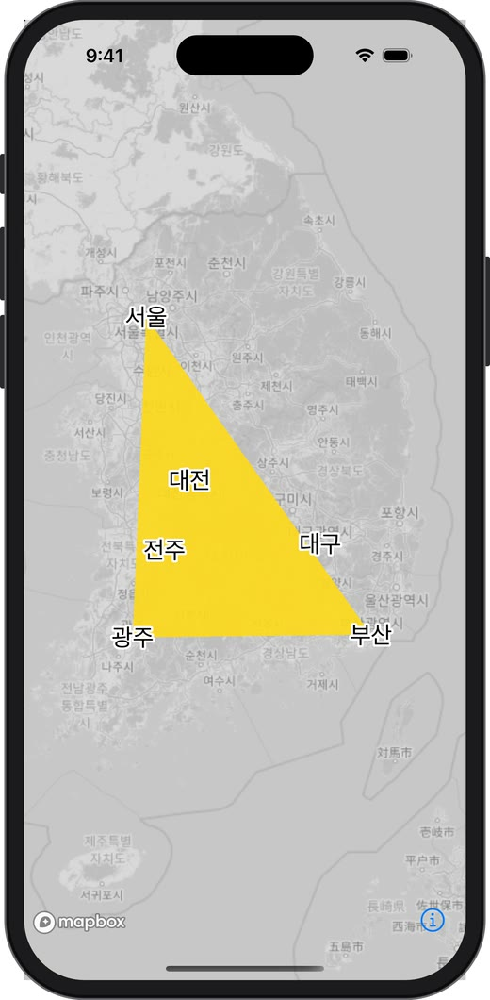
    <figcaption style="font-size: 0.8em; text-align: center;">삼각형 안쪽을 탭한 후 (hit = true)</figcaption>
  </figure>
</div>

&nbsp;

`queryRenderedFeatures`가 없어도, **좌표 변환(화면 → 위경도 → Mercator) + 수학 판정 + uniform 하나**로 일반 Layer의 feature-state 강조와 같은 효과를 만들 수 있습니다. 데이터(정점 버퍼)는 전혀 바꾸지 않았다는 점도 feature-state와 같습니다.

### 데이터가 바뀔 때 - 버퍼를 언제, 어디서 바꿀까

데이터(예: 서버에서 받은 좌표)는 보통 메인 스레드에서 바뀝니다. 그리고 12장에서 확인했듯 iOS에서 `render()`도 메인 스레드에서 호출됐습니다. 하지만 이는 SDK 문서가 보장하는 계약이 아니라 현재 구현에서 관찰된 동작이고, 6장에서 본 것처럼 **GPU는 이전 프레임의 버퍼를 아직 읽고 있을 수 있습니다.** 그래서 "같은 스레드니까 괜찮겠지" 하고 기존 버퍼를 바로 덮어쓰는 것은 위험합니다.

안전한 패턴은 "**메인 스레드에서는 새 데이터만 준비하고, 버퍼 교체는 render 쪽에서 한 번에**" 하는 것입니다.

<details class="notion-toggle-list" markdown="1">
<summary>버퍼 교체 패턴 전체 코드 보기</summary>

```swift
final class TriangleLayerHost: NSObject, CustomLayerHost {
    private var device: MTLDevice?
    private var vertexBuffer: MTLBuffer?

    private let lock = NSLock()
    private var pendingVertices: [TriangleVertex]?   // 메인 스레드가 넣어두는 새 데이터

    /// 메인 스레드에서 호출
    func update(vertices: [TriangleVertex]) {
        lock.lock(); pendingVertices = vertices; lock.unlock()
    }

    func renderingWillStart(_ metalDevice: MTLDevice, colorPixelFormat: UInt, depthStencilPixelFormat: UInt) {
        device = metalDevice
        // ... pipeline 생성
    }

    func render(_ parameters: CustomLayerRenderParameters, mtlCommandBuffer: MTLCommandBuffer, mtlRenderPassDescriptor: MTLRenderPassDescriptor) {
        lock.lock(); let newVertices = pendingVertices; pendingVertices = nil; lock.unlock()

        if let newVertices, let device {
            // 기존 버퍼를 덮어쓰지 않고 새 버퍼로 교체 → GPU가 읽고 있는 이전 버퍼는 안전
            vertexBuffer = device.makeBuffer(bytes: newVertices,
                                             length: MemoryLayout<TriangleVertex>.stride * newVertices.count,
                                             options: [])
        }
        // ... 이하 동일
    }
}
```

</details>

`renderingWillStart`에서 받은 `MTLDevice`를 보관해 두면 이후에도 버퍼를 만들 수 있습니다. 데이터가 매 프레임 바뀐다면 버퍼를 매번 새로 만드는 대신 6장에서 본 triple buffering으로 넘어가면 됩니다. 데이터를 바꾼 뒤에는 지도가 멈춰 있을 수 있으므로 `triggerRepaint()`를 한 번 호출해 주세요.

### 스타일이 바뀌면 Custom Layer도 사라진다

`loadStyle`로 스타일을 바꾸면 Layer 배열 전체가 새 스타일로 교체되므로 Custom Layer도 함께 사라집니다. `onStyleLoaded`에서 다시 추가하는 구조로 만들어야 합니다.

이때 **renderer 객체는 새로 만들지 말고 재사용**하는 것이 좋습니다. 공식 예제도 renderer를 프로퍼티로 보관하라고 주석으로 강조합니다. renderer를 매번 새로 만들면 셰이더 로드, Pipeline 생성을 다시 해야 하고, 갖고 있던 데이터도 처음부터 다시 만들어야 합니다.

### 메모리 - renderer는 강하게 잡힌다

SDK 변경 이력에 따르면 Mapbox는 `CustomLayerHost` 구현체를 **강한 참조(strong reference)** 로 보관합니다. 그래서 renderer가 `MapView`나 ViewController를 강하게 참조하면 순환 참조가 생겨 화면을 닫아도 메모리가 해제되지 않습니다.

- renderer는 그리기에 필요한 데이터만 갖고, 지도나 화면 객체는 참조하지 않습니다.
- 꼭 필요하다면 `weak`로 참조합니다.
- `CADisplayLink`도 target을 강하게 잡으므로 화면이 사라질 때 `invalidate()`해야 합니다.

&nbsp;

## 17. 아무것도 안 보일 때 체크리스트

Custom Layer는 실수해도 에러 없이 **그냥 아무것도 안 보이는** 경우가 많습니다. 아래를 순서대로 확인해 보세요.

| 증상 | 의심할 부분 |
| --- | --- |
| 아예 안 보임 | 셰이더 함수 이름 오타, `.metal` 파일이 앱 타겟에 포함되지 않음 (`makeFunction`이 nil) |
| 아예 안 보임 | Pipeline 픽셀 포맷이 Mapbox가 준 값과 다름 (생성 실패) |
| 아예 안 보임 | `endEncoding()` 누락 또는 Command Buffer를 직접 `commit` |
| 화면 구석에 작게 그려짐 | Viewport에 화면 배율(scale)을 곱하지 않음 |
| 엉뚱한 위치 | 행렬 곱 순서가 반대 (`model * projection`), 열 우선 순서 착각 |
| 엉뚱한 위치 | Globe 투영 상태인데 Mercator 기준으로 계산 |
| 모양이 깨짐 | Swift 구조체와 MSL 구조체의 메모리 레이아웃 불일치 |
| 애니메이션이 멈춤 | `triggerRepaint()`를 호출하지 않음 |
| 줌을 당기면 떨림 | `Float` 정밀도 문제 (Relative To Center 고려) |

표의 두 가지를 실제로 재현하면 이렇게 보입니다.

<div style="display: flex; gap: 16px; flex-wrap: wrap; justify-content: center;">
  <figure style="width: 240px; margin: 0;">
    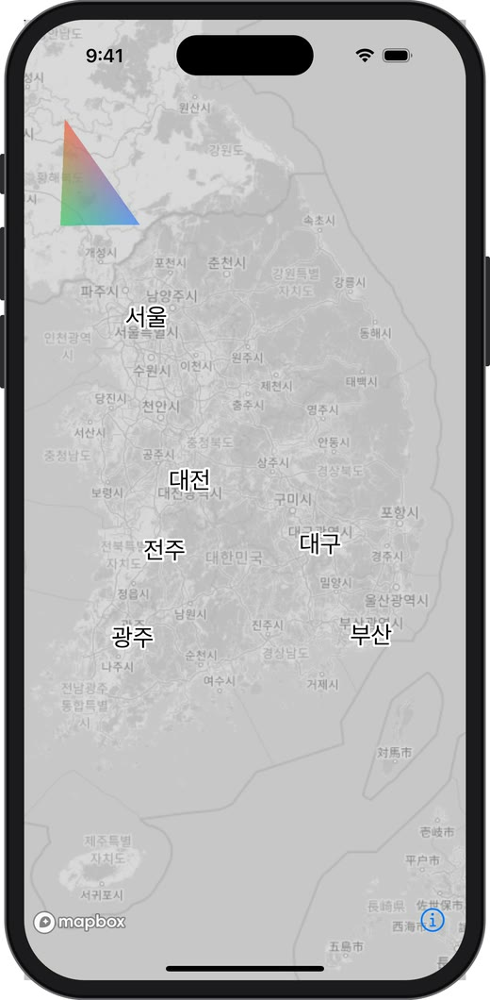
    <figcaption style="font-size: 0.8em; text-align: center;">Viewport에 화면 배율(3배)을 곱하지 않음</figcaption>
  </figure>
  <figure style="width: 240px; margin: 0;">
    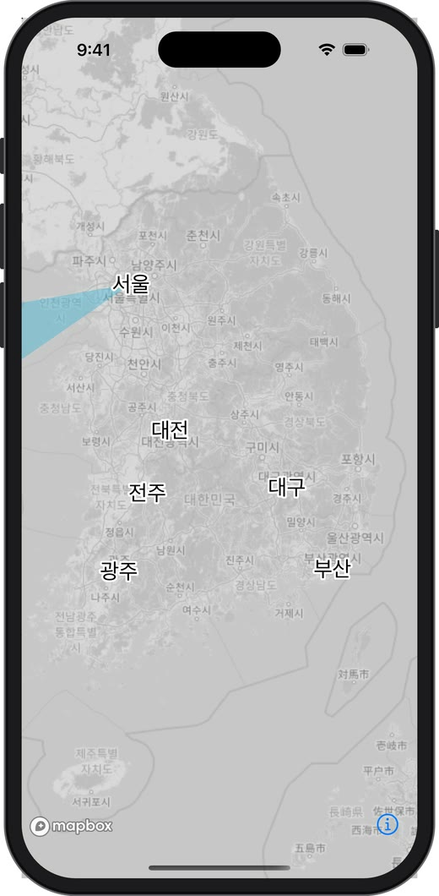
    <figcaption style="font-size: 0.8em; text-align: center;">정점을 [Float]로 꽉 채워 담음 (메모리 배치 불일치)</figcaption>
  </figure>
</div>

&nbsp;

- **왼쪽**: `parameters.width`(point 단위)를 그대로 Viewport에 넣어서, 실제 픽셀(3배) 화면의 왼쪽 위 1/3 영역에만 그려졌습니다. 모양과 색은 정상인데 위치와 크기만 틀린 것이 특징입니다.
- **오른쪽**: Swift에서 정점을 `[Float]`(x, y, r, g, b, a 6개 = 24바이트)로 담았는데, 셰이더 구조체는 패딩 때문에 정점 하나를 32바이트로 읽습니다. 두 번째 정점부터 엉뚱한 바이트를 위치와 색으로 읽어서 서울에서 화면 밖으로 뻗는 한 가지 색의 도형이 되었습니다. 12장 Step 1에서 `MemoryLayout<TriangleVertex>.stride`가 32인지 확인한 이유입니다.

**Xcode GPU Frame Capture**도 꼭 써보세요. 디버그 바의 카메라 모양 버튼으로 한 프레임을 캡처하면 Mapbox의 Layer별 draw call 목록 사이에서 `"Triangle Custom Layer"`라는 label로 내 Encoder를 찾을 수 있습니다. 정점 버퍼에 들어간 값, 행렬 값, 셰이더 출력까지 직접 확인할 수 있어서 "왜 안 보이지?"를 추측이 아니라 눈으로 확인할 수 있습니다. 코드에서 `encoder.label`을 지정한 이유가 바로 이것입니다.

&nbsp;

---

&nbsp;

## 정리

| 개념 | 한 줄 정의 |
| --- | --- |
| GPU | 같은 계산을 대량으로 동시에 처리하는 그래픽 전용 프로세서 |
| Metal | Apple 플랫폼에서 GPU에게 명령을 내리는 그래픽스 API |
| Vertex (정점) | 삼각형의 꼭짓점. 위치, 색 등의 정보를 가짐 |
| 렌더링 파이프라인 | 정점 → Vertex Shader → Rasterizer → Fragment Shader → 픽셀 |
| Shader | GPU에서 실행되는 작은 프로그램 (MSL로 작성) |
| Vertex Shader | 정점마다 실행, 화면 위치(Clip space) 계산 |
| Fragment Shader | 픽셀마다 실행, 색 계산 |
| Uniform | 모든 정점, 픽셀이 공유하는 값 (행렬, 시간 등) |
| 보간 (barycentric) | 정점 값을 세 꼭짓점과의 거리 비율로 섞어 픽셀마다 채우는 것 |
| Clip space | GPU의 표준 좌표 공간, -1 ~ 1 |
| MVP 행렬 | Model × View × Projection, 좌표 변환을 합친 행렬 |
| 원근 나눗셈 | Clip 좌표를 w로 나눠 멀리 있는 것을 작게 만드는 단계 |
| Draw call | Command Buffer에 기록되는 그리기 명령 하나. 호출 시점에는 기록만 됨 |
| Render pass | 어느 텍스처에, 기존 내용을 유지(load)할지 지울지(clear) 정한 "도화지" |
| Triple buffering | CPU와 GPU가 같은 버퍼를 동시에 쓰지 않도록 버퍼를 돌려쓰는 기법 |
| 깊이 버퍼 | 픽셀마다 가장 가까운 것의 거리를 저장해 가려짐을 처리 |
| Premultiplied alpha | rgb에 alpha를 미리 곱해두는 색 표현, 블렌딩 설정과 짝을 이룸 |
| Bucket | Mapbox가 타일마다 만드는 GPU용 정점 묶음. Source + Layer의 CPU 비용 대부분이 여기서 생김 |
| CustomLayer | Source 없이 Layer 배열에 자리 잡는 Layer |
| CustomLayerHost | Metal로 직접 그리는 렌더러. Start(1번) → Render(매 프레임) → End(1번) |
| projectionMatrix | Mapbox가 매 프레임 주는 World → Clip space 행렬 |

Custom Layer는 결국 **"Mapbox가 계산해 준 카메라 행렬을 받아서, 내 정점을 Clip space로 옮기는 셰이더를 짜는 일"** 입니다. 처음에는 용어가 많아 보이지만, 렌더링 파이프라인과 좌표의 여정 두 그림만 머릿속에 있으면 나머지 코드는 그 과정을 Metal 문법으로 적은 것에 불과합니다.

다음 딥다이브에서는 이 글에서 미뤄둔 주제들을 하나씩 다뤄볼 예정입니다.

- 미터 단위 3D 모델 배치와 깊이 테스트
- Globe 투영 대응 (`convertMercatorModelMatrix`, transition)
- Relative To Center로 정밀도 문제 해결
- `renderToTile`로 지형 위에 그리기

&nbsp;

### 참고

- [mapbox-maps-ios - CustomLayerExample.swift](https://github.com/mapbox/mapbox-maps-ios/blob/main/Sources/Examples/All%20Examples/CustomLayerExample.swift)
- [Apple - Metal](https://developer.apple.com/documentation/metal)
- [Apple - Using a Render Pipeline to Render Primitives](https://developer.apple.com/documentation/metal/using-a-render-pipeline-to-render-primitives)
- [Metal Shading Language Specification](https://developer.apple.com/metal/Metal-Shading-Language-Specification.pdf)
