선박 두 척 사이의 거리, 목적지까지의 방위, 가까워지는 시점(CPA/TCPA), 칼만 필터로 다듬은 위치. 해양 앱을 만들다 보면 이런 계산이 iOS에도, Android에도, 웹에도 똑같이 필요합니다.

플랫폼마다 Swift, Kotlin, JavaScript로 따로 구현하면 이런 일이 생깁니다.

- 같은 두 좌표인데 iOS와 Android가 서로 다른 거리를 보여줍니다. 공식이 같아도 반올림, 각도 정규화, 경계 처리가 조금씩 다르기 때문입니다.
- 버그를 고칠 때 세 군데를 고쳐야 하고, 정확도 테스트도 세 벌을 만들어야 합니다.

그래서 계산은 **C++ 한 곳에서 하고**, 각 플랫폼은 그 결과를 받아 쓰기만 하도록 [marine-algorithms](https://github.com/indextrown/marine-algorithms)라는 라이브러리를 만들고 있습니다. 지금은 측지 계산(하버사인, Vincenty)과 단위 변환까지 C++ 코어 → C 다리층 → Swift 바인딩으로 이어 놓았습니다.

이 글은 알고리즘보다 **C++ 코어를 Swift에서 쓰게 만드는 방법**을 다룹니다. 처음 접하면 `extern "C"`, 심볼, 모듈맵, `publicHeadersPath` 같은 단어가 한꺼번에 쏟아지기 때문에, 개념부터 쌓고 → 작은 라이브러리를 직접 만든 다음 → 실제 라이브러리 구조를 읽는 순서로 갑니다.

**Part 1. 먼저 알아둘 개념**

1. 한 장으로 먼저 보기
2. 소스 코드가 기계어가 되기까지 - C++ 따로, Swift 따로
3. `extern "C"`와 C ABI - 왜 굳이 C를 한 번 거치는가
4. Swift가 C를 가져오는 방법 - 모듈맵과 C++ interop

**Part 2. 처음부터 만들어 보기 - MiniNav**

5. 폴더 구조와 Package.swift
6. C++ 코어 - `std::expected`
7. C 다리층 - 상태 코드와 out 포인터
8. Swift 래퍼 - 값 타입과 typed throws
9. 테스트하고 심볼 확인하기
10. 자주 하는 실수 두 가지
{: start="5"}

**Part 3. 실제 라이브러리 - marine-algorithms**

11. 코어 설계 규칙
12. 다리층 규칙
13. 실패가 층을 넘는 방식
14. 빌드 두 갈래 - CMake와 SwiftPM
15. 테스트는 층마다 맡는 것이 다르다
16. 데모 앱에서 확인하기
17. 실제로 걸렸던 함정들
18. 다음 단계 - 상태 있는 객체
{: start="11"}

> 이 글의 결과는 모두 **Xcode 27.0 / Swift 6.4 / macOS(arm64)**에서 직접 빌드하고 돌려서 확인했습니다. 에러 메시지도 실제 출력을 그대로 옮겼습니다.

&nbsp;

---

&nbsp;

# Part 1. 먼저 알아둘 개념

## 1. 한 장으로 먼저 보기

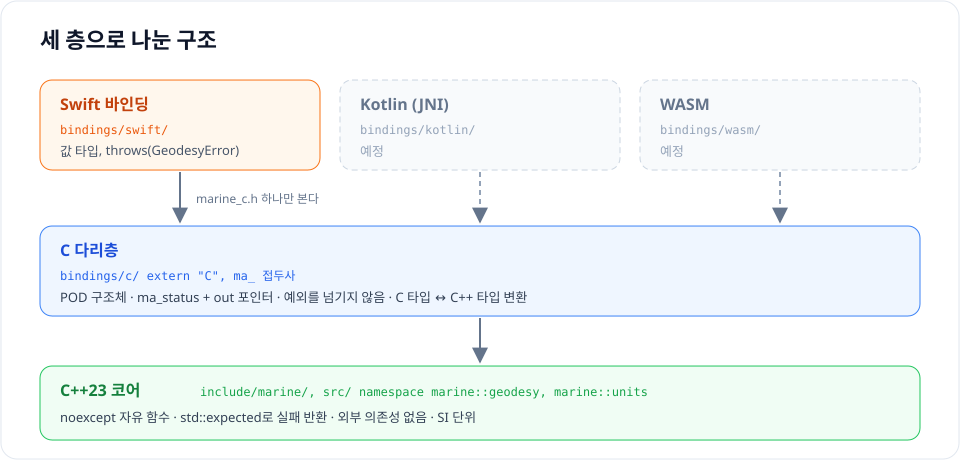

```text
marine-algorithms/
├── Package.swift            SwiftPM: iOS·macOS 앱이 가져다 쓰는 길
├── CMakeLists.txt           CMake: C++ 테스트, 이후 Android NDK가 쓰는 길
├── include/marine/          C++ 공개 헤더 (namespace marine::)
├── src/                     C++ 구현               ─┐ SwiftPM 타겟
├── bindings/                                        │ CMarineAlgorithms
│   ├── c/                                           │
│   │   ├── include/marine_c.h   C 헤더 (Swift에 보이는 유일한 헤더)
│   │   └── marine_c.cpp         extern "C" 구현    ─┘
│   └── swift/
│       ├── Sources/MarineAlgorithms/   Swift 래퍼 ← 앱이 import하는 모듈
│       └── Tests/                      Swift 테스트
└── tests/
    ├── cpp/                 C++ 테스트 (Catch2)
    └── data/                기준값 (GeodTest 일부)
```

규칙은 하나입니다. **Swift는 C 헤더 `marine_c.h`만 봅니다.** C++ 헤더는 Swift에 노출하지 않습니다.

| 층 | 하는 일 | 모르는 것 | 실패를 알리는 방법 |
| --- | --- | --- | --- |
| C++ 코어 | 계산 | 누가 자신을 부르는지 | `std::expected` |
| C 다리층 | C 타입 ↔ C++ 타입 변환 | 계산 방법 | `ma_status` + out 포인터 |
| Swift 바인딩 | C 값을 Swift 값 타입으로 | C++가 있다는 것 자체 | `throws(GeodesyError)` |

앞으로 나올 용어를 미리 정리해 두겠습니다.

| 용어 | 한 줄 설명 | 나오는 곳 |
| --- | --- | --- |
| 헤더 / 소스 | 선언(`.h`, `.hpp`)과 구현(`.c`, `.cpp`) | 2장 |
| 전처리 | `#include`를 복사·붙여넣기하는 등, 컴파일 전에 텍스트를 고치는 단계 | 2장 |
| 컴파일 | 소스 파일 **하나**를 기계어로 번역하는 단계. 프론트엔드 → 중간 코드 → 백엔드 | 2장 |
| 기계어 | CPU가 실제로 실행하는 숫자 명령. arm64는 명령 하나가 4바이트 | 2장 |
| 목적 파일 (`.o`) | 소스 하나를 컴파일한 결과. 기계어 + 심볼 표 + 아직 못 채운 빈칸 메모 | 2장 |
| 심볼 | 목적 파일 안에서 함수·변수를 가리키는 이름 | 2장 |
| AST | 소스를 문법 구조대로 나타낸 나무. 컴파일러 프론트엔드가 만든다 | 2장 |
| 중간 코드 (LLVM IR, SIL) | 언어와 CPU 사이의 공통 언어. SIL은 Swift 전용 | 2장 |
| 링커 / 링크 | 여러 `.o`를 합치며 이름을 짝짓고 빈칸에 주소를 채워 실행 파일을 만드는 도구와 단계 | 2장 |
| 정적 / 동적 라이브러리 | `.o` 묶음(`.a`) / 실행할 때 붙는 독립 파일(`.dylib`) | 2장 |
| name mangling | C++가 오버로딩을 위해 심볼 이름에 네임스페이스·인자 타입을 섞는 것 | 2장 |
| ABI | 컴파일된 코드끼리 지키는 약속. 심볼 이름, 인자 전달 방식, 구조체 메모리 배치 | 3장 |
| `extern "C"` | 이 함수는 C 방식(이름 그대로, C 호출 규약)으로 내보내라는 지시 | 3장 |
| POD 구조체 | 생성자·소멸자·가상 함수 없이 데이터만 있는 구조체. C와 메모리 배치가 같다 | 3장 |
| Clang 모듈 / 모듈맵 | C 헤더를 Swift가 `import`할 수 있는 모듈로 묶는 설명서 | 4장 |
| C++ interop | Swift 5.9부터 C++ 헤더를 직접 가져오는 기능 | 4장 |
| `std::expected` | "값 또는 오류"를 담는 C++23 타입. Swift `Result`와 비슷하다 | 6장 |
| typed throws | Swift 6의 `throws(ErrorType)`. 던지는 오류 타입을 정확히 적는다 | 8장 |

&nbsp;

---

&nbsp;

## 2. 소스 코드가 기계어가 되기까지 - C++ 따로, Swift 따로

Swift만 쓸 때는 Xcode의 ▶ 버튼 하나로 끝나서 잘 보이지 않지만, C++ 라이브러리를 붙이는 순간 그 버튼 뒤에서 일어나는 일을 알아야 합니다. 이 글에 나오는 에러 대부분이 **어느 단계에서** 났는지를 알면 바로 읽히기 때문입니다.

먼저 언어를 섞지 않고, **C++ 소스가 기계어가 되는 과정**과 **Swift 소스가 기계어가 되는 과정**을 각각 따로 보겠습니다. 두 언어를 잇는 이야기는 그다음입니다.

### 컴파일러는 번역가다

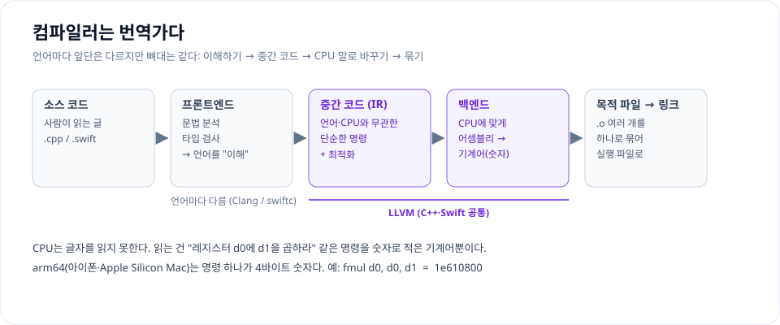

CPU는 `knots * 1852.0` 같은 글자를 읽지 못합니다. CPU가 아는 건 **기계어**, 즉 "레지스터 d0에 d1을 곱하라", "이 주소로 뛰어라" 같은 명령을 숫자로 적은 것뿐입니다. 아이폰과 Apple Silicon Mac의 arm64 CPU에서는 명령 하나가 4바이트 숫자입니다. 예를 들어 `fmul d0, d0, d1`은 `1e610800`입니다.

사람의 글을 이 숫자로 바꾸는 번역가가 **컴파일러**입니다. 언어가 달라도 컴파일러의 뼈대는 비슷합니다.

| 단계 | 하는 일 | 비유 |
| --- | --- | --- |
| 프론트엔드 | 문법을 분석해 구조(AST)로 만들고, 이름과 타입을 확인 | 원문을 읽고 뜻을 이해하기 |
| 중간 코드 (IR) | 언어에도 CPU에도 묶이지 않은 단순한 명령으로 바꾸고 최적화 | 뜻을 쉬운 말로 정리하고 군더더기 빼기 |
| 백엔드 | 특정 CPU(arm64, x86_64)의 어셈블리와 기계어로 | 목표 언어로 옮겨 쓰기 |
| 목적 파일 → 링크 | 파일마다 번역한 결과(`.o`)를 하나로 묶어 실행 파일로 | 장별로 번역한 원고를 책 한 권으로 묶기 |

프론트엔드는 언어마다 다릅니다(C++는 **Clang**, Swift는 **swiftc**). 중간 코드부터 뒤는 둘 다 **LLVM**이라는 같은 도구를 씁니다. 이 차이와 공통점을 아래에서 하나씩 확인합니다.

비교가 쉽도록 두 언어로 **똑같은 함수** 하나를 씁니다. 노트(kn)를 m/s로 바꾸는 함수입니다(1노트 = 1시간에 1852m).

> 아래 그림과 출력은 모두 `clang++`, `swiftc`의 단계별 옵션으로 직접 뽑은 실제 결과입니다.

### 2-1. C++ 소스가 기계어가 되기까지

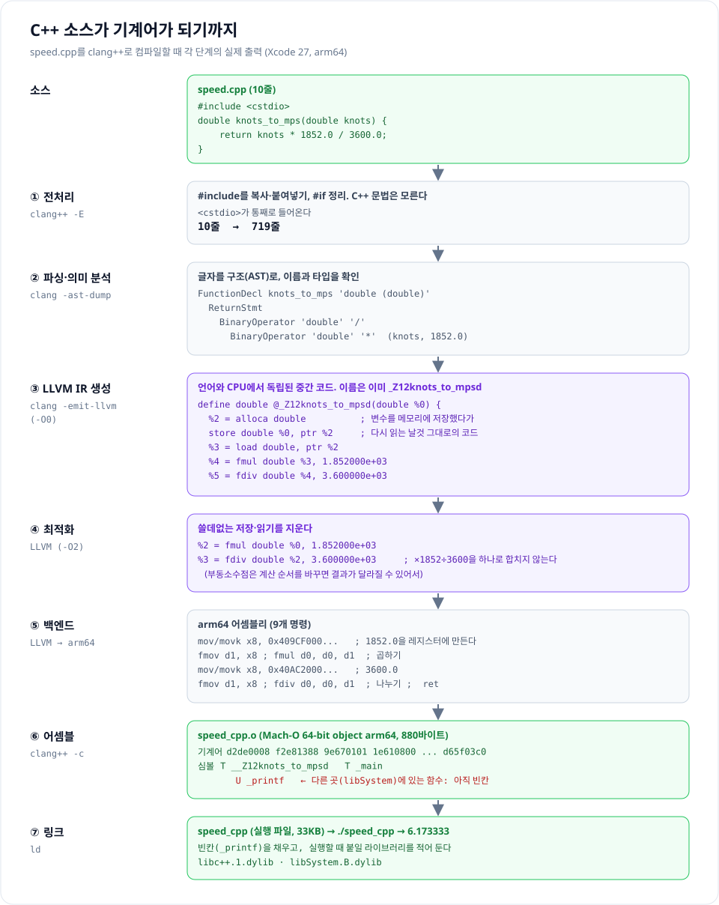

**① 전처리 - `#include`는 복사·붙여넣기다.** C++는 번역 전에 **전처리기**가 먼저 소스를 훑습니다. 전처리기는 C++ 문법을 모릅니다. `#`으로 시작하는 줄만 보고 텍스트를 고칩니다. `#include <cstdio>`는 그 헤더 파일 내용을 그 자리에 그대로 붙여 넣으라는 뜻이라, 10줄짜리 파일이 **719줄**이 됩니다. 컴파일러가 실제로 읽는 건 이 719줄입니다. `#ifdef`는 조건에 맞지 않는 줄을 지우고, `#pragma once`는 같은 헤더가 두 번 붙지 않게 막습니다.

**② 파싱·의미 분석 - 글자를 구조로.** Clang이 글자를 읽어 **AST**(추상 구문 트리)라는 나무 구조로 만듭니다. `knots * 1852.0 / 3600.0`은 "`/`의 왼쪽에 `*`가 있고, `*`의 양쪽에 `knots`와 `1852.0`이 있다"는 나무가 됩니다. 이 과정에서 `knots`가 `double`이라는 것, 함수 타입이 `double (double)`이라는 것도 확인합니다. 오타나 타입 오류는 여기서 걸립니다.

**③ LLVM IR 생성 - 중간 코드.** AST를 **LLVM IR**로 바꿉니다. 최적화를 끈(`-O0`) 결과를 보면 매개변수를 메모리에 저장(`store`)했다가 다시 읽는(`load`) 날것 그대로의 코드입니다. 함수 이름이 벌써 `_Z12knots_to_mpsd`로 바뀌어 있는데, 이건 2-4에서 다룹니다.

**④ 최적화.** `-O2`를 켜면 LLVM이 쓸데없는 저장·읽기를 지우고 곱셈과 나눗셈 두 줄만 남깁니다. `× 1852 ÷ 3600`을 `× 0.5144...` 하나로 합치지 **않는** 점이 재미있습니다. 부동소수점은 계산 순서를 바꾸면 마지막 자릿수가 달라질 수 있어서, 컴파일러가 마음대로 합치지 않습니다.

**⑤ 백엔드 - arm64 어셈블리.** IR을 arm64 명령 9개로 옮깁니다. arm64에는 실수 상수를 바로 곱하는 명령이 없어서, `1852.0`의 비트 모양(`0x409CF00000000000`)을 정수 레지스터에 만들고(`mov`, `movk`) 실수 레지스터로 옮긴 뒤(`fmov`) 곱합니다(`fmul`).

**⑥ 어셈블 - 기계어와 목적 파일.** 어셈블리를 숫자로 바꾸면 **목적 파일**(`.o`)이 나옵니다. `d2de0008 f2e81388 9e670101 1e610800 ...`이 위 9개 명령의 실제 기계어입니다. 목적 파일에는 기계어와 함께 **심볼 표**가 들어 있습니다. `T __Z12knots_to_mpsd`는 "이 파일이 가진 함수", `U _printf`는 "다른 곳에 있어야 하는 함수"입니다. `printf`는 이 파일에 없으니 부르는 자리가 아직 **빈칸**입니다.

**⑦ 링크 - 실행 파일.** 링커(`ld`)가 빈칸 `_printf`를 시스템 라이브러리(`libSystem`)와 연결하고, 실행 파일 `speed_cpp`(33KB)를 만듭니다. 실행하면 `6.173333`이 나옵니다. C++ 표준 라이브러리 `libc++`도 실행할 때 붙습니다.

<details class="notion-toggle-list" markdown="1">
<summary>C++ 단계별 명령과 실제 출력 보기</summary>

```text
$ wc -l speed.cpp
      10
$ clang++ -std=c++2b -E speed.cpp | wc -l              # ① 전처리
     719

$ clang++ -std=c++2b -fsyntax-only -Xclang -ast-dump speed.cpp   # ② AST
|-FunctionDecl <speed.cpp:4:1, line:6:1> line:4:8 used knots_to_mps 'double (double)'
| |-ParmVarDecl <col:21, col:28> col:28 used knots 'double'
| `-CompoundStmt
|   `-ReturnStmt
|     `-BinaryOperator 'double' '/'
|       |-BinaryOperator 'double' '*'
|       | |-ImplicitCastExpr 'double' <LValueToRValue>
|       | | `-DeclRefExpr 'double' lvalue ParmVar 'knots' 'double'
|       | `-FloatingLiteral 'double' 1.852000e+03

$ clang++ -std=c++2b -O0 -S -emit-llvm speed.cpp -o -   # ③ LLVM IR
define double @_Z12knots_to_mpsd(double noundef %0) #0 {
  %2 = alloca double, align 8
  store double %0, ptr %2, align 8
  %3 = load double, ptr %2, align 8
  %4 = fmul double %3, 1.852000e+03
  %5 = fdiv double %4, 3.600000e+03
  ret double %5
}

$ clang++ -std=c++2b -O2 -S -emit-llvm speed.cpp -o -   # ④ 최적화
define noundef double @_Z12knots_to_mpsd(double noundef %0) local_unnamed_addr #0 {
  %2 = fmul double %0, 1.852000e+03
  %3 = fdiv double %2, 3.600000e+03
  ret double %3
}

$ clang++ -std=c++2b -O2 -S speed.cpp -o -              # ⑤ 어셈블리
__Z12knots_to_mpsd:
	mov	x8, #263882790666240            ; =0xf00000000000
	movk	x8, #16540, lsl #48
	fmov	d1, x8
	fmul	d0, d0, d1
	mov	x8, #35184372088832             ; =0x200000000000
	movk	x8, #16556, lsl #48
	fmov	d1, x8
	fdiv	d0, d0, d1
	ret

$ clang++ -std=c++2b -O2 -c speed.cpp -o speed_cpp.o    # ⑥ 목적 파일
$ file speed_cpp.o
speed_cpp.o: Mach-O 64-bit object arm64
$ otool -t speed_cpp.o
0000000000000000 d2de0008 f2e81388 9e670101 1e610800
0000000000000010 d2c40008 f2e81588 9e670101 1e611800
0000000000000020 d65f03c0 ...
$ nm speed_cpp.o
0000000000000000 T __Z12knots_to_mpsd
0000000000000024 T _main
                 U _printf

$ clang++ speed_cpp.o -o speed_cpp && ./speed_cpp       # ⑦ 링크
6.173333
$ otool -L speed_cpp
	/usr/lib/libc++.1.dylib
	/usr/lib/libSystem.B.dylib
```

</details>

### 2-2. Swift 소스가 기계어가 되기까지

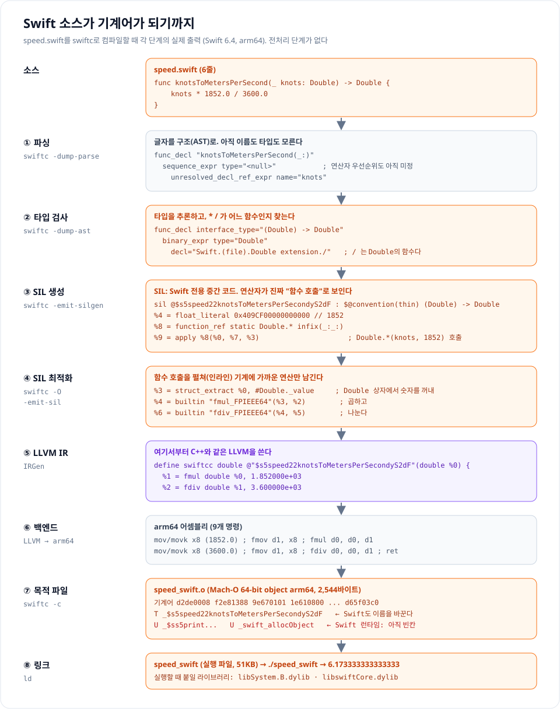

**전처리가 없습니다.** Swift에는 `#include`가 없고, 다른 코드는 `import`로 **모듈** 단위로 가져옵니다. 텍스트를 붙여 넣지 않고, 이미 컴파일된 모듈의 선언 정보를 읽습니다. 그래서 C++처럼 줄 수가 수백 배로 불어나지 않습니다.

**① 파싱 - 구조만 만든다.** swiftc도 먼저 글자를 AST로 만듭니다. 다만 이 단계의 AST에는 `type="<null>"`, `unresolved_decl_ref_expr`가 가득합니다. `knots`가 무엇인지, `*`와 `/` 중 무엇을 먼저 계산할지도 아직 정하지 않았습니다. Swift는 연산자를 라이브러리에서 정의할 수 있어서, 우선순위도 타입 검사 때 정해집니다.

**② 타입 검사 - 이름과 타입을 확정한다.** 여기서 함수 타입이 `(Double) -> Double`로 정해지고, `/`가 **`Double` 타입에 정의된 함수**(`Double extension./`)라는 것을 찾아냅니다. Swift에서 `+ - * /`는 언어에 박힌 기호가 아니라 표준 라이브러리의 함수입니다. 타입 추론, 프로토콜 확인 같은 Swift의 무거운 일이 대부분 이 단계에서 일어납니다.

**③ SIL 생성 - Swift만의 중간 코드.** C++와 가장 다른 단계입니다. swiftc는 LLVM IR로 바로 가지 않고 **SIL**(Swift Intermediate Language)이라는 Swift 전용 중간 코드를 한 번 더 거칩니다. 최적화 전 SIL을 보면 `*`가 정말로 `function_ref static Double.* infix(_:_:)`, 즉 **함수 호출**입니다. `1852.0`도 `Double.init(_builtinFloatLiteral:)` 호출로 만들어집니다.

**④ SIL 최적화 - 호출을 펼친다.** `-O`를 켜면 이 함수 호출들이 **인라인**(호출 대신 함수 몸통을 그 자리에 펼침)되어 `builtin "fmul_FPIEEE64"`, `builtin "fdiv_FPIEEE64"` 같은 기계에 가까운 연산만 남습니다. Swift가 SIL을 따로 두는 이유가 이것입니다. 참조 카운팅(ARC), 제네릭 특수화, 값 타입 복사 제거처럼 **Swift의 뜻을 알아야 할 수 있는 최적화**를 LLVM에 넘기기 전에 해 둡니다.

**⑤ LLVM IR - 여기서부터는 C++와 같은 도구.** 최적화된 SIL을 LLVM IR로 바꿉니다(IRGen). 결과를 보면 `fmul`, `fdiv` 두 줄로, 2-1의 최적화된 C++ IR과 몸통이 같습니다. 다른 점은 `swiftcc`(Swift 호출 규약)와 함수 이름 `$s5speed22knotsToMetersPerSecondyS2dF`입니다.

**⑥ 백엔드, ⑦ 목적 파일.** 이후는 C++와 같은 LLVM 백엔드가 처리합니다. 어셈블리 9개 명령, 기계어 `d2de0008 f2e81388 ...`까지 똑같습니다. 목적 파일의 심볼 표에는 `T _$s5speed22knotsToMetersPerSecondyS2dF`가 있고, `U _$ss5print...`, `U _swift_allocObject` 같은 **Swift 표준 라이브러리와 런타임** 함수가 빈칸으로 남아 있습니다.

**⑧ 링크.** 링커가 빈칸을 Swift 런타임(`libswiftCore`)과 연결해 실행 파일 `speed_swift`(51KB)를 만듭니다. 실행하면 `6.173333333333333`이 나옵니다. C++ 쪽과 자릿수가 다른 건 계산이 달라서가 아니라 `printf("%f")`와 Swift `print`가 숫자를 **보여 주는 방식**이 달라서입니다.

<details class="notion-toggle-list" markdown="1">
<summary>Swift 단계별 명령과 실제 출력 보기</summary>

```text
$ swiftc -dump-parse speed.swift                       # ① 파싱
(func_decl range=[speed.swift:2:1 - line:4:1] "knotsToMetersPerSecond(_:)"
  (result=type_unqualified_ident id="Double" unbound)
  (parameter_list (parameter "knots"))
  (brace_stmt
    (sequence_expr type="<null>"
      (unresolved_decl_ref_expr type="<null>" name="knots" function_ref=unapplied)

$ swiftc -dump-ast speed.swift                         # ② 타입 검사
(func_decl "knotsToMetersPerSecond(_:)" interface_type="(Double) -> Double" access=internal
  (parameter "knots" interface_type="Double"))
    (binary_expr type="Double"
      (dot_syntax_call_expr implicit type="(Double, Double) -> Double"
        (declref_expr decl="Swift.(file).Double extension./" function_ref=single apply)

$ swiftc -emit-silgen speed.swift                      # ③ SIL (최적화 전)
sil hidden [ossa] @$s5speed22knotsToMetersPerSecondyS2dF : $@convention(thin) (Double) -> Double {
bb0(%0 : $Double):
  %4 = float_literal $Builtin.FPIEEE64, 0x409CF00000000000 // 1852
  // function_ref Double.init(_builtinFloatLiteral:)
  %7 = apply %6(%4, %5) : ...
  // function_ref static Double.* infix(_:_:)
  %8 = function_ref @$sSd1moiyS2d_SdtFZ : $@convention(method) (Double, Double, @thin Double.Type) -> Double
  %9 = apply %8(%0, %7, %3) : ...
  ...
  // function_ref static Double./ infix(_:_:)
  %15 = apply %14(%9, %13, %2) : ...
  return %15

$ swiftc -O -emit-sil speed.swift                      # ④ SIL 최적화
bb0(%0 : $Double):
  %2 = float_literal $Builtin.FPIEEE64, 0x409CF00000000000 // 1852
  %3 = struct_extract %0, #Double._value
  %4 = builtin "fmul_FPIEEE64"(%3, %2) : $Builtin.FPIEEE64
  %5 = float_literal $Builtin.FPIEEE64, 0x40AC200000000000 // 3600
  %6 = builtin "fdiv_FPIEEE64"(%4, %5) : $Builtin.FPIEEE64
  %7 = struct $Double (%6)
  return %7

$ swiftc -O -emit-ir speed.swift                       # ⑤ LLVM IR
define hidden swiftcc double @"$s5speed22knotsToMetersPerSecondyS2dF"(double %0) local_unnamed_addr #4 {
entry:
  %1 = fmul double %0, 1.852000e+03
  %2 = fdiv double %1, 3.600000e+03
  ret double %2
}

$ swiftc -O -S speed.swift                             # ⑥ 어셈블리
_$s5speed22knotsToMetersPerSecondyS2dF:
	mov	x8, #263882790666240            ; =0xf00000000000
	movk	x8, #16540, lsl #48
	fmov	d1, x8
	fmul	d0, d0, d1
	mov	x8, #35184372088832             ; =0x200000000000
	movk	x8, #16556, lsl #48
	fmov	d1, x8
	fdiv	d0, d0, d1
	ret

$ swiftc -O -c speed.swift -o speed_swift.o            # ⑦ 목적 파일
$ nm speed_swift.o
00000000000000d8 T _$s5speed22knotsToMetersPerSecondyS2dF
0000000000000000 T _main
                 U _$ss5print_9separator10terminatoryypd_S2StF
                 U _swift_allocObject
                 U _swift_release
                 ...
$ nm speed_swift.o | grep knots | swift-demangle
speed.knotsToMetersPerSecond(Swift.Double) -> Swift.Double

$ swiftc speed_swift.o -o speed_swift && ./speed_swift # ⑧ 링크
6.173333333333333
$ otool -L speed_swift
	/usr/lib/libSystem.B.dylib
	/usr/lib/swift/libswiftCore.dylib
```

</details>

### 2-3. 나란히 놓고 보기

따로 따라가 본 두 과정을 표로 비교하면 이렇습니다.

| | C++ (`clang++`) | Swift (`swiftc`) |
| --- | --- | --- |
| 다른 코드 가져오기 | `#include` - 헤더 텍스트를 **붙여 넣음** (10줄 → 719줄) | `import` - 컴파일된 **모듈**의 선언을 읽음 |
| 프론트엔드 | 파싱과 의미 분석이 함께 | 파싱(이름·타입 미정) → 타입 검사 |
| 연산자 `*` `/` | 언어에 내장된 연산 | 표준 라이브러리 `Double`의 함수 |
| 언어 전용 중간 코드 | 없음 | **SIL** (인라인, ARC, 제네릭 최적화) |
| 공통 중간 코드 | LLVM IR | LLVM IR |
| 함수 이름 (심볼) | `__Z12knots_to_mpsd` | `_$s5speed22knotsToMetersPerSecondyS2dF` |
| 기계어 | `d2de0008 f2e81388 9e670101 1e610800 d2c40008 f2e81588 9e670101 1e611800 d65f03c0` | **바이트 하나까지 같음** |
| 목적 파일 형식 | Mach-O 64-bit object arm64 | Mach-O 64-bit object arm64 |
| 실행할 때 붙는 라이브러리 | `libc++`, `libSystem` | `libswiftCore`, `libSystem` |

앞단은 많이 다릅니다. 하지만 같은 일을 하는 함수는 결국 **같은 기계어**가 되고, 결과물은 **같은 형식의 목적 파일**입니다. 다른 점은 함수에 붙은 **이름**입니다. 이 두 사실이 다음 절의 출발점입니다.

### 2-4. 목적 파일 안의 빈칸과 링크

2-1과 2-2에서 목적 파일마다 `U`로 표시된 **빈칸**이 있었습니다. C++의 `U _printf`, Swift의 `U _swift_allocObject`처럼 다른 곳에 있는 함수를 부르는 자리입니다. 컴파일러는 파일 하나만 보고 번역하기 때문에, 남의 함수는 "이런 이름의 함수가 어딘가 있다"는 **선언**만 알고 주소는 모릅니다.

| 목적 파일 안에 든 것 | 뜻 | 보는 명령 |
| --- | --- | --- |
| 기계어 (`__TEXT,__text`) | CPU가 실행할 숫자 | `otool -t`, `otool -tv` |
| 심볼 표 | "내가 가진 함수(`T`)"와 "남에게 빌려야 하는 함수(`U`)"의 **이름** 목록 | `nm` |
| 재배치 정보 | "이 위치는 빈칸이니, 나중에 이 이름의 주소로 채워 달라"는 메모 | `otool -r` |

**링커**는 모든 `U`를 다른 파일의 같은 이름 `T`와 **이름으로** 짝짓고, 재배치 메모를 보고 빈칸에 실제 주소를 써 넣습니다. 책을 장별로 나눠 쓰고 "p.??"로 비워 둔 쪽수를, 편집자가 책을 묶으면서 채우는 것과 같습니다.

이 빈칸을 **다른 언어의 목적 파일**이 채워도 링커는 상관하지 않습니다. 2-3에서 본 대로 형식이 같고, 링커는 이름만 보기 때문입니다. 이것이 Swift에서 C++ 코드를 부를 수 있는 원리입니다. 9장까지 만들 MiniNav로 실제로 보겠습니다. Swift의 `main.o`는 C 다리 함수 `_mn_haversine_distance`를, C 다리의 `mininav_c.o`는 C++ 함수 `haversine_distance`를 빈칸으로 들고 있습니다.

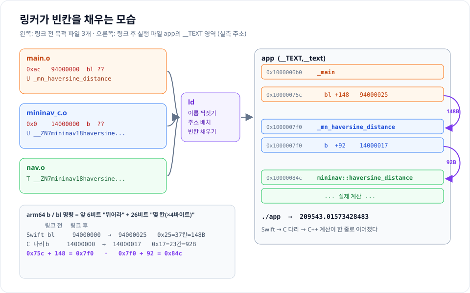

```text
$ nm main.o | grep mn_                          # Swift 쪽
                 U _mn_haversine_distance
$ nm mininav_c.o                                # C 다리 쪽
                 U __ZN7mininav18haversine_distanceENS_10CoordinateES0_
0000000000000000 T _mn_haversine_distance
$ otool -rv mininav_c.o
address  pcrel length extern type    scattered symbolnum/value
00000000 True  long   True   BR26    False     __ZN7mininav18haversine_distanceENS_10CoordinateES0_

$ swiftc main.o mininav_c.o nav.o -lc++ -o app && ./app
209543.01573428483
```

링크 전후의 같은 명령을 나란히 놓으면 빈칸이 채워진 것이 숫자로 보입니다. arm64의 `b`/`bl`(뛰어라) 명령은 앞 6비트가 명령 종류, 나머지 26비트가 "몇 칸(×4바이트) 앞으로"입니다.

| 명령 | 링크 전 | 링크 후 | 뜻 |
| --- | --- | --- | --- |
| Swift `main.o`의 `bl` | `94000000` | `94000025` | 0칸 → 37칸(148바이트) 앞 = `_mn_haversine_distance` |
| C 다리 `mininav_c.o`의 `b` | `14000000` | `14000017` | 0칸 → 23칸(92바이트) 앞 = `mininav::haversine_distance` |

> 링크 전 명령을 `otool -tv`로 풀면 `b _mn_haversine_distance`처럼 자기 자신으로 뛰는 것처럼 보입니다. "0칸 앞으로"를 그대로 해석해서 생기는 착시입니다.

### 링크가 실패하면 - 빈칸이 남았다

`nav.o`를 빼고 링크하면 이렇게 됩니다.

```text
$ swiftc main.o mininav_c.o -lc++ -o app
Undefined symbols for architecture arm64:
  "mininav::haversine_distance(mininav::Coordinate, mininav::Coordinate)", referenced from:
      _mn_haversine_distance in mininav_c.o
ld: symbol(s) not found for architecture arm64
```

"`mininav_c.o` 안의 `_mn_haversine_distance` 함수에 **빈칸이 있는데**, `mininav::haversine_distance`라는 이름을 가진 파일을 **아무도 주지 않았다**"는 뜻입니다. 원인은 둘 중 하나입니다.

- 그 이름을 가진 목적 파일이나 라이브러리를 링크에 넣지 않았다.
- 넣긴 했는데 **이름이 다르다.** 10장의 `extern "C"` 실수가 이 경우입니다.

`Undefined symbols`는 컴파일 에러가 아니라 **링크 에러**입니다. 그래서 라이브러리 타겟만 빌드하는 `swift build`는 통과하고, 실행 파일이나 테스트 번들을 만드는 순간(=링크하는 순간)에야 터집니다.

### 정적 라이브러리와 동적 라이브러리

목적 파일이 많아지면 묶어서 나눠 줍니다. 묶는 방법은 **빈칸을 언제 채우느냐**에 따라 두 가지입니다.

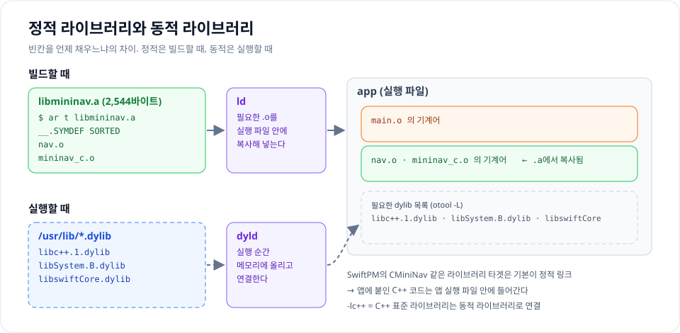

| | 정적 라이브러리 (`.a`) | 동적 라이브러리 (`.dylib`, `.so`, `.framework`) |
| --- | --- | --- |
| 정체 | 목적 파일 묶음 | 링크까지 끝난 독립 파일 |
| 빈칸 채우는 때 | **빌드할 때** 링커가 필요한 `.o`를 실행 파일에 복사 | **실행할 때** 운영체제(dyld)가 메모리에 올리고 연결 |
| 예 | `libmininav.a`, SwiftPM 라이브러리 타겟(기본) | `libc++.1.dylib`, `libSystem.B.dylib`, `libswiftCore.dylib` |

```text
$ ar rcs libmininav.a nav.o mininav_c.o      # 정적 라이브러리 만들기
$ ar t libmininav.a
__.SYMDEF SORTED
nav.o
mininav_c.o
$ swiftc main.o -L. -lmininav -lc++ -o app2 && ./app2
209543.01573428483
```

`.a`를 열어 보면 정말 `.o` 두 개가 들어 있습니다. 링크 명령의 `-lc++`는 C++ 표준 라이브러리(`libc++`)를 동적 라이브러리로 연결하라는 뜻이고, SwiftPM은 C++ 타겟이 있으면 이 옵션을 알아서 붙여 줍니다. SwiftPM에서 `CMiniNav` 같은 라이브러리 타겟은 기본적으로 **정적으로** 링크되어, 앱에 붙인 C++ 코드는 앱 실행 파일 안에 그대로 들어갑니다.

### 심볼 이름 - name mangling

마지막으로 2-3 표에서 유일하게 달랐던 **이름**입니다. 링커는 오직 이름으로만 짝짓는데, 두 언어 모두 함수 이름을 그대로 쓰지 않았습니다.

| 언어 | 소스의 이름 | 심볼 이름 | 푸는 도구 |
| --- | --- | --- | --- |
| C++ | `knots_to_mps(double)` | `__Z12knots_to_mpsd` | `c++filt` |
| Swift | `knotsToMetersPerSecond(_:)` | `_$s5speed22knotsToMetersPerSecondyS2dF` | `swift-demangle` |
| C | `mn_haversine_distance` | `_mn_haversine_distance` | (필요 없음) |

이름에 네임스페이스·모듈(`5speed`), 함수 이름 길이와 글자(`12knots_to_mps`), 인자·반환 타입(C++의 `d` = double, Swift의 `S2d` = Double 두 개, 인자와 반환값)을 섞는 것을 **name mangling**이라고 합니다. 오버로딩 때문입니다. `distance(int)`와 `distance(double)`이 둘 다 있으면, 이름으로만 짝짓는 링커가 둘을 구분하려면 인자 타입이 이름에 들어가야 합니다. C에는 오버로딩이 없어서 이름 앞에 `_` 하나만 붙입니다(Apple 플랫폼 규칙).

MiniNav를 SwiftPM으로 빌드한 목적 파일을 열어 보면 C++ 이름과 C 이름이 섞여 있습니다.

```text
$ nm -gU .build/out/Products/Debug/CMiniNav.o
0000000000000460 T __ZN7mininav13average_speedENS_10CoordinateES0_d
00000000000002e8 T __ZN7mininav18haversine_distanceENS_10CoordinateES0_
00000000000000a0 T _mn_average_speed
0000000000000000 T _mn_haversine_distance
$ nm -gU CMiniNav.o | c++filt
mininav::average_speed(mininav::Coordinate, mininav::Coordinate, double)
mininav::haversine_distance(mininav::Coordinate, mininav::Coordinate)
```

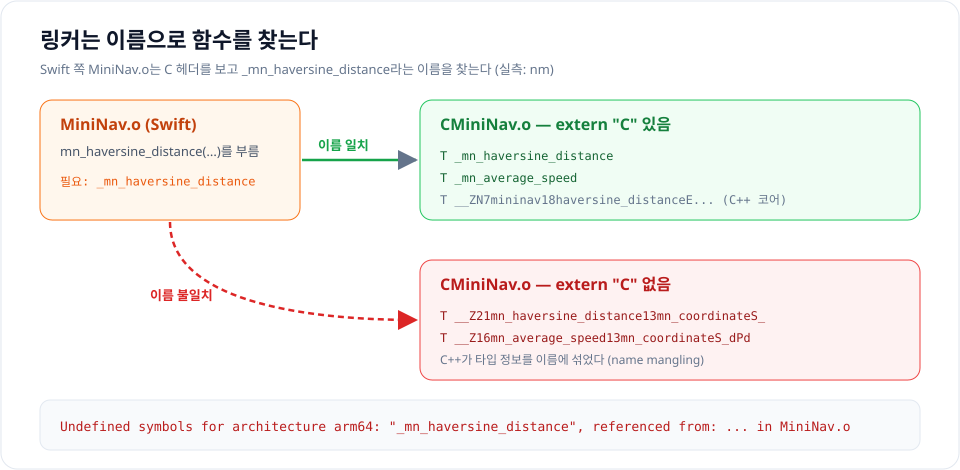

여기서 문제가 보입니다. C++와 Swift의 mangling 규칙은 **서로 다르고**, C++ 규칙은 언어 표준으로 정해져 있지도 않습니다(clang·gcc의 Itanium 방식과 MSVC 방식이 다릅니다). Swift가 C++의 이름을 맞춰 부르기는 사실상 불가능합니다. 반면 C의 이름은 단순하고 모든 언어가 압니다. 그래서 다른 언어가 부를 함수는 **C 방식 이름으로 내보내야** 합니다. 그 방법이 다음 장의 `extern "C"`입니다.

### 한 번에 정리

| 단계 / 용어 | 한 줄 요약 | 직접 보는 명령 |
| --- | --- | --- |
| 전처리 (C++만) | `#include`는 복사·붙여넣기 | `clang++ -E` |
| 파싱 / AST | 글자를 나무 구조로 | `clang -ast-dump`, `swiftc -dump-parse` |
| 타입 검사 / 의미 분석 | 이름과 타입을 확정 | `swiftc -dump-ast` |
| SIL (Swift만) | Swift 전용 중간 코드. 인라인·ARC 최적화 | `swiftc -emit-silgen`, `-emit-sil` |
| LLVM IR | 두 언어 공통 중간 코드 | `-emit-llvm`, `swiftc -emit-ir` |
| 어셈블리 / 기계어 | CPU 명령의 글자판 / 숫자판. arm64는 명령 하나가 4바이트 | `-S`, `otool -t` |
| 목적 파일 (`.o`) | 기계어 + 심볼 표 + 빈칸 메모. 두 언어 모두 Mach-O | `file`, `nm`, `otool -r` |
| 링크 | `U`와 `T`를 **이름으로** 짝짓고 빈칸에 주소를 채움 | `ld` (clang, swiftc가 대신 부름) |
| 정적 / 동적 라이브러리 | 빌드할 때 복사 / 실행할 때 연결 | `ar`, `otool -L` |
| name mangling | 이름에 타입을 섞음. C++와 Swift 규칙이 다르다 | `c++filt`, `swift-demangle` |

&nbsp;

---

&nbsp;

## 3. `extern "C"`와 C ABI - 왜 굳이 C를 한 번 거치는가

### ABI

**API**가 소스 코드 수준의 약속(함수 이름, 인자)이라면, **ABI**(Application Binary Interface)는 컴파일된 기계어 수준의 약속입니다.

| ABI가 정하는 것 | 예 |
| --- | --- |
| 심볼 이름 | `_mn_haversine_distance` vs `__ZN7mininav...` |
| 호출 규약 | 인자를 어느 레지스터에 넣는가, 반환값은 어디로 오는가 |
| 메모리 배치 | 구조체 필드 순서, 크기, 정렬(padding) |
| 예외 처리 방식 | 예외가 스택을 어떻게 거슬러 올라가는가 |

C의 ABI는 각 플랫폼(arm64 macOS, arm64 Android, x86_64 Linux...)마다 **하나로 정해져 있고 수십 년째 바뀌지 않았습니다.** 그래서 거의 모든 언어가 "C 함수 부르기"를 지원합니다. Swift는 C 헤더를 그대로 import하고, Kotlin은 JNI로, Rust는 FFI로, WASM은 export로 C 함수를 부릅니다.

### extern "C"

`extern "C"`는 C++ 컴파일러에게 **이 함수는 C ABI로 내보내라**고 알려줍니다. 이름을 mangling하지 않고, C 호출 규약을 씁니다.

```c
#ifdef __cplusplus      /* C++ 컴파일러가 읽을 때만 */
extern "C" {
#endif

double mn_haversine_distance(mn_coordinate from, mn_coordinate to);

#ifdef __cplusplus
}
#endif
```

`#ifdef __cplusplus`로 감싸는 이유는 이 헤더를 **C 컴파일러(그리고 Swift의 Clang importer)도 읽기 때문**입니다. C에는 `extern "C"`라는 문법이 없어서, C++ 컴파일러가 읽을 때만 보이게 합니다.

### C 경계를 넘을 수 있는 것과 없는 것

`extern "C"` 함수의 **시그니처**에는 C가 이해하는 타입만 쓸 수 있습니다. 함수 **안쪽**은 C++이라 무엇이든 써도 됩니다.

| 넘을 수 있다 | 넘을 수 없다 | 대신 |
| --- | --- | --- |
| `int`, `double`, `bool` | `std::string`, `std::vector` | `const char*` + 길이, 포인터 + 개수 |
| POD 구조체, `enum` | 클래스(생성자, 가상 함수) | 불투명 핸들 + `_new` / `_free` (18장) |
| 포인터 | 참조(`&`), 스마트 포인터 | 포인터 |
| 상태 코드 반환 | **예외** | 상태 코드 + out 포인터 (7장) |
| 함수 하나에 이름 하나 | 오버로딩, 템플릿, 기본 인자 | 이름을 다르게, 기본값은 Swift에서 |
| | 네임스페이스 | `mn_`, `ma_` 같은 접두사 |

특히 **예외**가 중요합니다. C++ 예외가 `extern "C"` 함수를 빠져나가 Swift 프레임으로 들어가면, Swift는 그 예외를 처리할 방법이 없어 프로세스가 죽습니다. 그래서 C 다리층 함수는 예외를 절대 밖으로 내보내지 않아야 하고, 이 글의 코어는 아예 예외 대신 `std::expected`로 실패를 반환합니다.

&nbsp;

---

&nbsp;

## 4. Swift가 C를 가져오는 방법 - 모듈맵과 C++ interop

### Clang 모듈과 모듈맵

Swift는 C 헤더를 직접 `#include`하지 않고 **Clang 모듈**로 가져옵니다. 모듈은 "이 헤더들을 묶어 `CMiniNav`라는 이름으로 import하게 한다"는 설명서(module map)로 정의됩니다. 아래는 SwiftPM이 MiniNav를 빌드하며 실제로 만든 모듈맵입니다(경로만 줄였습니다).

```text
// .build/out/Intermediates.noindex/GeneratedModuleMaps/CMiniNav.modulemap
module CMiniNav {
umbrella "<패키지 경로>/bindings/c/include"
export *
}
```

SwiftPM은 C/C++ 타겟의 `publicHeadersPath` 폴더를 보고 이 모듈맵을 **자동으로 만들어 줍니다.** 그래서 직접 모듈맵을 쓸 일은 거의 없습니다. 중요한 건 이 결과입니다.

- `publicHeadersPath` 폴더의 헤더는 **C 언어로 해석됩니다.** Swift 쪽 기본 설정에서는 C++ interop이 꺼져 있기 때문입니다.
- 그래서 이 폴더의 헤더에 `#include <expected>`나 `namespace`가 있으면 Swift 쪽에서 모듈을 만들다 실패합니다(10장에서 실제로 재현합니다).

Swift가 C 헤더를 가져오면 C 타입은 이렇게 바뀝니다. 아래 오른쪽은 `swift-synthesize-interface`로 `CMiniNav` 모듈을 Swift가 어떻게 보는지 뽑은 실제 결과입니다.

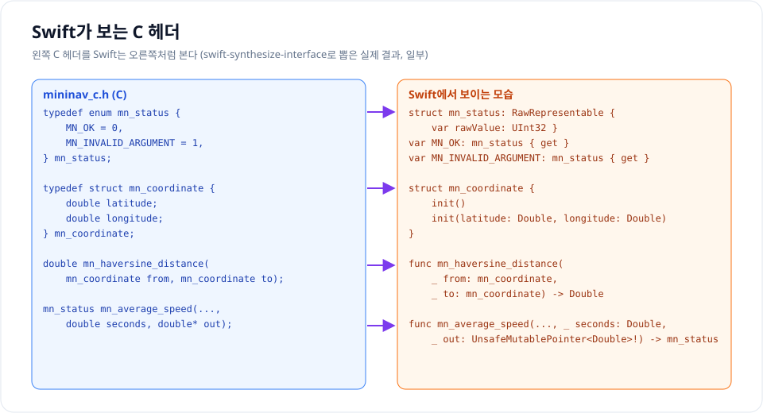

| C | Swift에서 보이는 모습 |
| --- | --- |
| `double` | `Double` (`CDouble`) |
| `typedef struct { double latitude; ... } mn_coordinate` | `struct mn_coordinate`, 멤버별 이니셜라이저 `mn_coordinate(latitude:longitude:)` |
| `typedef enum mn_status { MN_OK, ... }` | `struct mn_status` + 전역 상수 `MN_OK` |
| `double* out` | `UnsafeMutablePointer<Double>!` - `&변수`로 넘긴다 |
| `mn_filter*` (내용을 모르는 구조체) | `OpaquePointer` |

### C++ interop으로 바로 부르면 안 되나

Swift 5.9부터는 **C++ interop**이 있어서, C 다리층 없이 C++ 헤더를 바로 가져올 수 있습니다. 실제로 해 봤습니다.

<details class="notion-toggle-list" markdown="1">
<summary>C++ interop으로 바로 부르기 - 코드 보기</summary>

```swift
// Package.swift
.target(name: "CxxNav"),                                  // nav.hpp, nav.cpp
.executableTarget(
    name: "Direct",
    dependencies: ["CxxNav"],
    swiftSettings: [.interoperabilityMode(.Cxx)]          // C++ interop 켜기
),
```

```swift
// main.swift
import CxxNav

let busan = mininav.Coordinate(latitude: 35.1028, longitude: 129.0403)
let fukuoka = mininav.Coordinate(latitude: 33.5902, longitude: 130.4017)
print(mininav.haversine_distance(busan, fukuoka))

let r = mininav.average_speed(busan, fukuoka, 36_000)   // std::expected<double, NavError>
print(r.has_value())
print(r.pointee)
```

</details>

```text
209543.01573428483
true
5.820639325952357
```

잘 됩니다. 네임스페이스가 Swift 타입처럼 보이고, `std::expected`의 `has_value()`와 `pointee`까지 부를 수 있습니다.

문제는 **이 라이브러리를 가져다 쓰는 쪽**입니다. interop을 켠 라이브러리 `NavLib`를 만들고, interop을 켜지 않은 앱이 `import NavLib`하면 이렇게 됩니다.

```text
error: module 'NavLib' was built with C++ interoperability enabled,
       but current compilation does not enable C++ interoperability
```

`NavLib`의 공개 API가 Swift 타입뿐이고, C++ 모듈을 `internal import`나 `@_implementationOnly import`로 가려도 결과는 같았습니다. **C++ interop은 쓰는 쪽으로 전염됩니다.** 라이브러리를 쓰는 모든 앱 타겟이 C++ interop을 켜야 하고, 그 앱이 쓰는 다른 의존성도 C++ interop 아래에서 다시 컴파일됩니다.

| | C 다리층 | C++ interop 직접 |
| --- | --- | --- |
| 쓰는 쪽 설정 | 없음 | 앱 타겟마다 `.interoperabilityMode(.Cxx)` |
| 다른 언어(Kotlin, WASM) | 같은 C 함수를 그대로 | Swift 전용. 다른 언어는 따로 |
| 작성할 코드 | C 헤더 + 변환 코드 | 거의 없음 |
| C++ 타입 변경 | C 시그니처만 같으면 바인딩 그대로 | Swift 코드에 그대로 드러남 |
| 잘 맞는 경우 | 배포하는 라이브러리, 여러 언어 | 내 앱 안에서만 쓰는 C++ 코드 |

marine-algorithms는 **다른 앱이 가져다 쓰는 라이브러리**이고 **Kotlin·WASM 바인딩도 붙일 계획**이라 C 다리층을 택했습니다. 내 앱 안에서만 쓰는 C++라면 interop이 훨씬 간단한 선택일 수 있습니다.

&nbsp;

---

&nbsp;

# Part 2. 처음부터 만들어 보기 - MiniNav

개념을 확인하기 위해, marine-algorithms와 같은 구조를 가진 아주 작은 라이브러리 **MiniNav**를 처음부터 만들어 보겠습니다. 함수는 두 개뿐입니다.

| 함수 | 실패 | 보여주는 것 |
| --- | --- | --- |
| `haversine_distance` - 두 좌표의 대권 거리 | 없음 | 값을 그대로 돌려주는 경로 |
| `average_speed` - 두 좌표와 걸린 시간으로 평균 속력 | 시간이 0 이하 | 실패가 세 층을 넘는 경로 |

## 5. 폴더 구조와 Package.swift

```text
MiniNav/
├── Package.swift
├── include/mininav/nav.hpp            C++ 공개 헤더
├── src/nav.cpp                        C++ 구현
├── bindings/
│   ├── c/include/mininav_c.h          C 헤더 (Swift에 보임)
│   ├── c/mininav_c.cpp                extern "C" 구현
│   └── swift/
│       ├── Sources/MiniNav/MiniNav.swift
│       └── Tests/MiniNavTests/MiniNavTests.swift
```

SwiftPM 타겟은 두 개입니다. C++ 코어와 C 다리층을 **한 타겟(`CMiniNav`)**으로 컴파일하고, Swift 래퍼(`MiniNav`)가 그 위에 올라갑니다.

<details class="notion-toggle-list" markdown="1">
<summary>Package.swift - 코드 보기</summary>

```swift
// swift-tools-version: 6.0
import PackageDescription

let package = Package(
    name: "MiniNav",
    platforms: [.iOS(.v15), .macOS(.v13)],
    products: [
        .library(name: "MiniNav", targets: ["MiniNav"]),
    ],
    targets: [
        // C++ 코어 + C 다리층을 한 타겟으로 컴파일한다.
        .target(
            name: "CMiniNav",
            path: ".",
            sources: ["src", "bindings/c/mininav_c.cpp"],
            publicHeadersPath: "bindings/c/include",   // Swift에 보이는 헤더
            cxxSettings: [.headerSearchPath("include")] // C++ 헤더는 컴파일할 때만
        ),
        // Swift 래퍼
        .target(
            name: "MiniNav",
            dependencies: ["CMiniNav"],
            path: "bindings/swift/Sources/MiniNav"
        ),
        .testTarget(
            name: "MiniNavTests",
            dependencies: ["MiniNav"],
            path: "bindings/swift/Tests/MiniNavTests"
        ),
    ],
    cxxLanguageStandard: .cxx2b
)
```

</details>

설정 하나하나가 1~4장의 개념과 이어집니다.

| 설정 | 뜻 |
| --- | --- |
| `path: "."`, `sources: [...]` | 패키지 루트를 기준으로, 이 파일들만 이 타겟으로 컴파일 |
| `publicHeadersPath: "bindings/c/include"` | 이 폴더의 헤더로 모듈맵을 만든다. **Swift에 보이는 건 C 헤더뿐** |
| `.headerSearchPath("include")` | C++ 헤더는 이 타겟을 **컴파일할 때만** 찾는다. 밖으로 노출되지 않음 |
| `cxxLanguageStandard: .cxx2b` | C++23(`std::expected`). SwiftPM에서는 `cxx2b`라는 이름을 쓴다 |
| `products`에 `MiniNav`만 | 앱은 Swift 래퍼만 의존한다. `CMiniNav`는 앱에서 직접 볼 일이 없다 |

## 6. C++ 코어 - `std::expected`

코어는 다른 언어를 전혀 모르는 평범한 C++입니다.

<details class="notion-toggle-list" markdown="1">
<summary>include/mininav/nav.hpp - 코드 보기</summary>

```cpp
#pragma once
#include <expected>

namespace mininav {

struct Coordinate {
    double latitude;   // 도
    double longitude;  // 도
};

enum class NavError {
    invalid_argument,  // 시간이 0 이하
};

/// 구면 대권 거리(m). 실패하지 않는다.
double haversine_distance(Coordinate from, Coordinate to) noexcept;

/// 두 위치와 걸린 시간(s)으로 평균 속력(m/s). 시간이 0 이하면 실패.
std::expected<double, NavError>
average_speed(Coordinate from, Coordinate to, double seconds) noexcept;

} // namespace mininav
```

</details>

<details class="notion-toggle-list" markdown="1">
<summary>src/nav.cpp - 코드 보기</summary>

```cpp
#include "mininav/nav.hpp"

#include <cmath>
#include <numbers>

namespace mininav {

namespace {
constexpr double kEarthRadius = 6371008.8;  // 평균 반경(m)
constexpr double to_radians(double d) noexcept { return d * std::numbers::pi / 180.0; }
} // namespace

double haversine_distance(Coordinate from, Coordinate to) noexcept {
    const double p1 = to_radians(from.latitude), p2 = to_radians(to.latitude);
    const double dp = p2 - p1;
    const double dl = to_radians(to.longitude - from.longitude);
    const double a = std::sin(dp / 2) * std::sin(dp / 2)
                   + std::cos(p1) * std::cos(p2) * std::sin(dl / 2) * std::sin(dl / 2);
    return 2 * kEarthRadius * std::atan2(std::sqrt(a), std::sqrt(std::fmax(0.0, 1 - a)));
}

std::expected<double, NavError>
average_speed(Coordinate from, Coordinate to, double seconds) noexcept {
    if (!(seconds > 0)) return std::unexpected(NavError::invalid_argument);  // NaN도 막는다
    return haversine_distance(from, to) / seconds;
}

} // namespace mininav
```

</details>

`std::expected<T, E>`는 "값 `T`가 들어 있거나, 오류 `E`가 들어 있는" 상자입니다. Swift의 `Result<T, E>`와 거의 같습니다.

| | C++ `std::expected<double, NavError>` | Swift `Result<Double, NavError>` |
| --- | --- | --- |
| 성공 만들기 | `return 5.82;` | `.success(5.82)` |
| 실패 만들기 | `return std::unexpected(NavError::invalid_argument);` | `.failure(.invalidArgument)` |
| 성공했나 | `if (r)` / `r.has_value()` | `if case .success = r` |
| 값 / 오류 꺼내기 | `*r`, `r.value()` / `r.error()` | `try r.get()` |

예외 대신 이걸 쓰는 이유는 3장에서 본 대로 **예외는 C 경계를 넘을 수 없기 때문**입니다. 실패가 그냥 반환값이면 다리층에서 `if` 하나로 상태 코드로 바꿀 수 있습니다. 실패할 수 있다는 사실이 시그니처에 드러나는 것도 장점입니다.

`!(seconds > 0)`처럼 부정형으로 쓴 데도 이유가 있습니다. `seconds <= 0`으로 쓰면 `NaN`이 들어왔을 때 비교가 `false`라 통과해 버립니다. `NaN > 0`도 `false`이므로 부정형은 `NaN`까지 막습니다.

## 7. C 다리층 - 상태 코드와 out 포인터

C 헤더는 **C 컴파일러도 읽을 수 있는** 타입만 씁니다. C++ 헤더를 include하지 않습니다.

<details class="notion-toggle-list" markdown="1">
<summary>bindings/c/include/mininav_c.h - 코드 보기</summary>

```c
#ifndef MININAV_C_H
#define MININAV_C_H

#ifdef __cplusplus
extern "C" {
#endif

typedef enum mn_status {
    MN_OK = 0,
    MN_INVALID_ARGUMENT = 1,
} mn_status;

typedef struct mn_coordinate {
    double latitude;
    double longitude;
} mn_coordinate;

/* 실패하지 않음: 값을 돌려준다 */
double mn_haversine_distance(mn_coordinate from, mn_coordinate to);

/* 실패할 수 있음: 상태를 돌려주고, 성공했을 때만 *out에 쓴다 */
mn_status mn_average_speed(mn_coordinate from, mn_coordinate to,
                           double seconds, double* out);

#ifdef __cplusplus
}
#endif

#endif
```

</details>

- C에는 네임스페이스가 없어서 `mn_` 접두사가 그 역할을 합니다.
- `mn_coordinate`는 C++ `Coordinate`와 필드가 같지만 **일부러 다른 타입**입니다. C 헤더가 C++ 헤더를 include하지 않아야 Swift가 읽을 수 있기 때문입니다.
- 실패할 수 있는 함수는 **상태 코드를 반환하고 결과는 out 포인터에** 씁니다. C에는 `expected`도 예외도 없으니 이것이 C의 관용적인 방식입니다.

구현은 "C 타입을 C++ 타입으로 → 코어 호출 → 결과를 C 타입으로"가 전부입니다. 이 파일은 `.cpp`라서 C++ 헤더를 마음껏 include합니다.

<details class="notion-toggle-list" markdown="1">
<summary>bindings/c/mininav_c.cpp - 코드 보기</summary>

```cpp
#include "mininav_c.h"
#include "mininav/nav.hpp"

namespace {
mininav::Coordinate to_cpp(mn_coordinate c) noexcept { return {c.latitude, c.longitude}; }

mn_status to_c(mininav::NavError e) noexcept {
    switch (e) {
    case mininav::NavError::invalid_argument: return MN_INVALID_ARGUMENT;
    }
    return MN_INVALID_ARGUMENT;
}
} // namespace

extern "C" {

double mn_haversine_distance(mn_coordinate from, mn_coordinate to) {
    return mininav::haversine_distance(to_cpp(from), to_cpp(to));
}

mn_status mn_average_speed(mn_coordinate from, mn_coordinate to,
                           double seconds, double* out) {
    if (!out) return MN_INVALID_ARGUMENT;
    const auto r = mininav::average_speed(to_cpp(from), to_cpp(to), seconds);
    if (!r) return to_c(r.error());  // 실패: out은 그대로
    *out = *r;
    return MN_OK;
}

} // extern "C"
```

</details>

- 변환 함수(`to_cpp`, `to_c`)는 익명 네임스페이스에 둬서 이 파일 밖으로 나가지 않습니다.
- `to_c`의 `switch`에는 `default`를 두지 않습니다. 나중에 `NavError`에 값이 추가되면 컴파일러가 "처리하지 않은 case" 경고를 내서, 다리층을 고쳐야 한다는 걸 알려줍니다.
- **실패하면 out을 건드리지 않습니다.** 쓰는 쪽이 out을 미리 초기화해 두면, 실패해도 그 값을 믿을 수 있습니다.

## 8. Swift 래퍼 - 값 타입과 typed throws

마지막으로 C 함수를 Swift다운 API로 감쌉니다.

<details class="notion-toggle-list" markdown="1">
<summary>bindings/swift/Sources/MiniNav/MiniNav.swift - 코드 보기</summary>

```swift
import CMiniNav

public struct Coordinate: Hashable, Sendable {
    public var latitude: Double
    public var longitude: Double

    public init(latitude: Double, longitude: Double) {
        self.latitude = latitude
        self.longitude = longitude
    }

    // Swift → C. internal이라 라이브러리 밖에서는 mn_coordinate가 보이지 않는다.
    var c: mn_coordinate { mn_coordinate(latitude: latitude, longitude: longitude) }
}

public enum NavError: Error, Hashable, Sendable {
    case invalidArgument
}

public enum Nav {
    /// 구면 대권 거리(m)
    public static func distance(from: Coordinate, to: Coordinate) -> Double {
        mn_haversine_distance(from.c, to.c)
    }

    /// 평균 속력(m/s). 시간이 0 이하면 throw.
    public static func averageSpeed(
        from: Coordinate, to: Coordinate, seconds: Double
    ) throws(NavError) -> Double {
        var out = 0.0
        guard mn_average_speed(from.c, to.c, seconds, &out) == MN_OK else {
            throw .invalidArgument
        }
        return out
    }
}
```

</details>

| C에서 | Swift에서 | 방법 |
| --- | --- | --- |
| `mn_coordinate` | `Coordinate` (`Hashable`, `Sendable`) | 같은 필드의 Swift 구조체로 감싸고, C로 가는 변환은 `internal` |
| `mn_status` + `double* out` | `throws(NavError) -> Double` | `&out`으로 Swift 변수를 out 포인터에 넘기고, `MN_OK`가 아니면 throw |
| `mn_` 접두사 | `Nav.distance(from:to:)` | 네임스페이스 역할의 `enum`과 인자 레이블 |

쓰는 쪽에서는 C++가 있다는 걸 전혀 모릅니다.

```swift
import MiniNav

let d = Nav.distance(from: busan, to: fukuoka)                          // 209,543 m
let v = try Nav.averageSpeed(from: busan, to: fukuoka, seconds: 36_000) // 5.82 m/s
```

## 9. 테스트하고 심볼 확인하기

Swift Testing으로 세 가지만 확인합니다. 거리 값, 속력 값, 그리고 실패가 `throw`로 바뀌는지입니다.

<details class="notion-toggle-list" markdown="1">
<summary>MiniNavTests.swift - 코드 보기</summary>

```swift
import Testing
import MiniNav

let busan = Coordinate(latitude: 35.1028, longitude: 129.0403)
let fukuoka = Coordinate(latitude: 33.5902, longitude: 130.4017)

@Test func distanceBusanFukuoka() {
    let d = Nav.distance(from: busan, to: fukuoka)
    #expect(abs(d - 209_543) < 1)
}

@Test func averageSpeedOverTenHours() throws {
    let v = try Nav.averageSpeed(from: busan, to: fukuoka, seconds: 36_000)
    #expect(abs(v - 5.82) < 0.01)   // 약 5.82 m/s ≈ 11.3노트
}

@Test func zeroSecondsThrows() {
    #expect(throws: NavError.invalidArgument) {
        try Nav.averageSpeed(from: busan, to: fukuoka, seconds: 0)
    }
}
```

</details>

```text
$ swift test
✔ Test zeroSecondsThrows() passed after 0.001 seconds.
✔ Test distanceBusanFukuoka() passed after 0.001 seconds.
✔ Test averageSpeedOverTenHours() passed after 0.001 seconds.
✔ Test run with 3 tests in 0 suites passed after 0.001 seconds.
```

처음에는 거리 기대값을 "부산-후쿠오카 약 208km, 오차 1km"로 적었다가 테스트가 실패했습니다. 실제 값은 **209,543m**였습니다. 대략적인 값으로 테스트를 쓰면 이렇게 걸러지니, 기준값은 직접 계산해서 넣는 편이 안전합니다.

빌드된 목적 파일의 심볼은 2장에서 본 그대로입니다. C++ 코어 함수는 mangling된 이름, 다리층 함수는 `_mn_...` C 이름입니다. Swift 쪽이 찾는 것은 C 이름 두 개뿐입니다.

## 10. 자주 하는 실수 두 가지

### 실수 1. `extern "C"`를 빼먹었다

헤더와 구현에서 `extern "C"`를 지우고 다시 빌드해 봤습니다. `swift build`(라이브러리만 빌드)는 **성공합니다.** 링크가 일어나지 않기 때문입니다. 링크가 일어나는 `swift test`에서 이렇게 실패합니다.

```text
Undefined symbols for architecture arm64:
  "_mn_average_speed", referenced from:
      static MiniNav.Nav.averageSpeed(...) throws(MiniNav.NavError) -> Swift.Double in MiniNav.o
  "_mn_haversine_distance", referenced from:
      static MiniNav.Nav.distance(...) -> Swift.Double in MiniNav.o
ld: symbol(s) not found for architecture arm64
```

이때 `nm`으로 보면 원인이 바로 보입니다.

```text
$ nm -gU CMiniNav.o | grep mn_
00000000000000a0 T __Z16mn_average_speed13mn_coordinateS_dPd
0000000000000000 T __Z21mn_haversine_distance13mn_coordinateS_
```

함수는 분명히 있습니다. 다만 C++ 컴파일러가 이름을 `__Z21mn_haversine_distance13mn_coordinateS_`로 바꿔 버려서, Swift가 찾는 `_mn_haversine_distance`와 이름이 다릅니다(2장 그림의 빨간 경로). **"Undefined symbols"인데 함수를 분명히 구현했다면, 가장 먼저 `extern "C"`를 의심하면 됩니다.**

### 실수 2. C 헤더에 C++ 헤더를 include했다

C 헤더에서 C++ 타입을 쓰고 싶어서 `#include <expected>`를 넣으면 이렇게 됩니다.

```text
error: clang dependency scanning failure: While building module 'CMiniNav' imported from module-include.input:1:
bindings/c/include/mininav_c.h:4:10: fatal error: 'expected' file not found
error: bindings/swift/Sources/MiniNav/MiniNav.swift:1:8 unable to resolve module dependency: 'CMiniNav'
```

`<expected>`는 분명히 있는 헤더인데 "file not found"가 납니다. 4장에서 본 대로 **Swift는 공개 헤더를 C로 읽기 때문**입니다. C 모드에서는 C++ 표준 라이브러리 헤더 경로를 찾지 않습니다. 공개 헤더에는 C만, C++는 `.cpp`와 `include/` 쪽에만 둡니다.

| 증상 | 원인 | 확인 방법 |
| --- | --- | --- |
| `swift build`는 되는데 `swift test`나 앱 빌드에서 `Undefined symbols` | `extern "C"` 빠짐 | `nm -gU`로 `__Z...` 이름인지 |
| `fatal error: '<C++ 헤더>' file not found`, `could not build module` | 공개 헤더가 C++ 헤더를 include | 공개 헤더의 `#include` 목록 |

&nbsp;

---

&nbsp;

# Part 3. 실제 라이브러리 - marine-algorithms

MiniNav와 뼈대는 똑같습니다. 실제 라이브러리에서는 여기에 **설계 규칙, 정확도 기준값, 빌드 두 갈래, 함정**이 더해집니다.

## 11. 코어 설계 규칙

| 규칙 | 이유 |
| --- | --- |
| C++23 | `std::expected`를 쓰기 위해. Android NDK r26(clang 17, libc++ 17)과 Swift 패키지 양쪽에서 빌드됩니다 |
| 외부 의존성 없음 (테스트용 Catch2만) | 모바일 빌드에 끌고 갈 것이 없어야 합니다 |
| 공개 API는 SI 단위와 도(°) | 거리 m, 시간 s, 속도 m/s. 내부 계산만 라디안 |
| 순수 계산은 `noexcept` 자유 함수 | 상태가 없으니 클래스가 필요 없습니다. 필터처럼 상태가 필요한 것만 클래스로 |
| 실패는 `std::expected`로 반환 | 예외를 쓰지 않으니 C 경계에서 잡을 것도 없습니다 |

<details class="notion-toggle-list" markdown="1">
<summary>include/marine/geodesy.hpp (일부) - 코드 보기</summary>

```cpp
namespace marine::geodesy {

/// 위도·경도(도 단위).
struct Coordinate {
    double latitude;
    double longitude;
};

/// 회전 타원체. 장반경 a(m)와 편평률 f.
struct Ellipsoid {
    double semi_major_axis;
    double flattening;
};

/// GPS가 쓰는 WGS84 타원체.
inline constexpr Ellipsoid kWGS84{6378137.0, 1 / 298.257223563};

enum class GeodesyError {
    /// 반복 계산이 수렴하지 않았다. 두 점이 거의 대척점일 때 생긴다.
    not_converged,
};

/// 실패하지 않는 계산: 값을 그대로 돌려준다.
double haversine_distance(Coordinate from, Coordinate to) noexcept;

/// 실패할 수 있는 계산: std::expected로 돌려준다.
std::expected<InverseSolution, GeodesyError>
vincenty_inverse(Coordinate from, Coordinate to,
                 const Ellipsoid& ellipsoid = kWGS84) noexcept;

} // namespace marine::geodesy
```

</details>

함수가 두 종류로 나뉩니다. MiniNav의 `haversine_distance` / `average_speed`와 같은 구도입니다.

- **하버사인**은 지구를 구로 보고 닫힌 식으로 바로 계산합니다. 실패할 일이 없으니 `double`을 그대로 돌려줍니다.
- **Vincenty**는 지구를 타원체(WGS84)로 보고 고정점 반복으로 답을 찾습니다. 두 점이 거의 지구 반대편(대척점)에 있으면 반복이 흔들리며 수렴하지 않습니다. 그래서 `std::expected<InverseSolution, GeodesyError>`를 돌려줍니다.

<details class="notion-toggle-list" markdown="1">
<summary>vincenty.cpp 반복 루프 - 코드 보기</summary>

```cpp
for (;; ++iteration) {
    if (iteration == kMaxIterations)
        return std::unexpected(GeodesyError::not_converged);
    // ... λ 갱신 ...

    // 대척점 근처에서는 λ가 π를 넘어 흔들리며 수렴하지 않는다.
    if (std::fabs(lambda) > std::numbers::pi)
        return std::unexpected(GeodesyError::not_converged);
    if (std::fabs(lambda - previous) < kTolerance) break;
}
// ...
return InverseSolution{distance, initial_bearing, final_bearing};
```

</details>

## 12. 다리층 규칙

| 규칙 | 이유 |
| --- | --- |
| 값으로 넘길 수 있는 건 POD 구조체(`ma_coordinate`) | 수명 관리가 필요 없습니다 |
| 상태 있는 객체는 불투명 핸들 + `ma_*_new` / `ma_*_free` | C++ 타입을 숨기고, 누가 해제하는지 분명히 합니다 |
| 실패할 수 있는 함수는 `ma_status`를 돌려주고 결과는 out 포인터에. 실패하면 out은 그대로 | C·JNI·WASM은 C++ 예외를 받을 수 없습니다 |
| 실패하지 않는 함수는 결과를 값으로 | 쓰는 쪽이 상태를 확인할 필요가 없습니다 |
| 콜백을 두지 않습니다(pull 방식) | 거꾸로 넘어가는 콜백은 바인딩마다 가장 까다로운 부분입니다 |

MiniNav와 다른 점은 기본 인자 하나입니다. C++ `vincenty_inverse`에는 `ellipsoid = kWGS84` 기본값이 있지만 C에는 기본 인자가 없습니다. 그래서 C에는 `ma_wgs84()` 함수를 두고, Swift에서 `ellipsoid: Ellipsoid = .wgs84`로 기본값을 되살립니다.

<details class="notion-toggle-list" markdown="1">
<summary>marine_c.h / marine_c.cpp (일부) - 코드 보기</summary>

```c
typedef enum ma_status {
    MA_OK = 0,
    MA_NOT_CONVERGED = 1,     /* Vincenty 역문제의 대척점 근처 */
    MA_INVALID_ARGUMENT = 2,  /* out 포인터가 NULL */
} ma_status;

ma_ellipsoid ma_wgs84(void);

ma_status ma_vincenty_inverse(ma_coordinate from, ma_coordinate to,
                              ma_ellipsoid ellipsoid, ma_inverse* out);
```

```cpp
ma_status ma_vincenty_inverse(ma_coordinate from, ma_coordinate to,
                              ma_ellipsoid ellipsoid, ma_inverse* out) {
    if (!out) return MA_INVALID_ARGUMENT;
    const auto r = geo::vincenty_inverse(to_cpp(from), to_cpp(to), to_cpp(ellipsoid));
    if (!r) return to_c(r.error());   // 실패: out을 건드리지 않고 돌아간다
    *out = to_c(*r);                   // 성공했을 때만 쓴다
    return MA_OK;
}
```

```swift
public static func vincentyInverse(
    from: Coordinate, to: Coordinate, ellipsoid: Ellipsoid = .wgs84
) throws(GeodesyError) -> InverseSolution {
    var out = ma_inverse()
    let status = ma_vincenty_inverse(from.c, to.c, ellipsoid.c, &out)
    guard status == MA_OK else { throw GeodesyError(status) }
    return InverseSolution(out)
}
```

</details>

Swift에서 `&out`은 항상 유효한 포인터라 `MA_INVALID_ARGUMENT`는 여기까지 올 수 없습니다. 그래서 `GeodesyError(status)` 안에서 `precondition`으로 막아 둡니다. 도달할 수 없는 경우를 조용히 다른 오류로 바꾸지 않고, 일어나면 바로 드러나게 하는 것입니다.

## 13. 실패가 층을 넘는 방식

실패 하나를 세 층에 걸쳐 따라가 보겠습니다.

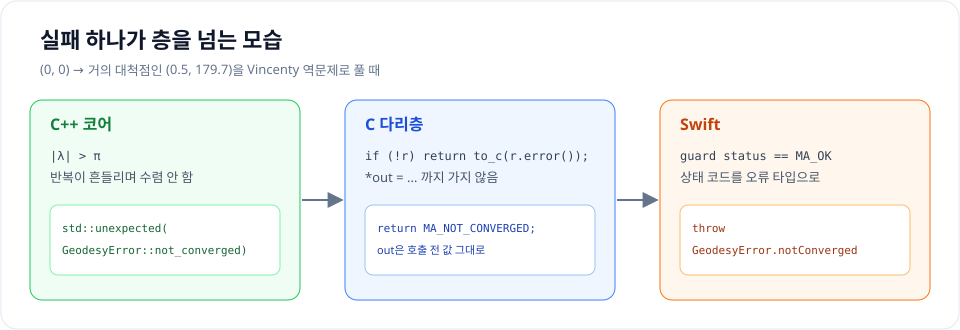

| 층 | 성공 | 실패 |
| --- | --- | --- |
| C++ | `std::expected`에 값 | `std::unexpected(GeodesyError::not_converged)` |
| C | `MA_OK`, 결과는 `out`에 | `MA_NOT_CONVERGED`, `out`은 그대로 |
| Swift | 값을 반환 | `throw GeodesyError.notConverged` |

실패는 층을 넘을 때마다 **그 언어에서 자연스러운 방식**으로 바뀝니다. C++ 개발자는 `expected`를, C 개발자는 상태 코드를, Swift 개발자는 `throws`를 봅니다. 어느 층에서도 예외가 경계를 넘지 않습니다.

## 14. 빌드 두 갈래 - CMake와 SwiftPM

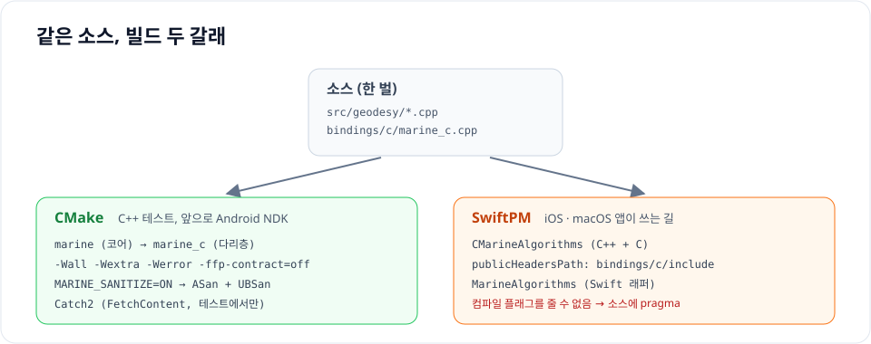

소스는 한 벌인데 빌드 시스템은 두 개입니다.

| | CMake | SwiftPM |
| --- | --- | --- |
| 쓰는 곳 | C++ 테스트, 이후 Android NDK | iOS·macOS 앱 |
| 만드는 것 | 정적 라이브러리 `marine`(코어), `marine_c`(다리층) | `CMarineAlgorithms` + `MarineAlgorithms` 모듈 |
| 컴파일 플래그 | `-Wall -Wextra -Wpedantic -Werror -ffp-contract=off` | 원격 의존성으로 쓰이려면 `unsafeFlags`를 쓸 수 없음 |
| 테스트 | Catch2 (ASan + UBSan) | Swift Testing |

<details class="notion-toggle-list" markdown="1">
<summary>CMakeLists.txt - 코드 보기</summary>

```cmake
cmake_minimum_required(VERSION 3.24)
project(marine_algorithms VERSION 0.1.0 LANGUAGES CXX)

set(CMAKE_CXX_STANDARD 23)
set(CMAKE_CXX_STANDARD_REQUIRED ON)
set(CMAKE_CXX_EXTENSIONS OFF)

option(MARINE_BUILD_TESTS "Build C++ tests" ${PROJECT_IS_TOP_LEVEL})
option(MARINE_SANITIZE "Build with AddressSanitizer + UBSan" OFF)

if(MARINE_SANITIZE)
    add_compile_options(-fsanitize=address,undefined -fno-omit-frame-pointer)
    add_link_options(-fsanitize=address,undefined)
endif()

# C++ 코어
add_library(marine src/geodesy/haversine.cpp src/geodesy/vincenty.cpp)
target_include_directories(marine PUBLIC ${PROJECT_SOURCE_DIR}/include)
target_compile_options(marine PRIVATE -Wall -Wextra -Wpedantic -Werror -ffp-contract=off)

# C 다리층
add_library(marine_c bindings/c/marine_c.cpp)
target_include_directories(marine_c PUBLIC ${PROJECT_SOURCE_DIR}/bindings/c/include)
target_link_libraries(marine_c PRIVATE marine)
target_compile_options(marine_c PRIVATE -Wall -Wextra -Wpedantic -Werror)

if(MARINE_BUILD_TESTS)
    include(FetchContent)
    FetchContent_Declare(Catch2
        GIT_REPOSITORY https://github.com/catchorg/Catch2.git
        GIT_TAG v3.7.1
        GIT_SHALLOW TRUE)
    FetchContent_MakeAvailable(Catch2)

    enable_testing()
    add_executable(marine_tests
        tests/cpp/haversine_test.cpp tests/cpp/vincenty_test.cpp
        tests/cpp/units_test.cpp tests/cpp/c_api_test.cpp)
    target_link_libraries(marine_tests PRIVATE marine marine_c Catch2::Catch2WithMain)
    include(Catch)
    catch_discover_tests(marine_tests)
endif()
```

</details>

`marine_c`가 `marine`을 `PRIVATE`로 링크하는 점을 보면, 다리층을 쓰는 쪽에는 C++ 헤더 경로가 전파되지 않습니다. SwiftPM의 `publicHeadersPath` / `headerSearchPath` 구분과 같은 일을 CMake에서 하는 것입니다.

## 15. 테스트는 층마다 맡는 것이 다르다

같은 내용을 세 층에서 반복해서 테스트하지 않습니다. 층마다 맡는 질문이 다릅니다.

| 층 | 묻는 것 | 도구 |
| --- | --- | --- |
| C++ | 알고리즘이 **정확한가** | Catch2, 공개 기준값(GeodTest) |
| C API | 코어와 **같은 값을** 돌려주는가 | Catch2 |
| Swift | 바인딩이 **제대로 이어졌는가** | Swift Testing(`@Test`) |

### C++ - 공개 기준값과 비교

정확도 기준값은 GeographicLib이 공개한 측지선 테스트 데이터 GeodTest에서 400쌍을 가져왔습니다.

<details class="notion-toggle-list" markdown="1">
<summary>vincenty_test.cpp - 코드 보기</summary>

```cpp
TEST_CASE("vincenty_inverse: 수렴하면 GeodTest와 맞고, 실패는 대척점 근처에서만 난다") {
    const auto cases = marine::test::load_geodtest();
    REQUIRE(cases.size() == 400);

    int failures = 0;
    double worst_distance = 0, min_failed_arc = 180;
    for (const auto& c : cases) {
        const auto r = vincenty_inverse({c.lat1, c.lon1}, {c.lat2, c.lon2});
        if (!r) {
            CHECK(r.error() == GeodesyError::not_converged);
            ++failures;
            min_failed_arc = std::min(min_failed_arc, c.a12);
            continue;
        }
        worst_distance = std::max(worst_distance, std::fabs(r->distance - c.s12));
    }
    CHECK(worst_distance < 1e-3);
    // 실패는 보조 구 위의 호가 179도를 넘는(대척점에서 1도 안쪽) 경우에만.
    CHECK(min_failed_arc > 179);
}
```

</details>

이 테스트는 "정확하다"만 보지 않고 **"실패는 대척점 근처에서만 난다"**도 같이 확인합니다. 실패를 허용하는 함수라면, 실패가 엉뚱한 곳에서 나지 않는다는 것까지 테스트해야 합니다.

ASan + UBSan을 켜고 돌린 결과입니다.

```text
vincenty_inverse: failures=66, min failed a12=179.542755, worst distance error=7.813e-05 m
vincenty_direct: worst position error=9.034e-05 m
===============================================================================
All tests passed (539 assertions in 13 test cases)
```

| | 수렴 | 최대 오차 | 실패한 쌍 |
| --- | --- | --- | --- |
| 역문제 (두 점 → 거리·방위) | 334 / 400 | **0.078mm** | 66쌍, 모두 보조 구 위 호 179.54° 이상(대척점 근처) |
| 정문제 (출발점·방위·거리 → 도착점) | 400 / 400 | **0.090mm** | 없음 |

### C API - 코어와 같은지만

```cpp
SECTION("수렴하지 않으면 MA_NOT_CONVERGED, out은 그대로") {
    ma_inverse out{-1, -1, -1};
    CHECK(ma_vincenty_inverse({0, 0}, {0.5, 179.7}, ma_wgs84(), &out) == MA_NOT_CONVERGED);
    CHECK(out.distance == -1);
}
```

다리층 테스트는 정확도를 다시 재지 않고 `ma_haversine_distance(...) == geo::haversine_distance(...)`처럼 **코어 결과와 비트 단위로 같은지**만 봅니다. 그리고 "실패하면 out은 그대로" 규칙을 여기서 고정합니다.

### Swift - 이어졌는지만

Swift 쪽 11개 테스트는 "부산-후쿠오카 거리가 맞는 범위인가", "대척점에서 `throw`가 나오는가" 정도만 봅니다. 정확도는 이미 C++에서 0.1mm 단위로 확인했으니까요.

```text
$ swift test
✔ Suite UnitsTests passed after 0.001 seconds.
✔ Suite GeodesyTests passed after 0.001 seconds.
✔ Test run with 11 tests in 2 suites passed after 0.001 seconds.
```

## 16. 데모 앱에서 확인하기

레포의 `demo/`에는 이 라이브러리를 로컬 패키지로 가져다 쓰는 SwiftUI 데모 앱이 있습니다. 앱 코드는 `import MarineAlgorithms`만 하고, C나 C++는 전혀 보지 않습니다. iPhone 17 시뮬레이터(iOS 27)에서 실행한 화면입니다.

<div style="display: flex; flex-wrap: wrap; gap: 16px; justify-content: center;">
  <figure style="width: 240px; margin: 0;">
    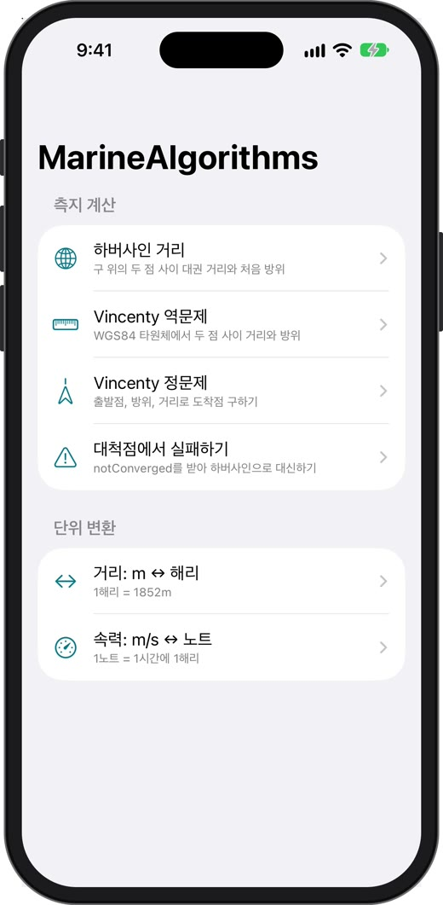
    <figcaption style="font-size: 0.8em; text-align: center;">예제 목록</figcaption>
  </figure>
  <figure style="width: 240px; margin: 0;">
    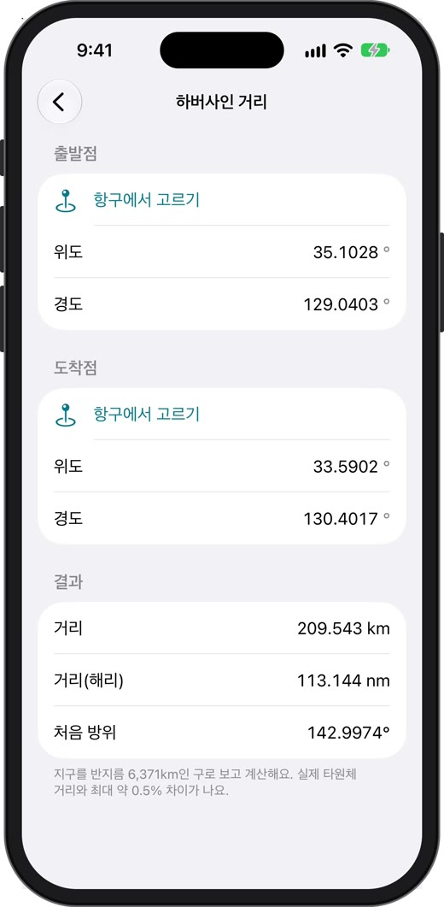
    <figcaption style="font-size: 0.8em; text-align: center;">하버사인: 부산 → 후쿠오카</figcaption>
  </figure>
</div>

<div style="display: flex; flex-wrap: wrap; gap: 16px; justify-content: center; margin-top: 16px;">
  <figure style="width: 240px; margin: 0;">
    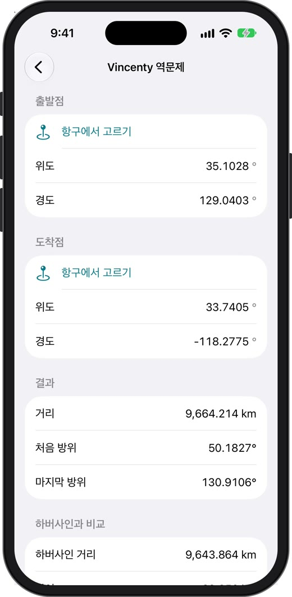
    <figcaption style="font-size: 0.8em; text-align: center;">Vincenty 역문제: 부산 → LA</figcaption>
  </figure>
  <figure style="width: 240px; margin: 0;">
    
    <figcaption style="font-size: 0.8em; text-align: center;">대척점: notConverged → 하버사인</figcaption>
  </figure>
</div>

| 화면 | 값 | 확인할 것 |
| --- | --- | --- |
| 하버사인 | 부산 → 후쿠오카 209.543km (113.144해리), 처음 방위 142.9974° | MiniNav 테스트 값과 같다. 같은 공식, 같은 반경 |
| Vincenty 역문제 | 부산 → LA 9,664.214km, 하버사인 9,643.864km | 타원체와 구의 차이가 약 20km(0.2%) |
| 대척점 | (0, 0) → (0.5, 179.7): `notConverged`, 하버사인으로 19,950.277km | C++의 `std::unexpected`가 Swift `catch`까지 왔다 |

마지막 화면이 13장의 실패 경로가 실제 앱에서 동작하는 모습입니다. 앱 코드는 이것뿐입니다.

```swift
do {
    d = try Geodesy.vincentyInverse(from: a, to: b).distance
} catch .notConverged {
    d = Geodesy.haversineDistance(from: a, to: b)
}
```

## 17. 실제로 걸렸던 함정들

### FMA가 같은 점의 거리를 0이 아니게 만든다

컴파일러는 `a * b + c`를 FMA(fused multiply-add) 명령 하나로 합칠 수 있습니다. 반올림을 한 번만 하니 보통은 더 정확하지만, **두 값이 서로 지워지도록 짠 식**에서는 오히려 결과가 어긋납니다. 같은 점 사이의 거리가 정확히 0이 아니게 되는 식입니다.

CMake에는 `-ffp-contract=off`를 줬는데, SwiftPM에는 같은 플래그를 줄 마땅한 방법이 없습니다. `unsafeFlags`가 있지만 이걸 쓰면 다른 패키지가 이 패키지를 원격 의존성으로 가져올 수 없습니다. 그래서 소스 파일에 직접 적었습니다.

```cpp
// 곱셈·덧셈을 FMA 하나로 합치지 않는다. SwiftPM은 컴파일 플래그를 줄 수 없어 소스에 둔다.
#if defined(__clang__)
#pragma clang fp contract(off)
#endif
```

빌드 시스템이 두 개면 **한쪽에만 준 컴파일 플래그는 없는 것과 같다**고 보는 게 안전합니다. 결과에 영향을 주는 설정은 소스에 두는 편이 낫습니다.

### 반올림 때문에 생기는 NaN과 360°

부동소수점 계산에서는 수학적으로 불가능한 값이 나옵니다.

```cpp
// 하버사인: 반올림 오차로 a가 1을 살짝 넘으면 sqrt(1 - a)가 NaN이 된다.
const double c = 2 * std::atan2(std::sqrt(a), std::sqrt(std::fmax(0.0, 1 - a)));

// 방위를 [0, 360)으로: -1e-20 + 360처럼 반올림으로 360이 되는 경우.
inline double normalize_bearing(double degrees) noexcept {
    double r = std::fmod(degrees, 360.0);
    if (r < 0) r += 360.0;
    return r >= 360.0 ? 0.0 : r + 0.0;   // + 0.0은 -0.0을 0.0으로
}
```

API 문서에 "방위는 [0, 360)"이라고 적었다면, 360.0이나 -0.0이 나오지 않는다는 것까지 코드로 보장해야 합니다. 다른 언어로 넘어간 뒤에 `== 0` 비교나 `switch`가 어긋나면 원인을 찾기가 훨씬 어렵습니다.

### Linux에서 std::expected가 없다

CI는 Ubuntu에서 돌립니다. macOS의 Swift 툴체인은 libc++를 쓰지만 Linux의 Swift는 시스템 libstdc++를 씁니다. `std::expected`는 libstdc++ 12부터 들어왔기 때문에, 오래된 이미지에서는 C++ 타겟이 빌드되지 않습니다. 그래서 Ubuntu 24.04(libstdc++ 13) 기반 Swift 이미지를 씁니다.

```yaml
swift:
  runs-on: ubuntu-latest
  container: swift:6.2-noble  # Ubuntu 24.04: libstdc++ 13에 std::expected가 있다
```

### Swift에서 UBSan을 켜면 링크 오류

C++는 ASan + UBSan으로 돌리는데, Swift 테스트에서도 C++ 코드까지 검사하고 싶었습니다. 그런데 기본 빌드 시스템으로 `--sanitize=undefined`를 주면 UBSan 런타임이 링크되지 않아 링크 오류가 납니다. 빌드 시스템을 native로 바꾸면 됩니다.

```sh
swift test --build-system native --sanitize=address --sanitize=undefined
```

## 18. 다음 단계 - 상태 있는 객체

지금까지는 **상태 없는 계산**만 있어서 C 다리층이 쉬웠습니다. 값 구조체를 넘기고 값이나 상태 코드를 받으면 끝입니다.

로드맵의 다음 모듈들은 C 다리층에 새로운 모양을 하나씩 추가합니다.

| 버전 | 모듈 | 새로 생기는 C 다리층 모양 |
| --- | --- | --- |
| 0.1 | 기반 + 대권 거리 | 값 구조체 + 자유 함수 |
| 0.2 | `geodesy` 완성 | 실패를 알리는 `ma_status` |
| 0.3 | `collision` CPA/TCPA | 결과 구조체 |
| 0.4 | `motion` 운동 예측 | |
| 0.5 | `filter` 칼만 필터 | 불투명 핸들 + new/free |
| 0.6 | `interpolation` 위치 보간기 | |

0.5의 칼만 필터는 측정이 들어올 때마다 내부 상태가 바뀌는 **상태 있는 객체**입니다. 3장 표의 "클래스는 경계를 넘을 수 없다 → 불투명 핸들"이 처음 쓰입니다. 아직 구현 전이지만 설계 규칙대로라면 이런 모양이 됩니다.

<details class="notion-toggle-list" markdown="1">
<summary>계획: 불투명 핸들 - 코드 보기</summary>

```c
/* 계획: 구현 전 */
typedef struct ma_filter ma_filter;          /* 내용은 C++만 안다 */

ma_filter* ma_filter_new(void);
ma_status  ma_filter_update(ma_filter* f, /* 측정값 */ ...);
void       ma_filter_free(ma_filter* f);
```

```swift
// 계획: 네이티브 자원을 쥔 타입만 class + deinit
public final class KalmanFilter {
    private let handle: OpaquePointer
    init() { handle = ma_filter_new() }
    deinit { ma_filter_free(handle) }
}
```

</details>

C 쪽은 `ma_filter`가 무엇인지 모르고 포인터만 들고 다닙니다(Swift에서는 `OpaquePointer`). 메모리는 C++가 만들고 C++가 지우며, Swift는 `deinit`에서 해제를 부르기만 합니다. 값 타입(`struct`)을 쓰던 Swift 쪽이 여기서 처음으로 `class`를 씁니다. 구조체로 두면 복사될 때 같은 핸들을 두 번 해제하게 되니까요.

&nbsp;

---

&nbsp;

## 정리

- C++ 함수는 이름이 mangling되어 다른 언어가 찾을 수 없습니다. **`extern "C"`로 C 이름을 내보내고**, 시그니처에는 C 타입만 씁니다.
- Swift는 `publicHeadersPath`의 헤더를 **C로 읽습니다.** 공개 헤더에는 C만, C++는 `.cpp`와 `headerSearchPath` 쪽에만 둡니다.
- C++ interop으로 바로 부를 수도 있지만, interop은 **쓰는 쪽 앱까지 전염**됩니다. 배포하는 라이브러리라면 C 다리층이 쓰는 쪽을 편하게 합니다.
- 실패는 층마다 그 언어의 방식으로 바꿉니다. **C++ `std::expected` → C 상태 코드 + out 포인터 → Swift typed throws.** 예외는 경계를 넘지 않습니다.
- 테스트는 층마다 맡는 질문이 다릅니다. 정확도는 C++에서, 다리층은 코어와 같은지, Swift는 이어졌는지만 봅니다.
- 빌드 시스템이 둘이면 **결과에 영향을 주는 설정은 소스에** 둡니다.

| 에러 메시지 | 먼저 볼 곳 |
| --- | --- |
| `Undefined symbols ... "_xx_함수"` | `extern "C"`, `nm -gU`로 심볼 이름 |
| `'<C++ 헤더>' file not found`, `could not build module` | 공개 헤더의 `#include` |
| `module 'X' was built with C++ interoperability enabled` | 쓰는 쪽 타겟의 `interoperabilityMode` |

다음 글에서는 0.3의 CPA/TCPA를 구현하면서, 위경도를 국지 평면(ENU)으로 바꿔 상대 운동을 푸는 과정을 정리해 보겠습니다.

&nbsp;

## 참고

- [indextrown/marine-algorithms](https://github.com/indextrown/marine-algorithms)
- [Swift.org - Mixing Swift and C++](https://www.swift.org/documentation/cxx-interop/)
- [Swift Package Manager - PackageDescription (target, publicHeadersPath)](https://docs.swift.org/package-manager/PackageDescription/PackageDescription.html)
- [Clang - Modules (module map)](https://clang.llvm.org/docs/Modules.html)
- [cppreference - std::expected](https://en.cppreference.com/w/cpp/utility/expected)
- [cppreference - Language linkage (extern "C")](https://en.cppreference.com/w/cpp/language/language_linkage)
- [Swift Evolution SE-0413 Typed throws](https://github.com/apple/swift-evolution/blob/main/proposals/0413-typed-throws.md)
- T. Vincenty, *Direct and inverse solutions of geodesics on the ellipsoid with application of nested equations*, Survey Review 23(176), 88-93 (1975)
- [GeographicLib - Test data for geodesics (GeodTest)](https://geographiclib.sourceforge.io/C++/doc/geodesic.html#testgeod)
