해양 내비게이션 앱에는 **팬더라인(Fender line)**이라는 기능이 있습니다. 배를 부두에 댈 때(접안), 사용자가 지도 위에서 안벽(부두 벽) 가장자리를 따라 점을 찍어 선을 그려 두면, 앱이 내 배의 펜더 위치와 그 선 사이의 최단거리를 계속 보여 주는 기능입니다. 펜더는 배와 안벽이 부딪힐 때 충격을 흡수하는 완충재라서, "펜더가 닿을 선"이라는 뜻으로 이해하면 됩니다.

<p style="text-align: center;">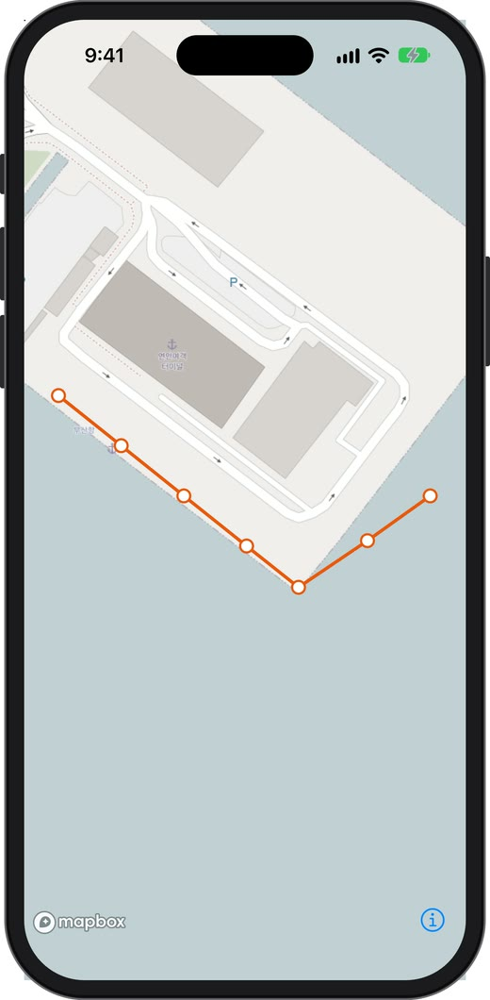</p>

위 화면은 부산 연안여객터미널 부두의 남동쪽 가장자리를 따라 점 7개로 그린 팬더라인입니다. 이 글에서는 실무 iOS 앱에서 이 팬더라인을 **편집하는 화면**을 Mapbox로 어떻게 그리고 있었는지 살펴보고, 그것을 **Source + Layer 방식으로 바꾸면 무엇이 달라지는지** 코드와 실측으로 비교합니다.

1. Mapbox로 지도에 그리는 4가지 방법과 핵심 개념
2. 기존 방식 - 표시는 Source + Layer, 편집은 Annotation
3. 겹겹이 떼어 보기 - Annotation Manager 6개의 정체
4. 개선 방식 - Source 1개, Layer 4개, feature-state
5. 두 방식 비교 (실측)
6. 정리

> 이 글은 **Mapbox Maps SDK for iOS 11.18.1**(실무 앱과 같은 버전) 기준입니다. 글의 코드는 회사 코드를 그대로 옮긴 것이 아니라, 같은 구조를 블로그용으로 단순화해 다시 작성한 것입니다. 모든 화면과 수치는 이 코드를 iPhone 17 시뮬레이터(iOS 27)에서 직접 실행해 얻었습니다.

&nbsp;

---

&nbsp;

## 1. Mapbox로 지도에 그리는 4가지 방법과 핵심 개념

### 먼저, 이 글에서 말하는 "엔진"

이 글에는 "엔진이 해 준다", "엔진의 준비 단계" 같은 표현이 자주 나옵니다. 여기서 **엔진**은 Mapbox SDK 안에서 **지도를 실제로 계산하고 그리는 C++ 코어**를 말합니다. 렌더러라고도 부릅니다.

Mapbox Maps SDK for iOS를 SPM으로 받으면 패키지가 두 층으로 들어옵니다.

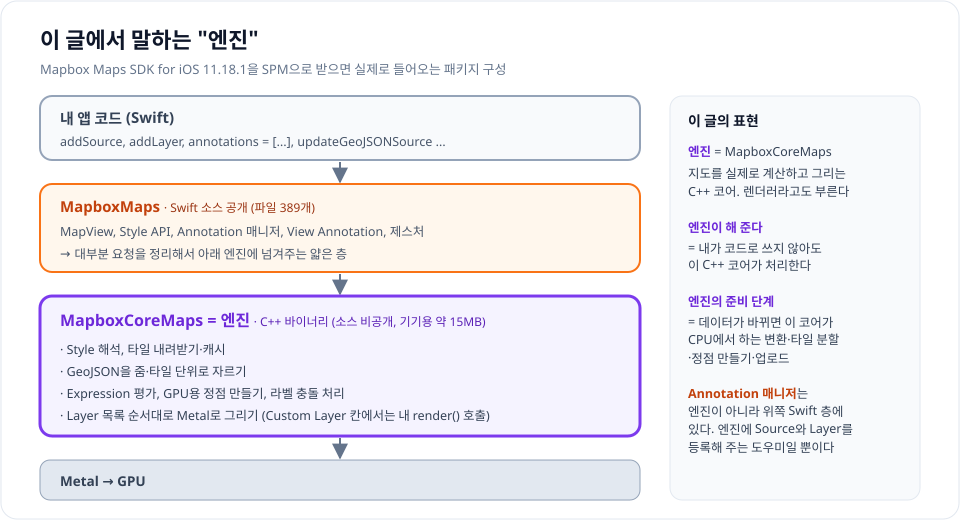

| 층 | 정체 | 하는 일 |
| --- | --- | --- |
| **MapboxMaps** | Swift 소스 (공개, 파일 389개) | `MapView`, Style API, Annotation 매니저, View Annotation, 제스처. 내 요청을 정리해 아래 엔진에 넘긴다 |
| **MapboxCoreMaps** = **엔진** | C++ 바이너리 (소스 비공개, 기기용 약 15MB) | Style 해석, 타일 내려받기, GeoJSON 타일 분할, Expression 평가, GPU용 정점 만들기, 라벨 충돌 처리, Layer 순서대로 Metal로 그리기 |

예를 들어 Swift에서 `updateGeoJSONSource`를 부르면, MapboxMaps 층은 데이터를 엔진이 받을 형태로 넘기기만 하고, 실제 타일 분할과 정점 만들기는 엔진이 합니다. 그리고 **Annotation 매니저는 엔진이 아니라 위쪽 Swift 층에 있습니다.** 엔진 입장에서는 Annotation이라는 개념이 없고, 매니저가 등록해 준 Source와 Layer만 보입니다. 이 점이 아래 내용의 열쇠입니다.

### 먼저 짚고 갈 개념 - GeoJSON, Source, Feature, filter, Layer

링크를 따라가지 않아도 이 글을 읽을 수 있도록, 필요한 개념만 다시 정리하겠습니다. 특히 **Source와 Feature가 둘 다 "데이터"처럼 들려서 헷갈리기 쉬운데**, 둘은 **통과 그 안의 한 줄**의 관계입니다.

먼저 그림으로 감을 잡겠습니다. **Feature는 "무엇을 그릴지"(그릴 대상), Layer는 "어떻게 그릴지"(그리는 방법)**입니다. 팬더라인을 만들고 편집할 때 실제로 생기는 네 장면으로, Feature 수와 Layer 수가 어떻게 정해지는지 보겠습니다. 모두 실제 시뮬레이터 화면입니다.

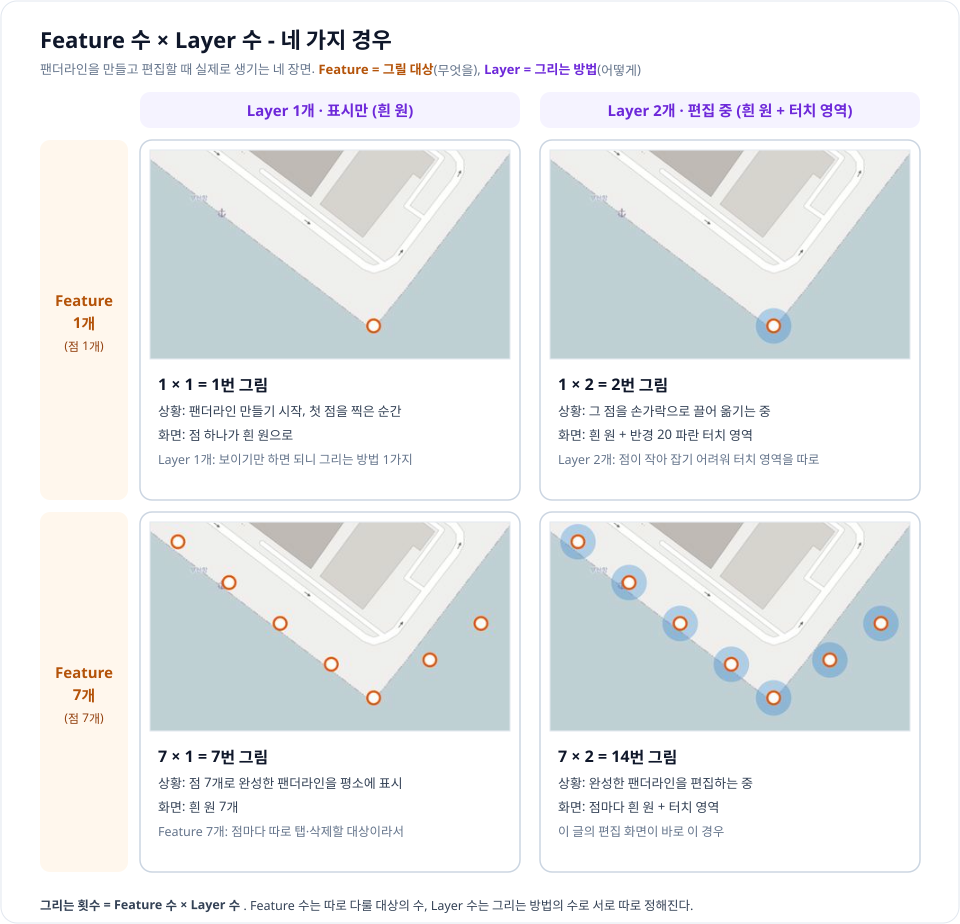

- **Feature 수는 "따로 다룰 대상이 몇 개인가"**로 정해집니다. 사용자가 점을 7개 찍었고, 점마다 따로 탭·드래그·삭제하니 점 Feature가 7개입니다.
- **Layer 수는 "몇 가지 방법으로 그리나"**로 정해집니다. 평소에는 흰 원 하나면 되지만, 편집할 때는 점이 손가락으로 잡기엔 너무 작아서 반경 20의 터치 영역을 한 번 더 그립니다. 그래서 Layer가 2개입니다.
- 두 수는 서로 따로 정해지고, 그리는 횟수는 둘을 곱한 만큼입니다.

같은 원리로, 이 글에서 **선분**도 Feature 하나가 아니라 6개로 나눴습니다. 선을 통째로 Feature 하나로 만들면 화면은 똑같아 보이지만, 선분 하나만 골라 선택할 수가 없습니다.

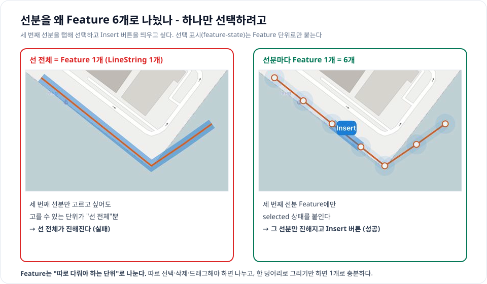

선택 표시(feature-state)는 **Feature 단위로만** 붙습니다. 그래서 "세 번째 선분을 탭하면 그 선분만 진해지고 Insert 버튼이 뜬다"를 만들려면 선분마다 Feature가 따로 있어야 합니다. 정리하면, **따로 선택·삭제·드래그해야 하는 단위로 Feature를 나누고**, 한 덩어리로 그리기만 하면 Feature 1개로 충분합니다.

그럼 Feature가 여러 개이고 Layer도 여러 개일 때, 각 Layer는 어떤 Feature를 그릴지 어떻게 알까요? **Layer는 Feature를 하나하나 지정하지 않습니다.** 통 전체를 위에서부터 한 줄씩 읽으면서 자기 filter로 검사하고, 통과한 줄만 그립니다.

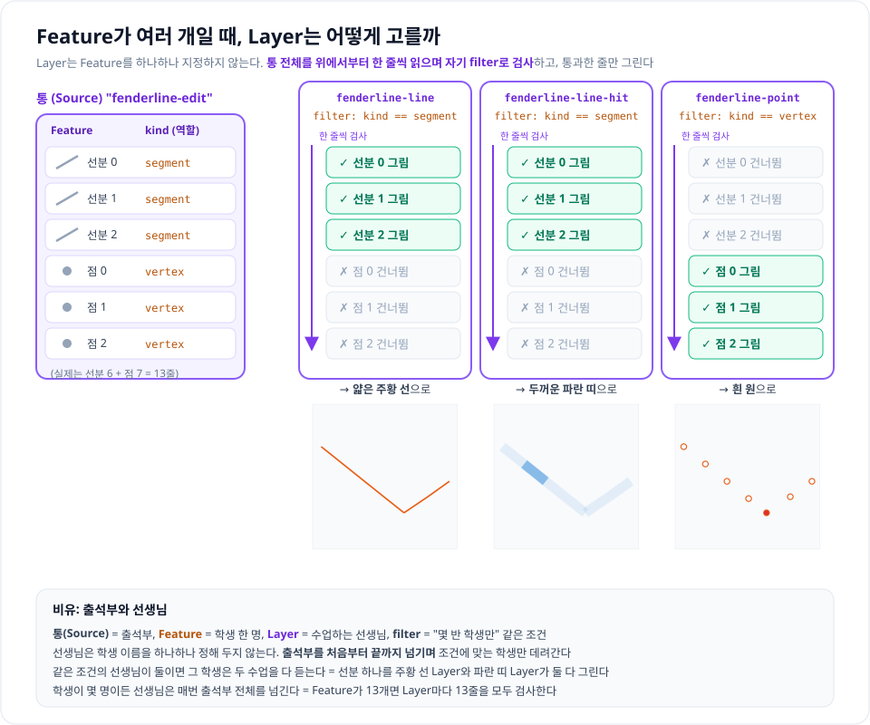

- `fenderline-line`과 `fenderline-line-hit`은 filter가 같아서(`segment`) **같은 선분들을 둘 다** 그립니다. 그래서 선분마다 주황 선과 파란 띠가 겹칩니다.
- `fenderline-point`는 filter가 `vertex`라서 선분은 건너뛰고 **점만** 그립니다.
- 이 검사는 Layer마다 따로 일어납니다. Feature가 13개면 Layer 4개가 각자 13줄을 모두 검사합니다.

이제 이 흐름을 실제 데이터 형식과 코드 이름으로 보면 이렇습니다.

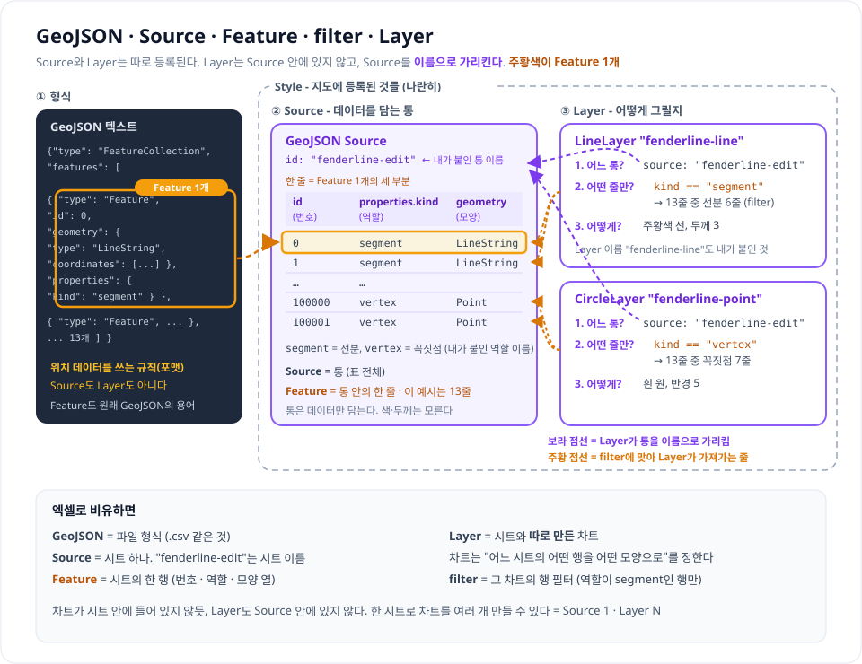

| 개념 | 정체 | 엑셀로 치면 | 이 글에서는 |
| --- | --- | --- | --- |
| **GeoJSON** | 위치 데이터를 JSON으로 쓰는 **형식(포맷)**. Source도 Layer도 아니다 | 파일 형식 (.csv) | 팬더라인을 적은 텍스트 |
| **Source** | 데이터를 담아 두는 **통**. 이름(id)을 붙여 지도에 등록한다. 어떤 형식을 담느냐에 따라 GeoJSON Source, Vector Source 등이 있다 | 이름이 붙은 시트 하나 | `fenderline-edit` 통 하나 |
| **Feature** | 통 안에 든 **한 줄**. 모양(geometry) + 속성(properties) + id | 시트의 한 행 | 선분 하나, 점 하나 (총 13줄) |
| **filter** | Layer가 통에서 **어떤 줄만 쓸지** 고르는 조건. Layer의 속성이다 | 필터 조건 | `kind == "segment"` |
| **Layer** | 고른 줄을 **어떤 모양으로 그릴지**. `LineLayer`, `CircleLayer` 등 | 시트로 만든 차트 | 주황 선, 흰 원, 터치 영역 |
| **Expression** | 데이터나 상태에 따라 값이 바뀌는 식. `["case", 조건, 값1, 값2]` 같은 모양 | 조건부 서식 | 선택이면 진하게, 아니면 옅게 |
| **feature-state** | 통의 데이터는 그대로 두고 특정 줄에만 붙이는 상태. Feature id로 찾는다 | 행에 붙인 메모 | `selected`, `dragging` |
| **Annotation** | Source + Layer **한 쌍을 감싼** 편의 API (아래에서 자세히) | 시트와 차트를 한 번에 만들어 주는 마법사 | 기존 편집 화면 |

헷갈리기 쉬운 세 가지를 짚고 가겠습니다.

- **GeoJSON은 Source인가 Layer인가?** 둘 다 아닙니다. GeoJSON은 "이런 모양으로 적는다"는 **형식**입니다. 그 형식의 데이터를 담는 Source 종류가 **GeoJSON Source**이고, `Feature`, `FeatureCollection`이라는 이름도 원래 GeoJSON 형식의 용어입니다.
- **Source와 Feature는 무엇이 다른가?** Source는 지도에 등록되는 **통 하나**이고, Feature는 그 통에 든 **데이터 한 건**입니다. 이 글의 개선 방식은 통 1개에 13줄(선분 6 + 점 7)을 담습니다. 기존 방식은 같은 줄들을 통 6개에 나눠, 일부는 여러 통에 **중복으로** 담았습니다.
- **Layer는 Source 안에 만드는 건가?** 아닙니다. Source와 Layer는 지도(Style)에 **따로, 나란히** 등록됩니다. 통 안에 Layer를 넣는 게 아니라, Layer가 `source: "fenderline-edit"`처럼 **통의 이름으로 그 통을 가리킵니다.** 엑셀에서 차트가 시트 안에 들어 있지 않고 "어느 시트의 데이터를 쓸지"만 지정하는 것과 같습니다. 그래서 등록할 때도 **통(Source)을 먼저** 추가하고, 그 이름을 가리키는 Layer를 나중에 추가합니다.
- **Layer는 무엇을 정하나?** 세 가지입니다. ① **어느 통?** (`source`) ② **그 통의 어떤 줄만?** (`filter`, 예: `kind == "segment"`) ③ **어떻게 그릴까?** (주황색 선, 두께 3). 즉 Layer는 "실제로 어떻게 그릴지"를 표현하는 것이고, filter는 그 전에 그릴 줄을 고르는 조건으로 Layer 안에 들어 있습니다.
- **`fenderline-edit`, `segment`, `vertex`는 뭔가?** 전부 **제가 붙인 이름**입니다. `fenderline-edit`는 통(Source)의 이름, `segment`(선분)와 `vertex`(꼭짓점)는 Feature의 역할을 적어 둔 값입니다. Mapbox가 정한 단어가 아니라서 다른 이름을 써도 됩니다. 반면 `LineString`, `Point`는 GeoJSON이 정한 **모양** 단어입니다.

### Feature, Source, Layer는 몇 대 몇일까

가장 헷갈리는 부분이라 관계를 한 번에 정리하겠습니다.

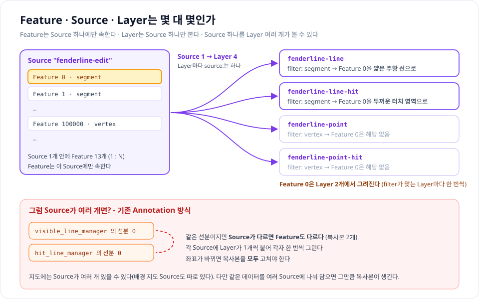

| 관계 | 몇 대 몇 | 설명 |
| --- | --- | --- |
| Source → Feature | **1 : N** | Source 하나에 Feature 여러 개가 들어 있다. 이 글의 개선 방식은 13개 |
| Feature → Source | **1 : 1** | Feature는 **하나의 Source에만** 속한다. 통 안의 한 줄이기 때문이다 |
| Layer → Source | **1 : 1** | Layer는 `source:`에 **Source 하나만** 지정한다 |
| Source → Layer | **1 : N** | Source 하나를 Layer 여러 개가 볼 수 있다. 이 글은 4개 |
| Feature → Layer | **1 : N** | 같은 Source를 보는 Layer 중 **filter가 맞는 Layer마다 한 번씩** 그려진다. 선분 Feature는 주황 선 Layer와 터치 영역 Layer에서 두 번 그려진다 |

헷갈리기 쉬운 두 가지를 더 짚겠습니다.

**Source 안에 Feature가 여러 개인 건 Layer를 여러 개 쓰기 위해서인가?** 아닙니다. 데이터 자체가 여러 건이기 때문입니다. 팬더라인에는 선분 6개와 점 7개가 있으니 13줄이 됩니다. Layer를 하나만 써도 Feature는 13개입니다. **Feature 개수는 "데이터에 몇 건이 있나"로, Layer 개수는 "몇 가지 방법으로 그리나"로** 따로 정해집니다.

**Feature 하나와 Layer는 1대1인가, 1대N인가?** 정해져 있지 않습니다. Feature와 Layer는 직접 연결되지 않고, **filter가 정합니다.** 이때 거르는 쪽은 Source가 아니라 **각 Layer**입니다. Source는 13줄을 그대로 담고 있을 뿐이고, Layer 4개가 **같은 통을 각자 훑으면서** 자기 filter에 맞는 줄만 가져가 그립니다. 그 결과를 표로 보면 이렇습니다(✓ = 이 Layer가 이 Feature를 그린다).

| Feature \ Layer | fenderline-line<br>(얇은 주황 선) | fenderline-line-hit<br>(두꺼운 터치 영역) | fenderline-point<br>(흰 원) | fenderline-point-hit<br>(터치 영역 원) | 그리는 Layer 수 |
| --- | --- | --- | --- | --- | --- |
| **선분 0 ~ 5** (각각) | ✓ | ✓ | | | **2개** |
| **점 0 ~ 6** (각각) | | | ✓ | ✓ | **2개** |
| **이 Layer가 그리는 Feature 수** | **6개** | **6개** | **7개** | **7개** | |

- 가로로 읽으면(Feature 기준) **선분 하나를 Layer 2개가 그립니다.** 그래서 화면에서 주황 선과 파란 띠가 겹쳐 보입니다.
- 세로로 읽으면(Layer 기준) **Layer 하나가 Feature 6~7개를 그립니다.**
- 즉 Feature와 Layer는 **다대다**이고, 어느 칸에 ✓가 들어갈지는 filter가 정합니다.

같은 Feature를 Layer 여러 개로 그리는 이유는, **Layer 하나에는 그리는 방법(색, 두께, 투명도)을 하나만 정할 수 있기 때문**입니다. 이 글은 같은 선분을 "눈에 보이는 얇은 주황 선"과 "터치용으로 두껍고 거의 투명한 띠" 두 가지로 그려야 해서 Layer가 2개 필요합니다. 한 가지 모양으로 충분하면 Layer도 하나면 됩니다. 실제로 평소 표시 화면은 선분은 주황 선, 점은 흰 원 한 가지씩만 그리므로, **같은 13개 Feature를 Layer 2개**로 그리고 Feature마다 Layer 1개씩만 그립니다.

그럼 **Source가 여러 개일 수는 없을까요?** 있습니다. 지도에는 Source가 여러 개 있을 수 있고, 배경 지도도 별도의 Source입니다. 다만 **같은 선분을 Source 두 개에 넣으면, 그건 같은 Feature가 아니라 복사본 두 개**가 됩니다. 좌표가 바뀌면 두 복사본을 모두 고쳐야 합니다. 기존 Annotation 방식이 바로 이 모양이었습니다(3장).

이 구조의 핵심은 **Source와 Layer가 분리되어 있다**는 점입니다. 통(Source)은 하나인데 그 통을 보고 그리는 Layer는 여러 개일 수 있습니다. 엑셀 시트 하나로 차트를 여러 개 만드는 것과 같습니다. 같은 선분을 얇은 주황 선으로 한 번, 두껍고 옅은 터치 영역으로 한 번 그리고 싶다면 통 하나에 Layer 두 개를 붙이면 됩니다.

### 지도에 그리는 4가지 방법

Mapbox iOS SDK로 지도 위에 무언가를 그리는 방법은 크게 네 가지입니다. 지도 렌더러가 그리는 세 가지는 **아래에서 위로 갈수록 추상화가 높아지는** 순서로 놓았습니다.

| 방법 | 그리는 곳 | 한 줄 요약 | 아래 단계와의 관계 | 잘 맞는 곳 |
| --- | --- | --- | --- | --- |
| ▲ **Annotation**<br>가장 추상적 | 지도 안 | `PointAnnotation`, `CircleAnnotation`, `PolylineAnnotation`, `PolygonAnnotation`을 매니저에 넣으면 끝 | **Style Layer 위에 지어짐.** 매니저가 안에서 Source + Layer를 만든다 | 개수가 적고 빨리 만들어야 할 때 |
| **Style Layer**<br>(Source&nbsp;+&nbsp;Layer) | 지도 안 | 데이터(Source)와 그리는 방법(Layer)을 직접 등록 | Custom Layer와 **같은 줄.** 둘 다 Layer 목록의 한 칸이고, 이 칸은 엔진이 내장 셰이더로 그린다 | 데이터가 많거나, 상태에 따라 스타일이 바뀔 때 |
| ▼ **Custom Layer**<br>가장 저수준 | 지도 안 | Metal 셰이더로 직접 그림 | Layer 목록의 한 칸을 받아, 그 칸만 **엔진 대신 내가** 그린다 | 표준 Layer로 표현할 수 없는 그래픽 |
| **View Annotation**<br>(사다리 밖) | 지도 위 (UIView) | 지도 좌표에 실제 `UIView`를 띄움 | **관계 없음.** 지도 렌더러가 그리지 않고, SDK는 뷰 위치만 맞춘다 | 버튼, 말풍선처럼 터치하는 UI |

"지도 안"은 지도 렌더러(Metal)가 지도와 함께 그린다는 뜻이고, "지도 위"는 지도 화면 위에 UIKit 뷰를 얹는다는 뜻입니다.

> 이전 글에서는 SwiftUI 전용 `Marker`까지 5가지로 나눴습니다. `Marker`는 내부적으로 View Annotation을 만드는 편의 API라서 여기서는 4가지로 묶었습니다.

### 추상화는 쌓였지만, 쌓는 관계는 일부만 성립한다

위로 갈수록 내가 직접 다룰 것이 줄고 엔진이 대신 해 주는 일이 늘어납니다. 그래서 **추상화 수준**으로는 Custom Layer < Style Layer < Annotation 순서가 맞습니다.

| 단계 | 내가 다루는 것 | 엔진이 대신 해 주는 것 |
| --- | --- | --- |
| **Annotation** | 점, 선 같은 객체 하나하나 | Source + Layer 생성, 객체 → Feature 변환, 스타일 → Expression 변환, 변경분 비교 |
| **Style Layer** | 데이터(Source)와 그리는 규칙(Layer, Expression) | 타일 분할, 삼각형 만들기, 셰이더, 라벨 충돌 처리, 그리기 |
| **Custom Layer** | Metal 버퍼, 셰이더, 좌표 변환 행렬 | 렌더 패스 안에서 그릴 자리와 카메라 행렬만 준다 |

하지만 **"위 단계가 아래 단계로 만들어졌다"는 관계는 일부만 성립**합니다.

- **Annotation → Style Layer: 성립합니다.** Annotation 매니저는 실제로 내부에서 GeoJSON Source와 Layer를 만듭니다. 아래 절에서 SDK 소스로 확인합니다.
- **Style Layer → Custom Layer: 성립하지 않습니다.** Style Layer가 내부에서 Custom Layer를 쓰지 않습니다. 둘은 Layer 목록에 한 칸씩 들어가는 같은 줄이고, 차이는 "그 칸을 엔진이 그리느냐, 내가 그리느냐"입니다. 바로 아래에서 자세히 봅니다.
- **View Annotation은 사다리 밖입니다.** 지도 렌더러가 그리지 않고 실제 `UIView`를 지도 위에 얹습니다. 그래서 지도 안의 Layer들과 그리는 순서가 섞이지 않고 항상 지도 콘텐츠 위에 뜹니다. 대신 터치되는 UIKit 버튼을 그대로 쓸 수 있습니다.

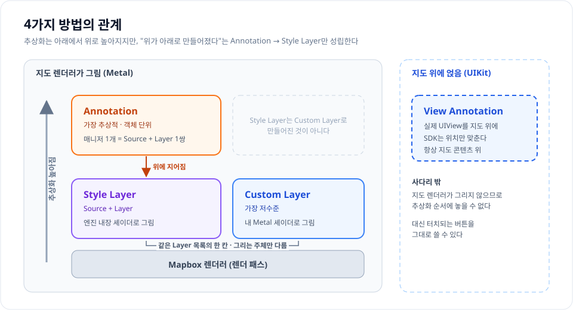

### 그럼 제일 추상적인 Annotation만 쓰면 되지 않을까

추상화가 높을수록 코드가 짧고 쉽습니다. 그런데도 낮은 단계가 필요한 이유는, **추상화가 편한 대신 "결정"을 대신 내려 버리기 때문**입니다. 흔한 경우에는 그 결정이 딱 맞아서 편하지만, 내 상황과 맞지 않으면 그 결정을 바꿀 방법이 없습니다. 그때 한 단계 내려가야 합니다.

iOS로 치면 `UIView` → `CALayer` → Metal과 같습니다. 대부분의 화면은 `UIView`로 충분하지만, 그림자 경로를 직접 정하려면 `CALayer`로, 수만 개 입자를 그리려면 Metal로 내려갑니다. `UIView`가 나빠서가 아니라 `UIView`가 대신 정해 둔 방식이 그 상황에 안 맞기 때문입니다.

Mapbox의 각 단계가 대신 내려 주는 결정과, 그 결정이 안 맞는 순간은 이렇습니다.

| 단계 | 대신 내려 주는 결정 | 이 결정이 안 맞는 순간 | 그때 내려갈 곳 |
| --- | --- | --- | --- |
| **Annotation** | 매니저 1개 = Source 1개 + Layer 1개.<br>Annotation마다 스타일을 데이터에 담는다 | 같은 데이터를 여러 모양으로 그려야 할 때 (데이터가 매니저 수만큼 복제됨).<br>선택·강조 같은 상태가 자주 바뀔 때 (상태 변경이 곧 데이터 변경) | Style Layer |
| **Style Layer** | 데이터가 바뀌면 엔진이 CPU에서 준비 단계(변환·타일 분할·정점 만들기)를 다시 한다.<br>그리는 모양은 Layer 종류가 정한다 | 수천 개 이상이 매 프레임 움직일 때 (준비 비용이 점 개수에 비례).<br>내장 Layer로 표현할 수 없는 그래픽이 필요할 때 | Custom Layer |
| **Custom Layer** | 아무것도 대신 해 주지 않는다 | 반대로, 탭 판정·라벨·줌별 스타일처럼 엔진이 공짜로 주던 기능이 필요할 때 | 다시 Style Layer |

마지막 줄이 중요합니다. 낮은 단계는 자유로운 대신 **위 단계가 공짜로 주던 것을 전부 직접 만들어야** 합니다. 그래서 무조건 낮은 단계가 좋은 것도 아닙니다.

그래서 이 글의 원칙은 이렇습니다.

1. **가장 높은 단계에서 시작한다.** 대부분은 Annotation이나 Style Layer로 충분합니다.
2. **추상화의 결정이 발목을 잡는 지점이 보이면, 그 부분만 한 단계 내려간다.**
3. **나머지는 그대로 둔다.**

팬더라인 편집 화면이 정확히 이 경우입니다. Annotation의 "매니저 1개 = Layer 1개" 결정 때문에 같은 선분과 점이 여러 Source에 복제되고, 선택할 때마다 데이터를 다시 보내야 했습니다(2·3장). 그래서 **그 부분만** Style Layer로 내려갑니다. 반면 Insert·Delete 버튼은 View Annotation의 결정(실제 `UIView`를 띄운다)이 딱 맞기 때문에 그대로 둡니다. Custom Layer까지 내려갈 이유는 없는데, 그 이유는 바로 아래에서 성능 수치로 봅니다.

### Style Layer와 Custom Layer는 무엇이 다를까

지도는 매 프레임 Style에 등록된 **Layer 목록을 아래부터 차례로** 그립니다. Style Layer와 Custom Layer는 둘 다 이 목록에 한 칸씩 들어갑니다. 그래서 Custom Layer를 line Layer와 circle Layer 사이에 넣으면 정말로 그 사이에 그려집니다.

차이는 **그 칸이 왔을 때 누가 그리느냐**입니다.

- **Style Layer 칸**: 엔진이 Source의 데이터를 가져와, Layer 종류(line, circle, fill…)에 맞는 **내장 셰이더**로 그립니다.
- **Custom Layer 칸**: 엔진은 그리지 않고 **내 `render()`를 호출**하면서 카메라 행렬만 넘겨줍니다. 그 칸은 내가 Metal로 직접 그립니다.

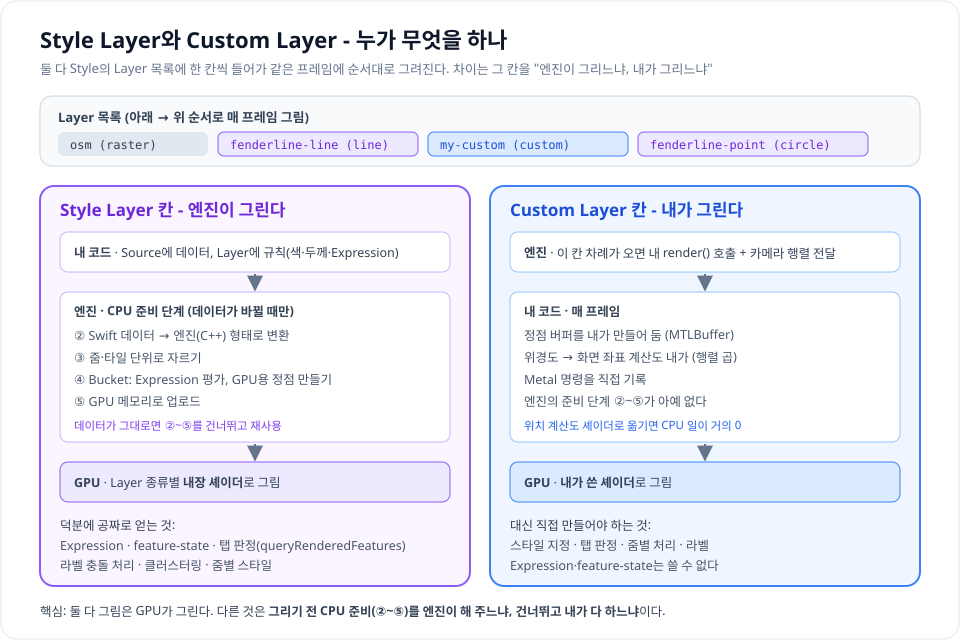

식당에 비유하면 Layer 목록은 **코스 순서표**입니다. Style Layer는 메뉴판에서 고르면 주방(엔진)이 정해진 조리법으로 요리해 주는 것이고, Custom Layer는 순서표의 한 칸에서 **주방을 빌려 내가 직접 요리하는 것**입니다. 둘 다 같은 코스 순서대로 나가지만, 요리하는 사람이 다릅니다.

| | Style Layer | Custom Layer |
| --- | --- | --- |
| 데이터 | Source(GeoJSON, 벡터 타일)에 넣는다 | 내가 Metal 버퍼를 직접 만든다 |
| 그리기 전 준비 | 엔진이 CPU로 변환 → 타일 분할 → 정점 만들기 → 업로드 (**데이터가 바뀔 때만**) | 없음. 내가 만든 버퍼를 그대로 쓴다 |
| 셰이더 | 엔진 내장 (Layer 종류별) | 내가 작성 |
| 위경도 → 화면 좌표 | 엔진이 계산 | 엔진이 준 행렬로 내가 계산 |
| 스타일 | `lineColor`, Expression, feature-state | 셰이더 코드로 직접 |
| 탭 판정 (`queryRenderedFeatures`) | 된다 | 안 된다. 직접 구현 |
| 라벨 충돌, 클러스터링, 줌별 스타일 | 엔진이 해 준다 | 직접 구현 |
| 그리는 순서 | Layer 목록의 한 칸 | Layer 목록의 한 칸 (**같다**) |

여기서 오해하기 쉬운 점이 하나 있습니다. **둘 다 실제로 그리는 일은 GPU가 합니다.** Style Layer도 Metal로 그립니다. 다른 것은 그리기 **전** 단계, 데이터를 GPU가 그릴 수 있는 정점으로 바꾸는 CPU 준비를 엔진이 해 주느냐(Style Layer), 건너뛰고 내가 다 하느냐(Custom Layer)입니다.

### 성능은 얼마나 다를까

[Custom Layer 딥다이브]() 15장에서 같은 조건으로 72회 측정한 결과입니다. 점 N개가 각자 원을 그리며 **매 프레임 움직이는** 상황을, Style Layer(GeoJSON Source + Layer)와 Custom Layer로 각각 그렸습니다.

| 방식 | 점 1,000개 | 점 20,000개 |
| --- | --- | --- |
| Style Layer · 정지 | 1.1% | 1.2% |
| Custom Layer · 정지 | 1.3% | 1.1% |
| Style Layer · 1초에 1번 갱신 | 5.8% | 12.9% |
| Style Layer · 매 프레임 갱신 (60Hz) | **55.5%** | **599.6%** |
| Custom Layer · 매 프레임, 위치를 CPU에서 계산 | 12.8% | 16.3% |
| Custom Layer · 매 프레임, 위치를 셰이더에서 계산 | **12.0%** | **12.4%** |

<p style="font-size: 0.85em; color: #64748b;">iPhone 16 Pro 시뮬레이터, Mapbox 11.34.1, 3회 평균. 100% = CPU 코어 1개. 약 12%는 1초에 60번 지도를 다시 그리는 고정 비용입니다.</p>

읽는 법은 간단합니다.

- **데이터가 가만히 있으면 차이가 없습니다.** 둘 다 약 1%입니다. 준비는 처음 한 번이면 끝나고, 카메라를 움직여도 GPU가 같은 정점을 다시 그리기만 합니다.
- **데이터가 매 프레임 바뀌면 Style Layer가 크게 무거워집니다.** 바뀔 때마다 엔진이 준비 단계를 처음부터 다시 하기 때문에 점 개수에 비례해 늘어납니다(1천 개 55% → 2만 개 600%).
- **Custom Layer는 준비 단계가 없어서 평평합니다.** 같은 계산을 CPU에서 해도 2만 개에서 16%이니, Style Layer의 큰 비용은 위치 계산이 아니라 엔진의 준비 단계에서 나온다는 뜻입니다.

### Custom Layer는 CPU 일을 없애는 걸까, GPU로 옮기는 걸까

"Custom Layer를 쓰면 CPU 일이 GPU로 넘어간다"는 말을 자주 듣습니다. 반은 맞고 반은 다릅니다. 점이 매 프레임 움직이는 경우, Style Layer에서 CPU가 하던 일은 세 갈래로 나뉩니다.

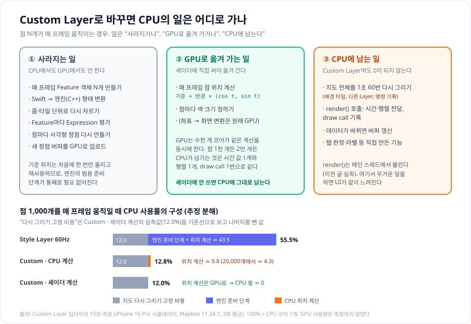

**CPU 일이 0이 되지는 않습니다.** 위 표에서 Custom Layer · 셰이더 계산도 약 12%였습니다. 이 12%는 위치 계산이 아니라 **지도 전체를 1초에 60번 다시 그리는 비용**입니다. 배경 타일과 다른 Layer를 다시 그리고, 내 `render()`를 불러 시간 값과 행렬을 넘기고, draw call을 기록하는 일은 Custom Layer여도 CPU가 합니다. 같은 Custom Layer를 멈춰 두면(다시 그리지 않으면) 1.3%로 떨어지는 것이 그 증거입니다.

**줄어든 CPU 일의 대부분은 "GPU로 옮겨 간" 게 아니라 "사라진" 것입니다.** 점 1,000개 기준으로 보면 이렇습니다.

| | CPU 사용률 | 고정 비용 12% 외에 남은 것 |
| --- | --- | --- |
| Style Layer · 60Hz | 55.5% | 약 43.5% - 엔진 준비 단계 + 위치 계산 |
| Custom · 위치를 CPU에서 계산 | 12.8% | 약 0.8% - 위치 계산만 |
| Custom · 위치를 셰이더에서 계산 | 12.0% | 약 0% |

같은 위치 계산을 CPU에서 해도 0.8%(2만 개에서도 약 4.3%)밖에 안 됩니다. 그러니 43.5%에서 줄어든 대부분은 **엔진의 범용 준비 단계**(Feature 객체 만들기, C++로 변환, 타일 분할, Expression 평가, 정점 재생성, 업로드)를 건너뛰어서 **아예 사라진** 몫입니다. 내가 그릴 모양을 알고 있으니 기준 위치는 처음에 한 번만 GPU에 올려 두고 재사용하면 되고, 엔진처럼 어떤 데이터든 받을 수 있게 준비할 필요가 없기 때문입니다.

**GPU로 옮겨 가는 것은 셰이더에 직접 쓴 계산뿐입니다.** 이 예시에서는 "기준 위치 + 반경 × (cos t, sin t)" 위치 계산과 점마다 색·크기를 정하는 일입니다. 위경도를 화면 좌표로 바꾸는 행렬 곱은 Style Layer도 원래 GPU 셰이더에서 하므로 새로 옮겨 간 일이 아닙니다. 반대로 위치 계산을 셰이더에 쓰지 않고 Swift에서 하면 그 일은 CPU에 그대로 남습니다(Custom · CPU 계산).

### CPU 일이 줄고 GPU 일이 늘면 좋은 걸까

**이런 종류의 일이라면 대체로 좋습니다.**

- **GPU는 같은 계산을 많이 하는 데 특화되어 있습니다.** 점 2만 개에 같은 공식을 적용하는 일은 GPU의 수천 개 코어가 동시에 처리합니다. CPU가 하면 점 개수에 비례해 시간이 늘지만, GPU에서는 CPU가 넘기는 것이 점 개수와 상관없이 시간 값 1개, 행렬 1개, draw call 1번입니다.
- **CPU, 특히 메인 스레드가 가벼워집니다.** 이전 글에서 측정했듯이 Custom Layer의 `render()`는 메인 스레드에서 불립니다. 메인 스레드는 제스처, 스크롤, UI 갱신도 맡고 있어서 여기서 일이 줄면 앱 전체 반응이 좋아집니다.

**하지만 GPU도 공짜는 아닙니다.**

| 주의할 점 | 이유 |
| --- | --- |
| GPU에도 프레임 예산이 있다 | 60Hz면 한 프레임에 약 16.7ms 안에 지도 전체와 내 셰이더를 다 그려야 한다. 셰이더가 무거우면 CPU가 한가해도 프레임이 떨어진다 |
| 배터리와 발열은 그대로 돌아온다 | 휴대폰은 CPU와 GPU가 한 칩에서 전력과 열을 나눠 쓴다. GPU 일이 많아지면 그만큼 전력을 쓴다 |
| 분기 많은 로직은 맞지 않는다 | GPU는 "모든 점에 같은 공식"에 강하다. 점마다 다른 조건 분기가 많으면 효율이 떨어진다 |
| 결과를 CPU로 다시 가져오면 손해 | 탭 판정처럼 계산 결과가 CPU에 필요하면 GPU 결과를 읽어 와야 하고, 그동안 CPU가 기다린다. 이런 일은 CPU에 두는 편이 낫다 |

정리하면, **"점 개수에 비례하는 단순 반복 계산"을 GPU로 옮기는 것은 좋은 거래**입니다. 반대로 "GPU로 옮기면 무조건 이득"은 아닙니다. 참고로 이 측정은 CPU 사용률만 쟀고 GPU 사용량은 재지 않았습니다. 이 예시의 셰이더는 점 하나당 삼각함수 두 번이라 GPU 입장에서는 가벼운 편입니다.

그래서 고르는 기준은 "어느 쪽이 빠르냐"가 아니라 **"데이터가 얼마나 자주, 얼마나 많이 바뀌냐"**입니다.

| 상황 | 고를 것 | 이유 |
| --- | --- | --- |
| 데이터가 가끔 바뀜 (항로, 구역, 저장된 팬더라인) | Style Layer | 성능 차이가 없고, 스타일·탭 판정·라벨을 공짜로 얻는다 |
| 몇 초에 한 번 바뀜 (AIS 선박 위치) | Style Layer | 1초 1회 갱신이면 2만 개도 13% 수준 |
| 수천 개 이상이 매 프레임 움직임 (입자, 애니메이션) | Custom Layer | 준비 단계를 건너뛰는 이득이 크다 |
| 표준 Layer로 표현할 수 없는 그래픽 | Custom Layer | 셰이더로만 가능 |

이번 글의 팬더라인은 점이 7개 남짓이고, 편집 중 드래그할 때만 좌표가 바뀝니다. Custom Layer로 얻을 성능 이득은 작고, 탭 판정과 feature-state를 직접 만들어야 하는 비용은 큽니다. 그래서 **Style Layer(Source + Layer)**를 택했습니다.

### Annotation은 Source + Layer 한 쌍을 추상화한 것

Annotation을 쓰면 Source와 Layer를 직접 만들지 않습니다. `PolylineAnnotation`에 좌표와 색을 넣고 매니저의 `annotations`에 넣으면 끝입니다. 그런데 SDK 소스(11.18.1)를 열어 보면 매니저가 안에서 하는 일은 결국 Source + Layer입니다.

| 내가 하는 일 | 매니저가 안에서 하는 일 (SDK 소스) |
| --- | --- |
| `makePolylineAnnotationManager(id: "visible_line_manager")` | 같은 id로 **GeoJSON Source 1개 + LineLayer 1개**를 만든다 (`GeoJSONSource(id: id)`, `addPersistentLayer`) |
| `PolylineAnnotation(id:, lineCoordinates:)` 하나 | **Feature 하나**가 된다. Annotation의 id가 Feature id |
| `annotation.lineColor = ...`, `lineWidth = ...` | Feature 속성 `layerProperties`에 들어간다. Layer는 `["coalesce", ["get", "line-color", ["get", "layerProperties"]], 기본값]` 식으로 그 값을 읽는다 |
| `manager.annotations = [...]` | 다음 프레임에 이전 목록과 id로 비교해, 바뀐 Feature만 Source에 부분 갱신 |
| `isDraggable = true`로 끌기 | 드래그용 Source + Layer 한 쌍을 하나 더 만든다 |

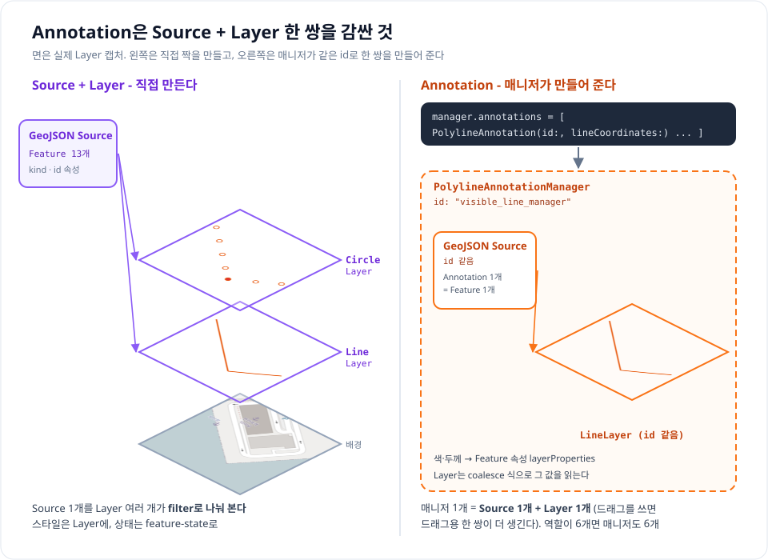

즉 **Annotation 매니저 1개 = Source 1개 + Layer 1개**이고, Annotation 1개 = Feature 1개입니다. Annotation은 이 한 쌍을 감춰서 "점 찍기, 선 긋기"처럼 쉽게 쓰게 해 주는 추상화입니다.

이 추상화에는 대가가 하나 있습니다. **매니저 하나는 Layer를 하나만 가집니다.** 그래서 같은 데이터를 다른 모양으로 한 번 더 그리려면(예: 같은 선을 터치 영역으로 두껍게) 매니저를 하나 더 만들어야 하고, 그 매니저는 **자기 Source에 같은 데이터를 한 벌 더** 담습니다. 위 그림 왼쪽처럼 Source 하나를 여러 Layer가 나눠 보는 구조는 Annotation으로는 만들 수 없습니다. 이 차이가 이 글 전체의 출발점입니다.

더 자세한 내용은 이전 글에 정리해 두었습니다.

- [[Mapbox] 처음 배우는 Mapbox 핵심 개념]() - Source, Layer, Feature, Expression, feature-state, 그리고 10장 "다시 보는 Annotation - 결국 Source + Layer"
- [[Mapbox] Custom Layer 딥다이브]() - Metal 셰이더로 직접 그리기

&nbsp;

---

&nbsp;

## 2. 기존 방식 - 표시는 Source + Layer, 편집은 Annotation

실무 앱을 열어 보니 팬더라인은 **두 가지 방식으로 나뉘어** 그려지고 있었습니다.

| 상황 | 그리는 방법 | 구성 |
| --- | --- | --- |
| 평소 표시 (저장된 팬더라인) | **Source + Layer** | GeoJSON Source 1개 + `LineLayer` + `CircleLayer` |
| 편집 (점 추가·이동·삭제·삽입) | **Annotation** | Annotation Manager 6개 + View Annotation 2개 |

평소 표시는 이미 Source + Layer입니다. 문제는 편집 화면입니다. 편집 화면에서는 같은 팬더라인을 **역할별로 6개의 Annotation Manager**에 나눠 그립니다.

| 매니저 | Annotation | 역할 |
| --- | --- | --- |
| 보이는 선 | `PolylineAnnotation` | 선분마다 하나. 폭 3 |
| 터치 영역 선 | `PolylineAnnotation` | 같은 선분을 폭 20, 투명도 0.1로 한 번 더. 손가락으로 선분을 잡기 쉽게 |
| 선택한 선분 | `PolylineAnnotation` | 선택한 선분 하나만 폭 20, 투명도 0.5로 강조 |
| 보이는 점 | `CircleAnnotation` | 점마다 하나. 반경 5 |
| 터치 영역 점 | `CircleAnnotation` | 같은 점을 반경 20, 투명도 0.1로. 드래그 중인 점은 뺀다 |
| 선택한 점 | `CircleAnnotation` | 선택한 점 하나만 반경 20, 투명도 0.5로 강조 |

그리고 선분을 선택하면 **Insert**, 점을 선택하면 **Delete** 버튼이 뜹니다. 이 버튼은 실제로 눌러야 하는 UI라서 View Annotation(`UIButton`)입니다.

<p style="text-align: center;">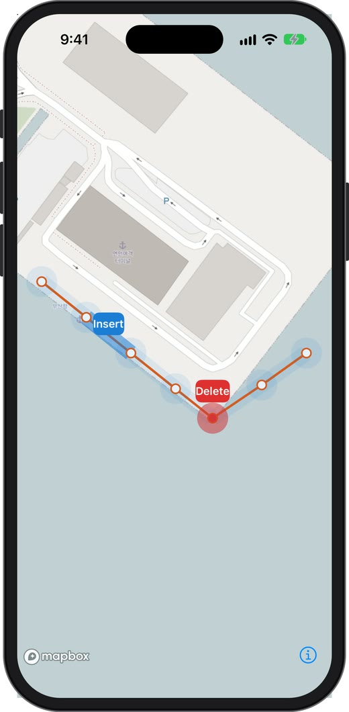</p>

선분 하나(Insert)와 점 하나(Delete)를 선택한 편집 화면입니다. 굵고 옅은 파란 띠가 터치 영역, 진한 파란 띠가 선택한 선분, 빨간 원이 선택한 점입니다.

상태는 다음 구조체 하나로 표현됩니다. 점을 탭하거나, 드래그하거나, 선분을 고를 때마다 이 값이 바뀌고, 그때마다 화면을 다시 그립니다.

<details class="notion-toggle-list" markdown="1">
<summary>예제에서 쓰는 색 - 코드 보기</summary>

```swift
enum Palette {
    static let line = "#e8590c"          // 팬더라인
    static let point = "#ffffff"
    static let pointStroke = "#e8590c"
    static let hit = "#1c7ed6"           // 터치 영역(반투명)
    static let selected = "#1c7ed6"      // 선택 강조
    static let delete = "#e03131"
}

// Expression 안에서는 StyleColor 대신 UIColor를 쓴다 (11.18 기준 StyleColor는 Expression 인자가 아니다)
extension UIColor {
    convenience init(hex: String) {
        let v = UInt32(hex.dropFirst(), radix: 16) ?? 0
        self.init(red: CGFloat((v >> 16) & 0xff) / 255, green: CGFloat((v >> 8) & 0xff) / 255,
                  blue: CGFloat(v & 0xff) / 255, alpha: 1)
    }
}
```

</details>

```swift
struct FenderlineEditState {
    var coordinates: [CLLocationCoordinate2D]
    var selectedPointIndex: Int?       // 선택한 점 → Delete 버튼
    var selectedSegmentIndex: Int?     // 선택한 선분(시작 인덱스) → Insert 버튼
    var draggingIndex: Int?            // 드래그 중인 점
}
```

<details class="notion-toggle-list" markdown="1">
<summary>기존 방식: Annotation Manager 6개로 그리기 - 코드 보기</summary>

```swift
import MapboxMaps

/// 기존 방식: 역할마다 Annotation Manager 하나 (Polyline 3 + Circle 3)
final class AnnotationFenderlineRenderer {
    private let visibleLine: PolylineAnnotationManager
    private let hitLine: PolylineAnnotationManager
    private let selectedLine: PolylineAnnotationManager
    private let visiblePoint: CircleAnnotationManager
    private let hitPoint: CircleAnnotationManager
    private let selectedPoint: CircleAnnotationManager

    init(mapView: MapView) {
        let a = mapView.annotations!
        visibleLine = a.makePolylineAnnotationManager(id: "visible_line_manager")
        hitLine = a.makePolylineAnnotationManager(id: "hit_line_manager")
        selectedLine = a.makePolylineAnnotationManager(id: "selected_line_manager")
        visiblePoint = a.makeCircleAnnotationManager(id: "visible_point_manager")
        hitPoint = a.makeCircleAnnotationManager(id: "hit_point_manager")
        selectedPoint = a.makeCircleAnnotationManager(id: "selected_point_manager")
    }

    /// 상태가 바뀔 때마다 6개 매니저를 모두 다시 채운다
    func update(_ state: FenderlineEditState) {
        let c = state.coordinates
        let segments = c.count < 2 ? [] : (0..<(c.count - 1)).map { (index: $0, coords: [c[$0], c[$0 + 1]]) }

        // 1) 보이는 선
        visibleLine.annotations = segments.map {
            var a = PolylineAnnotation(id: "visible_line_\($0.index)", lineCoordinates: $0.coords)
            a.lineColor = StyleColor(rawValue: Palette.line)
            a.lineWidth = 3
            a.lineJoin = .round
            return a
        }
        // 2) 터치 영역 선 (두껍고 거의 투명)
        hitLine.annotations = segments.map {
            var a = PolylineAnnotation(id: "hit_line_\($0.index)", lineCoordinates: $0.coords)
            a.lineColor = StyleColor(rawValue: Palette.hit)
            a.lineWidth = 20
            a.lineOpacity = 0.1
            return a
        }
        // 3) 선택한 선분
        if let i = state.selectedSegmentIndex, i + 1 < c.count {
            var a = PolylineAnnotation(id: "selected_line", lineCoordinates: [c[i], c[i + 1]])
            a.lineColor = StyleColor(rawValue: Palette.selected)
            a.lineWidth = 20
            a.lineOpacity = 0.5
            selectedLine.annotations = [a]
        } else {
            selectedLine.annotations = []
        }
        // 4) 보이는 점
        visiblePoint.annotations = c.enumerated().map { i, coord in
            var a = CircleAnnotation(id: "visible_point_\(i)", centerCoordinate: coord)
            a.circleRadius = 5
            a.circleColor = StyleColor(rawValue: state.selectedPointIndex == i ? Palette.delete : Palette.point)
            a.circleStrokeColor = StyleColor(rawValue: Palette.pointStroke)
            a.circleStrokeWidth = 2
            return a
        }
        // 5) 터치 영역 점 (드래그 중인 점은 숨김)
        hitPoint.annotations = c.enumerated().compactMap { i, coord in
            guard state.draggingIndex != i else { return nil }
            var a = CircleAnnotation(id: "hit_point_\(i)", centerCoordinate: coord)
            a.circleRadius = 20
            a.circleColor = StyleColor(rawValue: Palette.hit)
            a.circleOpacity = 0.1
            return a
        }
        // 6) 선택한 점
        if let i = state.selectedPointIndex {
            var a = CircleAnnotation(id: "selected_point", centerCoordinate: c[i])
            a.circleRadius = 20
            a.circleColor = StyleColor(rawValue: Palette.delete)
            a.circleOpacity = 0.5
            selectedPoint.annotations = [a]
        } else {
            selectedPoint.annotations = []
        }
    }
}
```

</details>

코드만 보면 깔끔합니다. Annotation 하나하나에 색, 두께, 투명도를 바로 지정하니 읽기도 쉽습니다. 이게 Annotation의 장점입니다. 그런데 이 코드가 지도 안에서 실제로 무엇을 만드는지는 코드에 보이지 않습니다.

&nbsp;

---

&nbsp;

## 3. 겹겹이 떼어 보기 - Annotation Manager 6개의 정체

편집 화면을 띄운 뒤 Style에 등록된 Source와 Layer 목록을 출력해 봤습니다.

```text
sources ["osm(raster)",
         "visible_line_manager(geojson)", "hit_line_manager(geojson)", "selected_line_manager(geojson)",
         "visible_point_manager(geojson)", "hit_point_manager(geojson)", "selected_point_manager(geojson)"]
layers  ["osm(raster)",
         "visible_line_manager(line)", "hit_line_manager(line)", "selected_line_manager(line)",
         "visible_point_manager(circle)", "hit_point_manager(circle)", "selected_point_manager(circle)"]
```

배경 지도(`osm`)를 빼면 **GeoJSON Source 6개, Layer 6개**입니다. 매니저 하나가 자기 이름으로 Source 1개와 Layer 1개를 만들었습니다.

이 Layer들을 하나씩만 보이게 하고 같은 영역을 잘라, 위로 쌓아 올려 봤습니다. 아래 그림의 각 면이 실제 Layer 하나를 캡처한 것입니다.

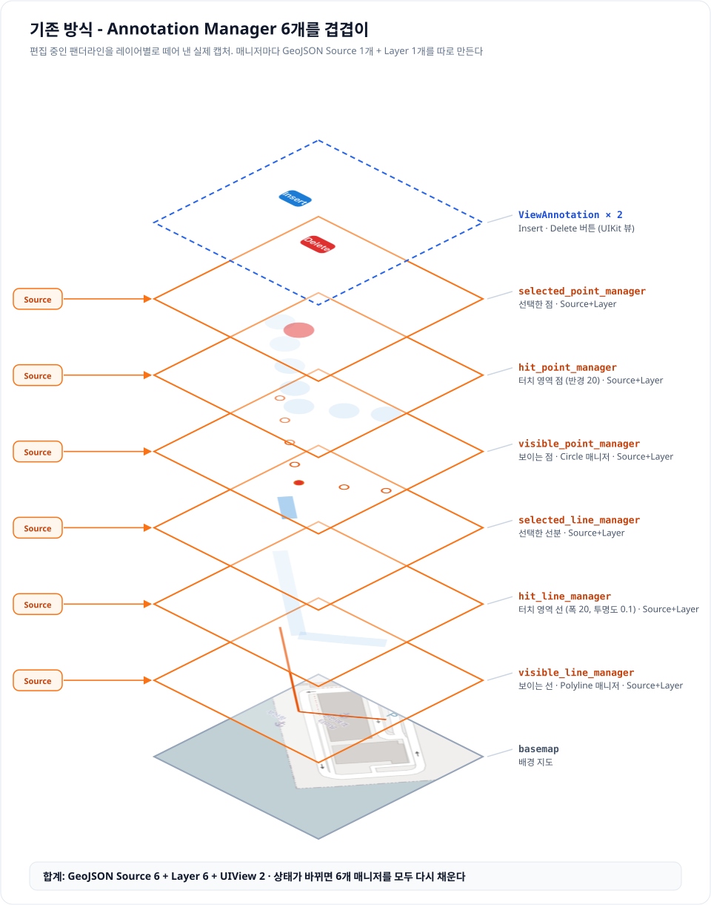

비교를 위해, 4장에서 만들 **개선 방식**의 같은 화면을 같은 방법으로 떼어 쌓은 그림을 바로 아래에 두겠습니다.

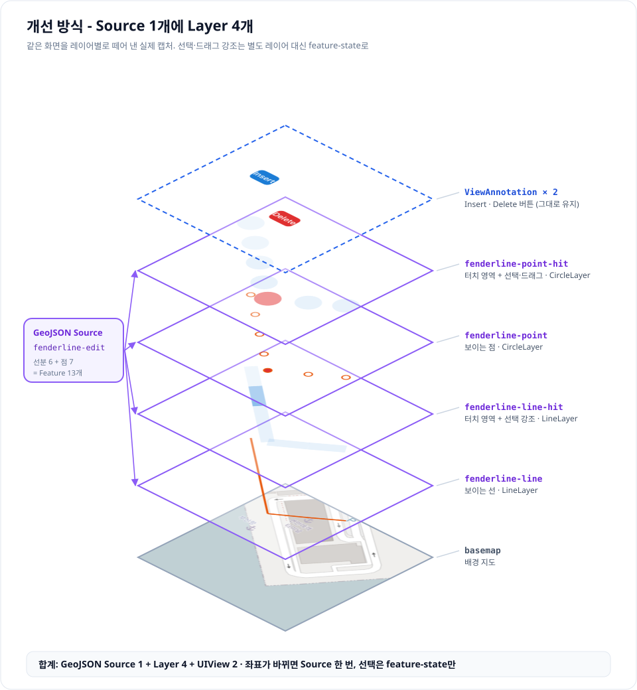

| | 기존 (위 그림) | 개선 (아래 그림) |
| --- | --- | --- |
| Source | 면마다 하나씩, **6개** | 왼쪽의 **1개**가 모든 면에 데이터를 나눠 줌 |
| Layer (면) | 6개 | 4개 |
| 선택 강조 | 별도 면 2개 (`selected_line`, `selected_point`) | 별도 면 없이 터치 영역 면 안에서 feature-state로 칠함 |
| 버튼 (Insert/Delete) | View Annotation | View Annotation (그대로) |


이렇게 펼쳐 놓고 보면 몇 가지가 보입니다.

- **같은 데이터가 여러 번 들어갑니다.** 선분 6개는 `visible_line`과 `hit_line` 두 Source에, 점 7개는 `visible_point`와 `hit_point` 두 Source에 똑같이 들어 있습니다. 선택한 선분과 점은 세 번째 Source에 또 들어갑니다.
- **바뀌는 것이 하나여도 6개를 모두 다시 채웁니다.** 점 하나를 드래그하면 그 점에 붙은 선분 2개와 점 1개만 움직이면 되지만, `update`는 6개 매니저의 `annotations`를 전부 새 배열로 바꿉니다. 그러면 매니저 6개가 각자 다음 프레임에 **새 배열 전체를 이전 배열과 id로 비교**하고, 달라진 Annotation만 골라 자기 Source에 부분 갱신(`updateGeoJSONSourceFeatures`)합니다. 하나라도 달라진 매니저는 **자기 Layer의 속성도 다시 설정**합니다(`setLayerProperties`). 아래 SDK 코드에서 확인할 수 있습니다.
- **"선택"이라는 상태 변화도 데이터 변경입니다.** Annotation에 지정한 색·두께·투명도는 Feature의 `layerProperties` 속성으로 들어가고, Layer는 `["coalesce", ["get", 키, ["get", "layerProperties"]], 기본값]` 식으로 그 값을 읽습니다. 그래서 점의 색을 빨갛게 바꾸는 것도, 선분을 강조하는 것도 **Source 데이터를 바꾸는 일**입니다.
- **표시와 편집이 서로 다른 그리기 방식입니다.** 같은 팬더라인인데 평소에는 Source + Layer, 편집할 때는 Annotation으로 그립니다. 색이나 두께를 바꾸려면 두 곳을 고쳐야 합니다.

<details class="notion-toggle-list" markdown="1">
<summary>SDK 11.18.1 - Annotation Manager가 매 프레임 하는 일 (발췌)</summary>

```swift
// AnnotationManagerImpl.swift
func syncSourceAndLayerIfNeeded() {        // 디스플레이 링크마다 호출
    syncSource()
    syncDragSource()
    syncLayer()
}

private func syncSource() {
    guard syncSourceOnce.continueOnce() else { return }      // annotations가 바뀌었을 때만
    let diff = mainAnnotations.diff(from: displayedAnnotations, id: \.id)   // 배열 전체를 id로 비교
    syncLayerOnce.reset(if: !diff.isEmpty)                    // 달라졌으면 Layer도 다시
    style.apply(annotationsDiff: diff, sourceId: id, feature: \.feature)
    displayedAnnotations = mainAnnotations
}

// Annotation.swift
func apply<T: Annotation>(annotationsDiff diff: CollectionDiff<[T]>, sourceId: String, feature: (T) -> Feature) {
    if !diff.remove.isEmpty { removeGeoJSONSourceFeatures(forSourceId: sourceId, featureIds: diff.remove.map(\.id), dataId: nil) }
    if !diff.update.isEmpty { updateGeoJSONSourceFeatures(forSourceId: sourceId, features: diff.update.map(feature), dataId: nil) }
    if !diff.add.isEmpty    { addGeoJSONSourceFeatures(forSourceId: sourceId, features: diff.add.map(feature), dataId: nil) }
}

// syncLayer(): Annotation들이 쓴 속성 키마다 coalesce Expression을 만들어 Layer에 한 번에 설정
//   ["coalesce", ["get", key, ["get", "layerProperties"]], 기본값]
try style.setLayerProperties(for: id, properties: allLayerProperties)
```

</details>

Annotation이 나쁜 것은 아닙니다. 마커 몇 개를 빨리 찍는 데는 이보다 편한 방법이 없습니다. 다만 팬더라인 편집처럼 **같은 데이터를 역할별로 여러 번 그리고, 상태가 자주 바뀌는** 화면에서는 "매니저 = Source + Layer"라는 구조가 그대로 비용이 됩니다.

&nbsp;

---

&nbsp;

## 4. 개선 방식 - Source 1개, Layer 4개, feature-state

방향은 세 가지입니다.

1. **데이터는 한 번만** - 선분과 점을 GeoJSON Source **하나**에 넣고, Feature마다 `kind`(`segment` / `vertex`) 속성을 붙입니다.
2. **역할은 Layer가 나눈다** - 같은 Source를 보는 Layer 여러 개가 `filter`로 선분 또는 점만 골라 각자 다르게 그립니다.
3. **상태는 feature-state로** - 선택, 드래그 같은 상태는 데이터를 바꾸지 않고 Feature에 상태만 붙입니다. Layer는 Expression으로 그 상태를 읽어 투명도와 색을 바꿉니다.

이렇게 하면 기존의 "터치 영역"과 "선택 강조" 매니저 두 개가 Layer 하나로 합쳐집니다. 터치 영역 Layer가 평소에는 투명도 0.1로, `selected` 상태인 Feature만 0.5로 그리면 되기 때문입니다. 그래서 **6개가 4개**가 됩니다.

| 기존 매니저 | 개선 Layer | 상태 처리 |
| --- | --- | --- |
| 보이는 선 | `fenderline-line` (`LineLayer`) | - |
| 터치 영역 선 + 선택한 선분 | `fenderline-line-hit` (`LineLayer`) | `selected`면 투명도 0.5, 아니면 0.1 |
| 보이는 점 | `fenderline-point` (`CircleLayer`) | `selected`면 빨간색 |
| 터치 영역 점 + 선택한 점 | `fenderline-point-hit` (`CircleLayer`) | `dragging`이면 0, `selected`면 빨간색·0.5, 아니면 0.1 |
| Insert / Delete 버튼 | View Annotation 그대로 | - |

Insert, Delete 버튼은 **그대로 View Annotation**으로 둡니다. 실제로 탭해야 하는 UIKit 버튼이고, 화면에 많아야 2개라서 View Annotation이 가장 잘 맞는 자리입니다. 모든 것을 Source + Layer로 바꾸는 것이 목표가 아니라, 각자 맞는 방법을 쓰는 것이 목표입니다.

### 데이터 - Feature에 id와 kind를 붙인다

```swift
static func features(_ c: [CLLocationCoordinate2D]) -> FeatureCollection {
    var features: [Feature] = []
    for i in 0..<max(c.count - 1, 0) {
        var f = Feature(geometry: LineString([c[i], c[i + 1]]))
        f.identifier = .number(Double(segmentId(i)))
        f.properties = ["kind": "segment", "index": .number(Double(i))]
        features.append(f)
    }
    for (i, coord) in c.enumerated() {
        var f = Feature(geometry: Point(coord))
        f.identifier = .number(Double(vertexId(i)))
        f.properties = ["kind": "vertex", "index": .number(Double(i))]
        features.append(f)
    }
    return FeatureCollection(features: features)
}

// 선분과 점이 한 Source에 있으니 feature id가 겹치지 않게
static func segmentId(_ i: Int) -> Int { i }
static func vertexId(_ i: Int) -> Int { 100_000 + i }
```

feature-state는 **Feature id**로 상태를 붙이기 때문에 id가 꼭 필요합니다. 선분과 점이 한 Source에 들어가므로 id가 겹치지 않도록 점에는 100,000을 더했습니다.

> 선분을 하나의 LineString으로 잇지 않고 **선분마다 Feature를 따로** 만든 이유는, 선분 하나만 선택 상태로 바꾸려면 선분마다 id가 있어야 하기 때문입니다. 실무 앱의 표시 모드도 선분마다 Feature와 id를 따로 만들어 탭 판정에 쓰고 있었습니다.

### Layer - filter로 나누고, feature-state로 칠한다

<details class="notion-toggle-list" markdown="1">
<summary>개선 방식: Source 1개 + Layer 4개 만들기 - 코드 보기</summary>

```swift
import MapboxMaps

/// 개선 방식: Source 1개 + Layer 4개. 선택·드래그는 feature-state로
final class LayerFenderlineRenderer {
    static let sourceId = "fenderline-edit"

    private let map: MapboxMap
    private var lastState: FenderlineEditState?

    init(map: MapboxMap) throws {
        self.map = map
        var source = GeoJSONSource(id: Self.sourceId)
        source.data = .featureCollection(FeatureCollection(features: []))
        try map.addSource(source)

        let isSegment = Exp(.eq) { Exp(.get) { "kind" }; "segment" }
        let isVertex = Exp(.eq) { Exp(.get) { "kind" }; "vertex" }
        func state(_ key: String) -> Exp { Exp(.boolean) { Exp(.featureState) { key }; false } }

        // 1) 보이는 선
        var line = LineLayer(id: "fenderline-line", source: Self.sourceId)
        line.filter = isSegment
        line.lineColor = .constant(StyleColor(rawValue: Palette.line))
        line.lineWidth = .constant(3)
        line.lineJoin = .constant(.round)

        // 2) 터치 영역 선 + 선택 강조 (기존 hit/selected 매니저 2개를 하나로)
        var lineHit = LineLayer(id: "fenderline-line-hit", source: Self.sourceId)
        lineHit.filter = isSegment
        lineHit.lineColor = .constant(StyleColor(rawValue: Palette.hit))
        lineHit.lineWidth = .constant(20)
        lineHit.lineOpacity = .expression(Exp(.switchCase) { state("selected"); 0.5; 0.1 })

        // 3) 보이는 점
        var point = CircleLayer(id: "fenderline-point", source: Self.sourceId)
        point.filter = isVertex
        point.circleRadius = .constant(5)
        point.circleColor = .expression(Exp(.switchCase) {
            state("selected"); UIColor(hex: Palette.delete)
            UIColor(hex: Palette.point)
        })
        point.circleStrokeColor = .constant(StyleColor(rawValue: Palette.pointStroke))
        point.circleStrokeWidth = .constant(2)

        // 4) 터치 영역 점 + 선택 강조 + 드래그 중 숨김
        var pointHit = CircleLayer(id: "fenderline-point-hit", source: Self.sourceId)
        pointHit.filter = isVertex
        pointHit.circleRadius = .constant(20)
        pointHit.circleColor = .expression(Exp(.switchCase) {
            state("selected"); UIColor(hex: Palette.delete)
            UIColor(hex: Palette.hit)
        })
        pointHit.circleOpacity = .expression(Exp(.switchCase) {
            state("dragging"); 0
            state("selected"); 0.5
            0.1
        })

        for layer in [line, lineHit, point, pointHit] as [Layer] {
            try map.addLayer(layer)
        }
    }
}
```

</details>

Expression이 낯설다면 이전 글의 "Swift `Exp` 문법 읽는 법"을 참고하면 됩니다. 핵심만 짚으면 이렇습니다.

| 코드 | JSON | 뜻 |
| --- | --- | --- |
| `Exp(.eq) { Exp(.get) { "kind" }; "segment" }` | `["==", ["get", "kind"], "segment"]` | `kind` 속성이 `segment`인 Feature만 |
| `Exp(.boolean) { Exp(.featureState) { "selected" }; false }` | `["boolean", ["feature-state", "selected"], false]` | `selected` 상태. 없으면 `false` |
| `Exp(.switchCase) { 조건; 0.5; 0.1 }` | `["case", 조건, 0.5, 0.1]` | 조건이 참이면 0.5, 아니면 0.1 |

### 갱신 - 좌표는 Source 한 번, 상태는 feature-state만

<details class="notion-toggle-list" markdown="1">
<summary>개선 방식: update - 코드 보기</summary>

```swift
extension LayerFenderlineRenderer {
    /// 좌표가 바뀌면 Source 데이터 한 번, 선택·드래그는 feature-state만
    func update(_ state: FenderlineEditState) {
        if lastState?.coordinates != state.coordinates {
            map.updateGeoJSONSource(withId: Self.sourceId,
                                    geoJSON: .featureCollection(Self.features(state.coordinates)))
        }
        let old = lastState
        setFlag("selected", segment: old?.selectedSegmentIndex, to: state.selectedSegmentIndex)
        setFlag("selected", vertex: old?.selectedPointIndex, to: state.selectedPointIndex)
        setFlag("dragging", vertex: old?.draggingIndex, to: state.draggingIndex)
        lastState = state
    }

    private func setFlag(_ key: String, segment old: Int?, to new: Int?) {
        setFlag(key, old: old.map(Self.segmentId), new: new.map(Self.segmentId))
    }
    private func setFlag(_ key: String, vertex old: Int?, to new: Int?) {
        setFlag(key, old: old.map(Self.vertexId), new: new.map(Self.vertexId))
    }
    private func setFlag(_ key: String, old: Int?, new: Int?) {
        guard old != new else { return }
        if let old { map.setFeatureState(sourceId: Self.sourceId, featureId: String(old), state: [key: false]) { _ in } }
        if let new { map.setFeatureState(sourceId: Self.sourceId, featureId: String(new), state: [key: true]) { _ in } }
    }
}
```

</details>

기존 `update`는 무엇이 바뀌었든 6개 매니저를 모두 다시 채웠습니다. 개선한 `update`는 좌표가 바뀌었을 때만 Source를 바꾸고, 선택·드래그 같은 상태는 feature-state로만 처리합니다.

| 일어난 일 | 기존 (Annotation) | 개선 (Source + Layer) |
| --- | --- | --- |
| 점을 드래그해 좌표가 바뀜 | 매니저 6개가 각자 배열 전체를 비교 → 달라진 3개 매니저(보이는 선·터치 영역 선·보이는 점)가 Source 부분 갱신 + Layer 속성 재설정 | `updateGeoJSONSource` 1번 |
| 선분을 선택 | 선택 매니저에 Feature 추가 + Layer 속성 재설정 | `setFeatureState` 1~2번 (이전 것 끄고 새것 켜기). **데이터는 그대로** |
| 점을 선택 | 보이는 점 매니저의 Feature 1개 갱신(색), 선택 매니저에 Feature 추가, 각각 Layer 속성 재설정 | `setFeatureState` 1~2번 |

> 개선 방식의 드래그는 Source 전체를 `updateGeoJSONSource`로 바꿉니다. 기존 방식처럼 바뀐 Feature만 `updateGeoJSONSourceFeatures`로 보내면 더 줄일 여지가 있지만, 이 글에서는 측정하지 않았습니다.

### 결과 - 같은 화면, 다른 구조

<div style="display: flex; flex-wrap: wrap; gap: 16px; justify-content: center;">
  <figure style="width: 240px; margin: 0;">
    
    <figcaption style="font-size: 0.8em; text-align: center;">기존: Annotation Manager 6개</figcaption>
  </figure>
  <figure style="width: 240px; margin: 0;">
    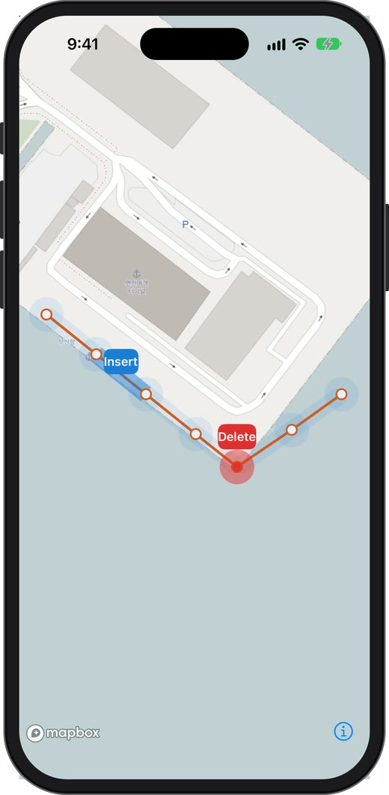
    <figcaption style="font-size: 0.8em; text-align: center;">개선: Source 1개 + Layer 4개</figcaption>
  </figure>
</div>

같은 상태(두 번째 선분과 다섯 번째 점을 선택)를 두 방식으로 그린 화면입니다. 눈으로는 차이가 없습니다. Style 목록은 이렇게 바뀌었습니다.

```text
sources ["osm(raster)", "fenderline-edit(geojson)"]
layers  ["osm(raster)", "fenderline-line(line)", "fenderline-line-hit(line)",
         "fenderline-point(circle)", "fenderline-point-hit(circle)"]
```

3장에서 미리 본 개선 방식의 분해도가 바로 이 화면입니다. Source 1개에서 Layer 4개가 데이터를 나눠 가져가고, 선택 강조는 별도 Layer가 아니라 feature-state로 칠해집니다.

### 개선으로 얻은 것 - Source가 하나가 되면 무엇이 좋아지나

화면은 똑같은데 무엇이 나아졌는지 정리하겠습니다. 실측한 것과 구조상 얻는 것을 나눠 적습니다.

**① 드래그할 때 CPU가 줄었다 (실측)**

점을 끌어 옮기는 동안, 매 프레임 갱신하는 조건에서 측정했습니다(자세한 방법은 5장).

| 점 개수 | 기존 | 개선 | 줄어든 비율 |
| --- | --- | --- | --- |
| 7 (실제 팬더라인 규모) | 44.9% | 29.9% | 약 3분의 1 |
| 50 | 80.3% | 50.5% | 약 37% |
| 200 | 173.1% | 83.8% | 절반 이상 |

가만히 있을 때는 두 방식 모두 2% 안팎으로 차이가 없었습니다. 즉 이득은 **바뀔 때** 생깁니다.

**② 좌표가 바뀌면 고칠 곳이 한 군데다 (Source가 하나라서)**

| 점 하나를 드래그할 때 매 프레임 | 기존 | 개선 |
| --- | --- | --- |
| 같은 데이터 사본 | 선분은 보이는 선·터치 영역 **2벌**, 점도 **2벌** | **1벌** |
| 갱신하는 Source | 3개 (보이는 선, 터치 영역 선, 보이는 점)에 각각 부분 갱신 | **1개** |
| 다시 설정하는 Layer 속성 | 그 3개 Layer 전부 (`setLayerProperties`) | **없음** (처음 한 번만) |
| 비교 작업 | 매니저 6개가 각자 배열 전체를 id로 비교 | 없음 |

같은 선분이 두 통에 따로 들어 있으면, 하나가 바뀔 때 두 통을 모두 고쳐야 합니다. 통이 하나면 한 번 고치면 끝입니다. ①의 CPU 차이도 이 구조 차이에서 나옵니다.

**③ 선택은 데이터를 건드리지 않는다**

기존에는 선분 하나를 선택해도 "선택한 선분" 통에 Feature를 새로 넣고, 점 색을 바꾸려면 "보이는 점" 통의 데이터를 바꿔야 했습니다. 개선 후에는 `setFeatureState`로 **그 Feature에 표시만 붙입니다.** 통의 데이터도, Layer 설정도 그대로입니다.

**④ 선과 터치 영역이 어긋날 수 없다 (구조상)**

보이는 선과 터치 영역이 **같은 통의 같은 Feature**를 그리므로, 둘의 위치가 다른 데이터에서 올 여지가 없습니다. 기존에는 두 모양이 서로 다른 통에서 그려져서, 두 통을 항상 같이 고쳐야 같은 자리에 그려졌습니다.

**⑤ 탭한 대상을 바로 알 수 있다**

탭한 위치의 터치 영역 Layer에서 Feature를 찾으면, 그 Feature의 `kind`(선분인지 점인지)와 `index`(몇 번째인지)가 같이 나옵니다. 모든 대상이 한 통에 같은 규칙으로 들어 있으니, 어느 통에서 왔는지 따로 구분할 필요가 없습니다.

**⑥ 그리는 방식이 하나로 통일된다**

평소 표시 화면은 원래 Source + Layer였습니다. 편집 화면까지 Source + Layer가 되면서 팬더라인을 그리는 방식이 하나가 됐습니다. 색·두께를 바꾸거나 다른 오버레이와 그리는 순서를 맞출 때 같은 방식으로 다루면 됩니다.

**대신 생긴 비용**

Expression과 feature-state를 알아야 코드를 읽을 수 있습니다. Annotation처럼 "점 하나에 색 하나"를 바로 적는 직관성은 줄었습니다. Layer 개수가 6개에서 4개로 준 것 자체는 정지 화면 성능에 차이를 만들지 않았습니다(①).

&nbsp;

---

&nbsp;

## 5. 두 방식 비교 (실측)

구조가 줄어든 것이 실제 비용에도 드러나는지 재 봤습니다. 측정 방법은 두 방식 모두 똑같이 맞췄습니다.

| 항목 | 조건 |
| --- | --- |
| 환경 | iPhone 17 시뮬레이터 (iOS 27, Apple Silicon Mac), Mapbox 11.18.1, 같은 카메라(줌 16.15) |
| 상태 | **정지**: 편집 화면을 띄워 두기만 함 / **드래그**: `CADisplayLink`로 매 프레임(60Hz) 가운데 점 하나를 움직이고 `update` 호출 |
| 점 개수 | 7개(실제 팬더라인 규모), 50개, 200개. 같은 경로를 점 개수만 늘려 나눔 |
| 측정 | 앱 실행 5초 뒤부터 10초 동안 프로세스 누적 CPU 시간 증가분 (`ps -o time`) |
| 반복 | 2방식 × 2상태 × 3개수 = 12조합을 한 바퀴로, **3바퀴** 반복 (조합 순서를 섞어 시간에 따른 편차가 한쪽에 몰리지 않게) |
| 단위 | 100% = CPU 코어 1개 |

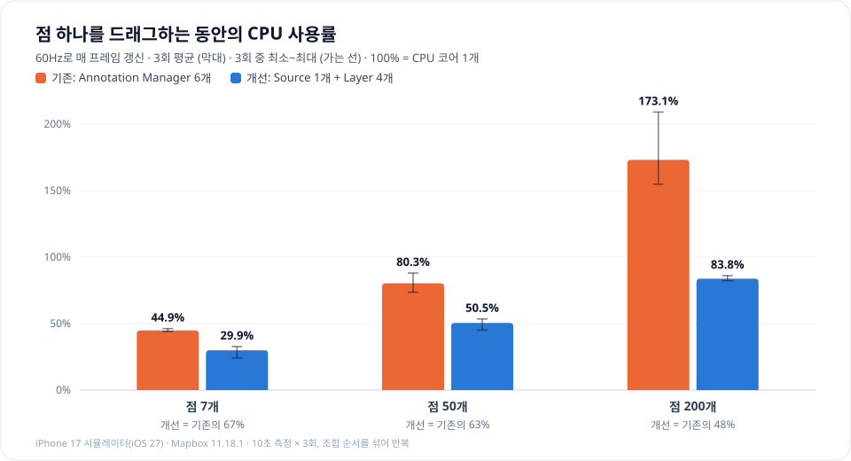

| 점 개수 | 상태 | 기존 (Annotation) | 개선 (Source + Layer) | 개선 / 기존 |
| --- | --- | --- | --- | --- |
| 7 | 정지 | 1.8% | 1.4% | - |
| 7 | 드래그 | 44.9% (44.0~46.3) | 29.9% (24.2~32.7) | 67% |
| 50 | 정지 | 1.9% | 1.6% | - |
| 50 | 드래그 | 80.3% (73.6~88.0) | 50.5% (45.1~53.5) | 63% |
| 200 | 정지 | 2.0% | 1.6% | - |
| 200 | 드래그 | 173.1% (154.8~209.1) | 83.8% (82.3~86.1) | 48% |

괄호 안은 3회 중 최소~최대입니다.

### 결과 읽기

- **가만히 있을 때는 차이가 없습니다.** 두 방식 모두 2% 안팎입니다. Layer가 6개냐 4개냐는 정지 화면에서는 거의 비용이 아닙니다.
- **드래그 중에는 실제 팬더라인 규모(점 7개)에서도 3분의 1 정도 줄었습니다.** 44.9% → 29.9%입니다.
- **점이 많을수록 차이가 커집니다.** 200개에서는 173.1% → 83.8%로 절반 이하가 됐습니다. 기존 방식은 200개에서 3회 편차도 컸습니다(155~209%).
- 개선 방식은 매 프레임 **Source 전체를 통째로 바꾸는데도** 기존의 부분 갱신보다 가벼웠습니다.

왜 그런지는 SDK 내부까지 계측하지 않아서 확정할 수 없습니다. 다만 코드로 보면 기존 방식은 매 프레임 ① 매니저 6개가 각자 배열 전체를 id로 비교하고, ② 달라진 3개 Source에 부분 갱신을 보내고, ③ 그 3개 Layer의 속성을 `coalesce` Expression으로 다시 설정합니다. 개선 방식은 Source 1개를 바꾸는 일이 전부이고 Layer 속성은 처음 한 번만 설정합니다. 특히 ③처럼 Layer 속성이 바뀌면 그 Layer를 다시 준비해야 할 가능성이 있어(추정), 프레임마다 반복되는 일의 종류 자체가 줄어든 것이 차이로 보입니다.

### 주의할 점

- 시뮬레이터는 Mac의 CPU로 돌기 때문에 **절댓값은 실제 기기와 다릅니다.** 같은 조건에서 두 방식을 비교한 **상대적인 차이**로 읽어야 합니다.
- 드래그 중 매 프레임 `update`를 부르는 것은 실무 앱의 드래그 처리와 같은 패턴이지만, 실제 손가락 드래그는 이보다 덜 촘촘할 수 있습니다.
- FPS는 측정하지 않았습니다. 이 글의 수치는 CPU 사용률만입니다.

### 한눈에 비교

| | 기존 (Annotation) | 개선 (Source + Layer) |
| --- | --- | --- |
| GeoJSON Source | 6개 | **1개** |
| Layer | 6개 | **4개** |
| 같은 데이터 중복 | 선분 2벌, 점 2벌 + 선택분 | **1벌** |
| 선택·드래그 표시 | Source 데이터 변경 | **feature-state** |
| 버튼 (Insert/Delete) | View Annotation | View Annotation (그대로) |
| 드래그 CPU (점 7개) | 44.9% | **29.9%** |
| 표시 모드와 그리는 방식 | 다름 (표시는 Source + Layer) | **같음** |
| 코드 읽기 | Annotation마다 스타일을 바로 지정해서 직관적 | Expression과 feature-state를 알아야 함 |

마지막 줄도 중요합니다. Source + Layer 방식은 Expression과 feature-state를 알아야 읽을 수 있습니다. 팀이 이 개념에 익숙하지 않다면 그것도 비용입니다. 그래서 이전 글에서 Source, Layer, Expression, feature-state를 먼저 정리해 두었습니다.

&nbsp;

---

&nbsp;

## 6. 정리

- Mapbox로 그리는 방법은 Annotation, View Annotation, Source + Layer, Custom Layer 네 가지이고, **Annotation은 매니저마다 GeoJSON Source 1개 + Layer 1개를 만듭니다.**
- 기존 팬더라인 편집은 역할별로 매니저 6개를 썼습니다. 실제 Style에는 **Source 6개, Layer 6개**가 쌓였고, 같은 선분과 점이 여러 Source에 중복으로 들어갔습니다. 상태가 하나 바뀌어도 6개를 모두 다시 채웠습니다.
- 개선 방식은 **Source 1개에 Feature마다 `kind`와 id**를 붙이고, Layer 4개가 `filter`로 역할을 나눕니다. 선택·드래그는 **feature-state**로 처리해 데이터를 다시 넣지 않습니다.
- 탭해야 하는 Insert, Delete 버튼은 **View Annotation 그대로** 둡니다. 목표는 "전부 Source + Layer"가 아니라 "각자 맞는 방법"입니다.
- 평소 표시 모드도 이미 Source + Layer라서, 편집 모드를 바꾸면 **팬더라인을 그리는 방식이 하나로 통일**됩니다.
